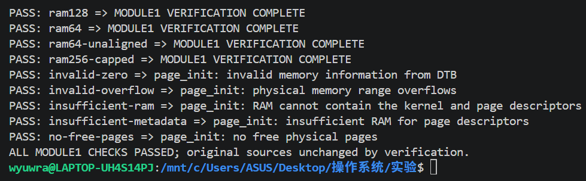

# 操作系统实验报告

## 实验基本信息

| 项目 | 内容 |
|---|---|
| **实验名称** | Lab2：物理内存管理 |
| **小组成员** | [成员一学号]-[姓名]、2413276-胡楚骅、[成员三学号]-[姓名] |
| **本版更新日期** | 2026-10-18 |
| **本版范围** | 模块一实现、独立验证及 GDB 核验已完成；模块二和全组最终验收待整合 |

### 小组分工

| 成员 | 实验任务 | 报告任务 |
|---|---|---|
| [成员一学号]-[姓名] | 模块一：`page_init()`，物理内存布局与初始化 | 模块一设计、实现、测试、提示词与证据 |
| 2413276-胡楚骅 | 模块二前两项：First-Fit 分析、Best-Fit 实现 | 对应算法分析、代码说明及测试 |
| [成员三学号]-[姓名] | 模块二第三项：Buddy；按小组计划完成选做 Challenge | 对应实现、提示词、测试与选做说明 |
| 全体 | 集成、QEMU MMU/页表调试、最终验收 | 汇总环境、结论与整组运行截图 |

本报告按照仓库 `main` 分支的《实验报告模板.md》组织。成员信息与队友实验结果需由本人补充。报告、提示词和证据统一放在 `lab2/report/`。

## 一、实验目的

1. 理解内核如何将 DTB 描述的 RAM 转化为可管理的物理页帧。
2. 正确区分虚拟地址、物理地址、物理页号和 `struct Page` 指针，建立它们之间的转换关系。
3. 保留固件预留区、内核和页描述符自身占用的页，只将完整空闲页交给分配器。
4. 通过正常运行、边界输入、异常输入和 GDB 观察验证初始化接口，为不同分配算法提供相同的基础。
5. 在全组后续工作中比较 First-Fit、Best-Fit、Buddy，并结合页表调试理解物理分配与地址映射的关系。

## 二、实验环境

### 2.1 模块一实际验证环境

| 项目 | 实际环境 |
|---|---|
| 主机与终端 | Windows，PowerShell；实验构建与调试在 WSL Ubuntu 内执行 |
| 目标架构 | RISC-V RV64，QEMU `virt` |
| 交叉编译器 | SiFive `riscv64-unknown-elf-gcc` 8.3.0 |
| 模拟器 | QEMU 4.1.1 |
| 固件 | QEMU 配套 OpenSBI v0.4，串口报告 SBI 0.1 |
| 调试器 | GNU gdb-multiarch 15.1 |
| 物理页大小 | 4096 字节 |
| 源码目录 | `lab2/lab2_new/` |
| 验证方式 | Linux 临时副本中构建与运行，原源码哈希核对，日志回存本报告目录 |

工具版本分别记录在[自动验证汇总](evidence/module1/results.json)与[GDB 汇总](evidence/module1-gdb/results.json)。成员二、三需补充各自实际环境与差异。

### 2.2 AI 工具

| 成员 | AI 编程工具 | 底层模型 | 使用情况 |
|---|---|---|---|
| [成员一学号]-[姓名] | Codex | GPT-6（本会话环境标识） | 需求分析、实现、验证和文档；具体客户端配置可由本人核对补充 |
| 2413276-胡楚骅 | [本人填写] | [本人填写] | [本人填写] |
| [成员三学号]-[姓名] | [本人填写] | [本人填写] | [本人填写] |

## 三、实验整体逻辑分析

### 3.1 本章节的逻辑主线

Lab1 使内核能够启动、输出信息和处理基本异常；Lab2 开始回答“内核有哪些物理内存可以分配，以及如何分配和回收”。

模块一负责划清资源边界：读取 RAM 信息，安置页描述符，保留已用页，登记空闲区。模块二负责在这个空闲区中选择、拆分、回收和合并内存块。页表调试则观察虚拟地址如何定位到物理地址。这三个问题相互关联，但页分配成功并不自动代表页表映射正确。

### 3.2 功能的逐步实现

```text
OpenSBI 将 hart ID、DTB 地址传给内核入口
  → entry.S 保存参数，建立启动分页，设置栈，转入高地址 kern_init
  → kern_init 清理 BSS，dtb_init 解析 RAM，初始化控制台
  → pmm_init
      → init_pmm_manager：选择分配器，并初始化空链表和计数
      → page_init：计算内存布局，初始化描述符，登记空闲页
      → check_alloc_page：执行当前分配器的自检
      → 记录并输出启动页表的虚拟地址、物理地址
```

`page_init()` 必须在 DTB 解析和分配器初始化之后执行。否则无法取得有效内存边界，或无法把空闲区加入有效的管理结构。不同分配器均通过 `pmm_manager` 的接口接收空闲页，因而模块一需要保证交付前的页状态符合接口约定。

## 四、实验内容与实现

### 4.1 功能模块一：物理内存初始化

**负责人：** [成员一学号]-[姓名]

**修改文件：** [kern/mm/pmm.c](../lab2_new/kern/mm/pmm.c)。核心函数：

```c
static void page_init(void);
```

#### 4.1.1 地址和页描述符的含义

| 对象 | 含义 | 当前框架的关系 |
|---|---|---|
| VA | 内核使用的虚拟地址 | 直接映射区内 `VA = PA + va_pa_offset` |
| PA | 物理字节地址 | `PADDR(VA)` 从内核直接映射地址减去偏移 |
| PPN | 绝对物理页号 | `PA >> PGSHIFT` |
| `nbase` | DRAM 起始页号 | `0x80000000 / 4096 = 0x80000` |
| `npage` | 管理结束位置的绝对页号，不包含该页 | 默认 128 MiB 时为 `0x88000` |
| `pages` | 页描述符数组的内核虚拟地址 | 描述符数量是 `npage - nbase` |
| `pages[i]` | 第 i 个描述符 | 对应 PA `(nbase + i) * PGSIZE` |

`npage` 不能直接当作描述符数量。也不能把 `struct Page *` 当作其所描述物理页的起始地址：描述符是管理信息，本身与被管理页位于不同位置。

#### 4.1.2 行为规格

| 类别 | 约束 |
|---|---|
| 前置条件 | 启动分页和栈可用，DTB 已解析，当前分配器已初始化；沿用课程单段 RAM 与固定内核映射布局 |
| 成功后置条件 | 偏移、页号上界、描述符地址正确；所有描述符先初始化为保留；仅将元数据之后的完整空闲页交付分配器 |
| 错误处理 | DTB 信息无效、范围溢出、无法容纳内核或描述符、没有完整空闲页时明确 `panic` |
| 接口约束 | `init_memmap(base, n)` 的 `n > 0`；输入描述符范围合法，交付前每页均为保留状态 |
| 不变量 | 容量检查先于数组写入；不释放内核和元数据占用页；不硬编码描述符结构体大小 |

#### 4.1.3 布局计算与实现顺序

设 DTB 报告起点为 `B`、大小为 `S`，`P = PGSIZE`：

```text
raw_end          = B + S                  （先检查加法溢出）
managed_end      = ROUNDDOWN(min(raw_end, PHYSICAL_MEMORY_END), P)
descriptor_count = PPN(managed_end) - nbase
pages_va         = ROUNDUP(end, P)
pages_pa         = PADDR(pages_va)
descriptor_bytes = descriptor_count * sizeof(struct Page)
metadata_end     = pages_pa + descriptor_bytes
free_begin       = ROUNDUP(metadata_end, P)
free_count       = (managed_end - free_begin) / P
```

所有内存区间采用**左闭右开**表示法，结束地址不属于区间。

实现分为六步：

1. **读取并检查 RAM。** 设置 `va_pa_offset` 后才使用 `PADDR`；拒绝零起点、零大小和范围加法溢出。
2. **确定管理结束位置。** 限制在框架上界 `0x88000000` 内，并向下页对齐。检查 RAM 能覆盖固定内核起点和实际内核末尾。
3. **放置描述符。** 将 `pages` 放在链接符号 `end` 之后的首个页边界，使用实际 `sizeof(struct Page)` 计算容量。
4. **先检查，后写入。** 对齐和乘法可能溢出时提前拒绝；用剩余空间比较避免容量加法溢出。确定存在至少一页空闲内存后再写描述符。
5. **默认全部保留。** 清零引用计数、标志和 `property`，初始化链表节点，再设置保留位。这样尚未确认安全的页不会被提前开放。
6. **登记完整空闲区。** 元数据末尾向上对齐，调用 `init_memmap(pa2page(free_begin), free_count)`。具体分配器清除空闲页保留位，建立空闲块及计数。

内存布局如下；页描述符对应整个管理范围，描述符数组本身也占用其中的 RAM：

```text
0x80000000          0x80200000        pages_pa          free_begin        managed_end
    | 固件预留区域       | 内核、栈、页表等 | 页描述符及对齐尾部 | 可分配完整页       |
    +------------------+----------------+------------------+------------------+
    |<-------------------- 保留 -------------------------->|<---- 空闲 ------>|
```

前 2 MiB 是课程框架的固定预留范围；这不表示 OpenSBI 实际占满 2 MiB。当前运行固件报告自身大小为 112 KiB。

#### 4.1.4 为什么要一处向下对齐、一处向上对齐

RAM 结束位置向下对齐，是因为不足一页的尾部不能分配为完整页。描述符末尾向上对齐，是因为只要某一页仍含元数据，该页就不能交给分配器。两者分别避免分配越界和覆盖管理信息。

描述符初始化属于一次启动过程，时间复杂度为 `O(npage - nbase)`，元数据空间复杂度也为 `O(npage - nbase)`。当前 RV64 构建实际 `sizeof(struct Page) = 40` 字节，128 MiB 对应 32768 个描述符，占用 1310720 字节；实现使用 `sizeof`，没有写死 40。

#### 4.1.5 最终提示词整理版

以下是依据实际请求与后续复核整理的复用版本；实际发送的原文及每轮结果保存在 [prompt.md](prompt.md#raw-inputs)，不把整理版当作历史逐字输入。

```text
[PROMPT]
任务：完成 Lab2 模块一 static void page_init(void)，为后续分配算法建立可靠基础。
功能目标：依据 DTB 计算可管理 RAM，安置并初始化 Page 数组，登记完整空闲页。
修改范围：kern/mm/pmm.c；辅助验证工具放 tools，报告与证据放 lab2/report。
操作要求：先核对地址转换与分配器接口；显式处理边界；保留官方测试与代码标记。
验收方式：正常 RAM、不同容量、非页对齐、容量不足和溢出检查；GDB 核对交付前后状态。

[RELY]
已有 DTB getter、PADDR/PPN/pa2page、链接符号 end、PGSIZE、struct Page 与 pmm_manager。
启动映射已建立，DTB 已解析，分配器 init 已执行；当前采用单段 RAM 与固定内核映射。

[GUARANTEE]
先验证布局容量再写数组；保留固件预留区、内核和元数据页；不向 init_memmap 传零页。
采用实际 sizeof(struct Page)；区分 VA/PA/PPN/描述符指针；保持分配器接口及官方测试。
仅在临时副本隔离未完成的队友代码；结果与日志必须来自真实运行。

[SPECIFICATION]
对象：static void page_init(void)
Pre-Condition：上述启动、DTB、分配器前置条件成立。
Post-Condition：offset、npage、pages 正确，全部描述符先保留，仅开放完整空闲页。
Case 1：有效且足够的 RAM，按框架上限和页边界初始化并打印布局。
Case 2：无效 DTB、溢出、容量不足或没有完整空闲页，明确 panic，禁止错误交付。
Requirements：不覆盖已用页，验证前后核对源文件哈希；未知学号保留占位。
```

#### 4.1.6 实际实现与复核过程

| 阶段 | 实际工作 | 发现与处理 |
|---|---|---|
| 初次实现 | 完成布局、描述符初始化、边界拒绝和输出；建立七组隔离验证 | 验证器读写 Windows 挂载目录中的活动日志出现 `Errno 61`，改为在 Linux 临时目录轮询，进程结束后保存日志；七组通过 |
| 对齐复核 | 增加 `ram64-unaligned`，报告 RAM 大小减 1 字节 | 八组通过；澄清 `npage` 与偏移的注释，未修改函数执行逻辑 |
| 接口与证据复核 | 增加交付前逐页检查、元数据容量不足案例、结果状态及源文件哈希 | 九组通过；故意在副本删除链表初始化，检查器捕获错误，失败结果覆盖预置的旧 PASS |
| 本次补齐交付 | 实际 GDB 核对、完整重跑九组、正式报告和证据图 | GDB 交付前后与原自检通过；验证过程未修改原工程源码 |

后两次质量复核补强了测试，未发现需要修改 `page_init()` 执行逻辑的功能缺陷。故意破坏副本的子验证结果为 FAIL 是检查器自检的预期结果，见[自检记录](evidence/module1/checker-selftest.json)，不是实际实现失败。

### 4.2 模块二：分配算法

#### 4.2.1 任务一：First-Fit 分析

**负责人：** 2413276-胡楚骅

**（1）空闲页初始化**

First-Fit 分配器首先通过 `default_init()` 初始化双向循环链表，并将空闲页总数置为零。

随后，`default_init_memmap()` 检查传入的页数 `n` 是否大于零，并初始化这段连续物理页对应的描述符，清除标志和 `property` 字段，将引用计数置零。之后，将这段空闲区的首页标记为空闲块首页，用其 `property` 记录块内页数，并增加空闲页总数。

最后，将该空闲块加入链表。如果链表为空，直接插入首页的链表节点；否则遍历已有空闲块，按照地址递增顺序找到位置并插入。

**（2）分配连续物理页**

`default_alloc_pages()` 首先检查申请页数 `n` 是否大于零；如果申请量超过空闲页总数，则返回 `NULL`。随后，从空闲链表头开始遍历，找到第一个页数不少于 `n` 的空闲块；如果没有满足条件的连续块，同样返回 `NULL`。

找到后，将该块的首页节点从链表中摘下，把前 `n` 页分配给调用者。如果仍有剩余页，则以剩余区域的第一页作为新空闲块首页，记录剩余页数、设置首页标志，并将其插回原链表位置。

最后，将空闲页总数减少 `n`，清除已分配区域首页的空闲块首页标志，并返回其 `Page` 描述符指针。

**（3）回收页面与合并相邻空闲块**

`default_free_pages()` 首先检查归还页数 `n` 是否大于零，并逐页检查其不是保留页或已登记的空闲块首页。随后清除相关状态标志，将引用计数置零，以传入区域的第一页作为空闲块首页，记录块内页数、设置首页标志，并增加空闲页总数。之后按照地址递增顺序，将该块的首页节点插入空闲链表。

插入后，先检查能否与前一个空闲块合并。如果前块的起始描述符加上块内页数，恰好等于本块的起始描述符，说明两个块在物理位置上连续。此时将本块长度累加到前块，清除本块的首页标志并摘下其节点，再将当前块指针更新为合并后的首页。

随后，以更新后的当前块检查后一个空闲块。如果当前块的起始描述符加上块内页数，恰好等于后块的起始描述符，则累加后块长度，并清除后块的首页标志、摘下其节点。合并只改变空闲块的组织方式，不再增加空闲页总数。

**（4）First-Fit 算法的改进空间**

First-Fit 在找到第一个满足申请量的空闲块后就进行分配，拆分后可能留下较小的碎片。可以考虑改为选择最大的空闲块，使分配后的剩余块仍能满足多种大小的申请，即 Worst-Fit 策略。但这种方式也可能提前拆散大块，影响后续较大连续空间的申请，因此效果取决于实际申请序列。

查找开销也有改进空间。当前实现每次从链表头开始遍历，可以记录上次查找的位置，采用 Next-Fit 减少重复扫描，但最坏情况下仍需遍历全部空闲块。也可以按块大小分组，跳过明显不足的块，不过需要在拆分、释放和合并时维护分组，并可能改变原有的首次适配选择顺序。

#### 4.2.2 任务二：Best-Fit 实现

**负责人：** 2413276-胡楚骅

当前已取得的代码中实现区尚未补全。本节待补充：行为规格、实际提示词、选块策略、分配器注册与切换、实际实现过程，以及保留原有测试后的验证结果和改进空间分析。

#### 4.2.3 任务三：Buddy System 实现

**负责人：** 成员三

当前已取得的代码中未见实现。本节由负责人补充：分阶管理、拆分、伙伴定位与合并、接口适配、实现与测试两类提示词，以及测试覆盖说明和实际验证结果。

上述状态只描述当前已取得的文件，不代表队友独立工作区的实际进度。**Buddy 是模块二的必做任务。**

### 4.3 Challenge（选做）

成员三按实际完成情况补充：其他 RAM 探测方式的分析，以及 SLUB 实现和测试。SLUB 应包含实现、测试两类提示词与实际验证记录。未完成时应明确选做状态，不填写通过结论。

### 4.4 QEMU MMU/页表调试

这是全组独立的后续调试任务，需按实验书检查地址转换、页表项及 QEMU 的转换过程，并保存实际证据。本次 GDB 观察的是模块一的初始化与分配器交接，尚未完成这部分 MMU 调试要求。

## 五、测试与验证

### 5.1 为什么使用临时副本验证

当前本地 Best-Fit 尚未实现完毕，直接编译全工程会受其影响。验证工具在 Linux 临时目录复制源码，仅在副本 Makefile 的源文件列表中排除 `best_fit_pmm.c`，保留当前选择的 `default_pmm_manager`。

九组检查还仅在临时副本加入交付检查、逐页布局检查及官方模块一测试调用。输入故障只注入临时 DTB getter。GDB 构建不注入这些 C 检查代码，仅隔离未完成的 Best-Fit。原始工程文件均进行验证前后 SHA-256 比较，结果记录在汇总 JSON。

因此，本节证明模块一在现有 First-Fit 接口下的独立行为；全组整合后仍需执行正式构建和实验书要求的完整测试。本版没有完整 `make grade` 通过记录。

### 5.2 可重复执行的命令

在 **WSL** 中，从仓库根目录执行；不要在 WSL 中使用 `C:\Users\...` 路径：

```bash
cd /mnt/c/Users/ASUS/Desktop/操作系统/实验

# 九组真实 QEMU 检查；日志写入报告目录
python3 lab2/lab2_new/tools/verify_page_init.py \
  --log-dir lab2/report/evidence/module1

# 实际 GDB + QEMU；构建、启动、断点观察及清理均由脚本完成
python3 lab2/lab2_new/tools/debug_page_init.py \
  --log-dir lab2/report/evidence/module1-gdb
```

脚本使用已有工具路径 `~/.local/opt/riscv/bin`、`~/.local/opt/qemu-4.1.1/bin`，同时支持 PATH 中的工具。只终止各自启动的 QEMU；日志末尾 signal 15 来自完成采集后的主动结束。

工具：[自动验证入口](../lab2_new/tools/verify_page_init.py)、[交付与逐页检查](../lab2_new/tools/check_page_init.c)、[GDB 验证入口](../lab2_new/tools/debug_page_init.py)。

### 5.3 九组结果

本次完整重跑的顶层状态为 **PASS**，九组均通过，原源码未被验证过程修改。判定要求是命中明确结果标记；无标记的超时按失败处理。

| 案例 | 输入/变化 | 判定结果 |
|---|---|---|
| `ram128` | 128 MiB | 原 First-Fit 自检、官方模块一测试、交付前与逐页检查通过 |
| `ram64` | 64 MiB | 随容量调整，以上检查通过 |
| `ram64-unaligned` | 64 MiB 的 DTB 报告大小减 1 字节 | RAM 末尾向下对齐，元数据尾页继续保留；以上检查通过 |
| `ram256-capped` | 256 MiB | 管理范围限制到 `0x88000000`；交付、逐页和 First-Fit 自检通过 |
| `invalid-zero` | DTB 报告大小为零 | 明确拒绝，未进入 `init_memmap` |
| `invalid-overflow` | 起点与大小相加溢出 | 明确拒绝，未进入 `init_memmap` |
| `insufficient-ram` | 报告范围无法容纳内核 | 明确拒绝，未进入 `init_memmap` |
| `insufficient-metadata` | 内核可放下，描述符数组放不下 | 明确拒绝，未进入 `init_memmap` |
| `no-free-pages` | 能容纳元数据，但无完整空闲页 | 明确拒绝，未进入 `init_memmap` |

负向案例 PASS 的含义是**正确拒绝错误输入**。256 MiB 场景中，官方模块一测试假设 `npage` 等于未经截断的 DTB 结束页号，与框架固定上界不一致，因此明确输出该官方检查的 SKIP，使用新增逐页检查核验截断布局；没有修改官方测试函数。其余三个正常容量案例仍执行官方模块一测试。



图为成员一在 WSL 重新运行验证脚本后自行截取的终端结果，包含九行 PASS 与最终成功总结。[完整结果与源码哈希](evidence/module1/results.json)；[元数据不足时的实际 panic](evidence/module1/insufficient-metadata-qemu.log)。

### 5.4 串口输出与布局数值


图为本次验证运行完成后，在终端回显串口日志并自行截取的图片，包含 DTB、内存布局、原自检、官方模块一测试及完整验证结束标记。[原始 QEMU 日志](evidence/module1/ram128-qemu.log)、[原始编译日志](evidence/module1/ram128-build.log)。

| 数值 | 含额外检查的九组验证构建 | 不注入 C 检查的 GDB 构建 |
|---|---|---|
| `nbase` / `npage` | `0x80000` / `0x88000` | 相同 |
| 描述符数量 / 字节数 | 32768 / 1310720 | 相同 |
| 描述符数组 PA | `0x80208000` | `0x80207000` |
| 首个空闲页 PA | `0x80348000` | `0x80347000` |
| 空闲页数 | 31928 | 31929 |

两份构建包含的检查代码不同，内核 `end` 因而不同；布局结果随之变化一页是正常现象。**应验证计算关系，不应把某一构建的地址写死为预期常量。**

未对齐案例的管理末尾为 `0x83fff000`，描述符占 655320 字节，空闲起点 `0x802a8000`，初始空闲页数 15703，见[实际日志](evidence/module1/ram64-unaligned-qemu.log)。

### 5.5 实际 GDB 观察

本次使用 QEMU `-S` 暂停 CPU，并开放绑定在 `127.0.0.1` 的独立 GDB 端口。调试器加载本次临时构建的 `bin/kernel`，随后连接该 QEMU。完整执行脚本见 [commands.gdb](evidence/module1-gdb/commands.gdb)。其中端口由本次运行分配，不能直接假定始终为 1234。

核心指令及其作用：

```gdb
set pagination off
set architecture riscv:rv64
file bin/kernel
target remote 127.0.0.1:<本次端口>
break page_init
continue
bt 3
break *default_init_memmap
continue
set $base = (struct Page *)$a0
set $count = (unsigned long)$a1
p/x nbase
p/x npage
p/x pages
p *$base
delete breakpoints
tbreak *default_check
continue
p free_area.nr_free
p *$base
finish
p free_area.nr_free
detach
quit
```

1. **在 `page_init` 停住。** 回溯确认调用来自 `pmm_init → kern_init`。
2. **在 `default_init_memmap` 的首条指令停住。** RV64 ABI 的 `a0`、`a1` 分别保存交付描述符与数量，尚未被分配器修改。抽查起始保留页、元数据末页、首个空闲页及管理范围末页，均为 `flags=1`、`ref=0`、`property=0`，链表节点自链接。同时验证空闲区起点、长度、偏移和数组边界。
3. **在 `default_check` 入口停住。** 此时空闲区已登记，`nr_free=31929`；空闲块头 `flags=2`、`property=31929`，保留前缀仍为 `flags=1`。这些位值来自当前框架的 Reserved/Property 定义。
4. **`finish` 执行完原 First-Fit 自检。** 空闲页计数恢复为 31929；断开 GDB 后串口输出 `check_alloc_page() succeeded!`，并继续输出页表地址。


GDB 的自动断言均通过。这里的 GDB 抽查与九组验证中的**全描述符扫描**相互补充。[原始 GDB 日志](evidence/module1-gdb/gdb.log)、[GDB 结果与数值](evidence/module1-gdb/results.json)、[断开调试后的串口日志](evidence/module1-gdb/qemu.log)、[编译日志](evidence/module1-gdb/build.log)。优化构建下入口断点可能显示内联头文件位置，应结合实际函数名、指令地址和调用栈理解，不据此误判为跳错函数。

### 5.6 图片性质与整组验收待办

本版三张 PNG 为成员一于 2026-10-18 自行保存的实际终端截图。第一张显示验证脚本的直接输出，第二、三张分别显示本次串口日志与 GDB 批处理日志的终端回显；GDB 图不是现场逐条输入指令的交互界面。已检查图片中的通过标记及布局数值，并替换此前生成的日志阅读图。文件及对应日志的 SHA-256 清单见 [image-sources.json](images/image-sources.json)。

模块二合并后，全组仍需按实验书完成正常构建、所要求的完整测试及 MMU 调试，并补充相应的实际终端截图。报告模板要求的整组 `make qemu` / `make grade` 截图不以本版模块一图片替代；最终具体命令以本实验 Makefile 的真实目标为准。

## 六、实验总结与收获

### 6.1 对操作系统的理解

| 原理知识 | 模块一中的体现 | 范围与区别 |
|---|---|---|
| 物理页帧管理 | 以 4 KiB 为单位建立描述符与空闲区 | 初始化只确定可分配资源，选择哪一块由分配器负责 |
| 元数据与被管理资源 | `Page` 记录物理页状态，但数组自身也消耗 RAM | 元数据占用页必须保留，不能把数组存放区再次分配 |
| 地址转换 | 直接映射偏移、页号、数组下标相互转换 | 当前固定映射公式不能推广到任意进程地址空间 |
| 安全初始化顺序 | 先全部保留，再只开放已确认安全的区间 | 先做容量检查，防止在发现错误之前已经覆盖内存 |
| 页边界与内部碎片 | 可用末尾向下对齐，元数据末尾向上对齐 | 未满一页的空间不能作为完整物理页分配 |
| 分配状态与映射状态 | PMM 返回页，启动页表完成地址映射 | 4 KiB 分配粒度与启动页表的 1 GiB 叶子映射粒度不同 |

本模块尚未覆盖按需分页、换入换出、进程地址空间隔离、多段 RAM、完整 DTB 保留区处理、多核并发分配和内存热插拔。当前实现沿用课程单段内存及固定预留布局，不能直接宣称为通用操作系统的完整内存发现与管理机制。

### 6.2 AI 协作开发的经验

1. 先把 `npage`、`pages` 与地址单位讲清楚，再写函数，能减少“可编译但范围算错”的问题。
2. 仅检查分配器处理后的结果可能掩盖初始描述符缺陷。把观察点前移到 `init_memmap` 之前，才能验证模块之间真实的交付约定。
3. 测试工具本身也会出错。实际遇到的活动日志读取问题和旧 PASS 风险，需要通过日志位置、状态更新和故意破坏副本的自检解决。
4. 成功输出必须对应具体源码版本；临时隔离检查应记录排除了什么、加入了什么，不能直接当作整组验收。
5. 提示词润色有助于表达目标、依赖和验收条件，但应保留实际输入，避免混淆真实协作过程。

### 6.3 提交前核对

- [x] 模块一实现、九组检查、实际 GDB 核验与原始证据。
- [x] 本报告、四段式提示词记录、三张实际终端截图和来源说明，均位于 `lab2/report/`。
- [ ] 填写真实姓名、学号；将 `pmm.c` 的 `//lab2 function1 YOUR CODE` 占位替换为负责人的实际学号。
- [ ] 整合成员二、三内容，补齐全组报告、完整测试和 MMU 调试截图。
- [ ] 全组最终核对分支、源码目录和提交材料，再按助教要求提交。
