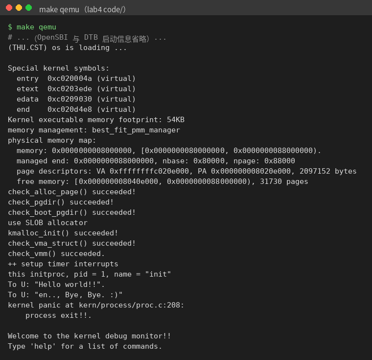
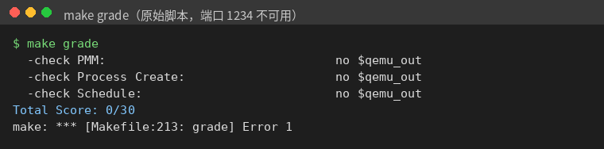
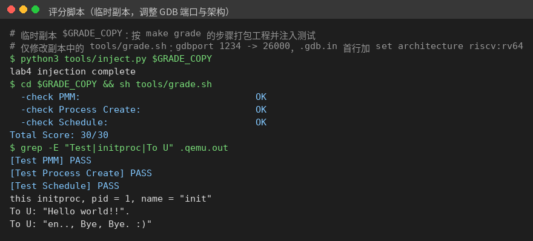
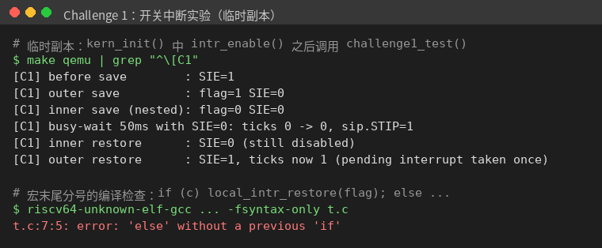
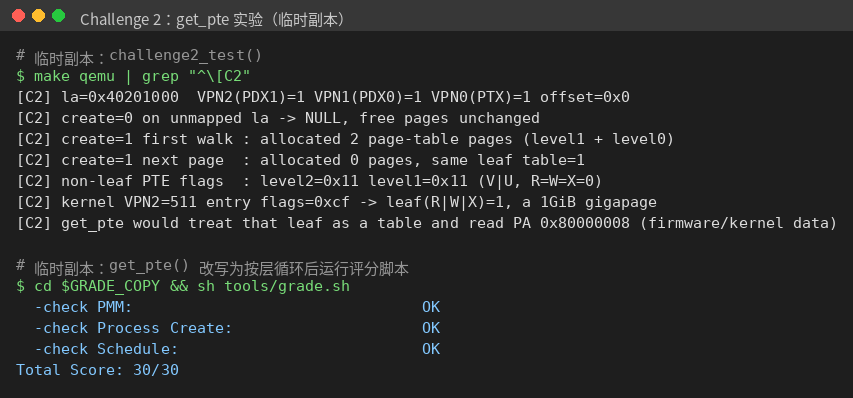

# Lab4 提示词记录

## 模块一——虚拟内存页操作（胡楚骅，2413276）

以下三份提示词整理自模块一的开发对话。

### page_insert() 实现提示词

~~~~text
[PROMPT]

任务：在 Lab4 的 `/home/sven1/course-project/os/OS-/code/kern/mm/pmm.c` 中，完成模块 1 的 `page_insert()`。

功能目标：将虚拟地址 `la` 所在的页映射到调用者指定的物理页 `page`，并按 `perm` 设置权限。正确处理首次插入、更新同一页的权限，以及替换旧物理页三种情况。

修改范围：保留 `//LAB4 function1 YOUR CODE` 标记，在该区域实现 `page_insert()`。本轮不实现 `page_remove()`，不修改已有接口和测试，也不依赖尚未实现的删除函数。

验收方式：用现有 `check_pgdir()` 中的首次插入、替换映射、权限更新与引用计数断言核对实现。另单独检查“同一虚拟页重新映射到同一物理页”时，引用计数是否保持不变。本轮只核对该函数，不把整套 Lab4 的编译或测试通过作为本轮结果。

[RELY]

依据当前工程中的已有接口：

- `get_pte(pgdir, la, true)` 定位 `la` 对应的叶子表项，必要时尝试分配下级页表；返回 `NULL` 表示没拿到表项。返回非空只表示表项位置存在，还要检查 `*ptep & PTE_V` 才知道有没有旧映射。
- `pte2page(*ptep)` 将**有效的旧表项**转成它所引用的 `struct Page *`。
- `page2ppn(page)` 取得物理页号；`pte_create(ppn, perm)` 根据物理页号和权限构造新表项，并自动置上 `PTE_V`。
- `page_ref_inc()` 和 `page_ref_dec()` 更新引用计数，并返回更新后的值。`page_ref_dec()` 不会自动释放页；释放使用 `free_page()`。
- `tlb_invalidate(pgdir, la)` 处理该虚拟地址的旧 TLB 翻译；`E_NO_MEM` 已在工程中定义。

[GUARANTEE]

实现并保持现有函数签名：

```c
int page_insert(pde_t *pgdir, struct Page *page, uintptr_t la, uint32_t perm);
```

优先使用已有辅助接口，不新增对外接口。

[SPECIFICATION]

前置条件：`pgdir` 是内核可访问的根页表指针；`page` 是调用者指定的、有效的目标物理页。操作的是 `la` 所在的虚拟页，不要求 `la` 必须是页首地址。

成功后的状态：返回 `0`。对应叶子表项有效、指向 `page`，权限按本次传入的 `perm` 构造，不继承旧表项的权限。表项更新后，使对应的旧 TLB 翻译失效。

- 情况一：原来没有有效映射。建立映射，`page` 的引用计数增加 `1`。
- 情况二：原来已经映射到 `page`。按本次权限更新表项，引用计数保持不变，不能释放该页。
- 情况三：原来映射到另一个物理页。撤销旧页的这一份引用，给新页增加一份引用。旧页引用归零时释放；不能留下指向已释放页的有效映射。
- 失败情况：`get_pte()` 返回 `NULL` 时返回 `-E_NO_MEM`，不建立新的叶子映射，也不改变目标物理页的引用计数。
~~~~

### page_remove() 实现提示词

~~~~text
[PROMPT]

任务：在 Lab4 的 `/home/sven1/course-project/os/OS-/code/kern/mm/pmm.c` 中，完成模块 1 的 `page_remove()`。

功能目标：撤销虚拟地址 `la` 所在页的映射，同步处理页表项、旧物理页的引用计数和 TLB。没有有效映射时直接返回。

修改范围：只在模块 1 的区域实现 `page_remove()`，保留已有的 `page_insert()`、实验标记和测试。完成后展示改动，并解释各分支的结果；本轮不运行编译或测试。

[RELY]

- `get_pte(pgdir, la, false)` 只查找表项，不分配下级页表。返回 `NULL` 表示没有找到表项位置；返回非空时，还需要用 `PTE_V` 判断表项是否有效。
- `pte2page(*ptep)` 从**有效的页表项**取得旧物理页的 `struct Page *`，因此需要在清除表项之前取得旧页。
- `page_ref_dec(page)` 将引用计数减 `1`，并返回减完后的值。它不会自动释放页；释放使用 `free_page(page)`。
- `tlb_invalidate(pgdir, la)` 用于使该虚拟地址的旧 TLB 翻译失效。

[GUARANTEE]

实现并保持现有函数签名：

```c
void page_remove(pde_t *pgdir, uintptr_t la);
```

复用已有接口，不新增对外接口。

[SPECIFICATION]

前置条件：`pgdir` 是内核可访问的根页表指针；`la` 可以是目标虚拟页内的任意地址。

- 情况一：查不到表项，或者表项没有置 `PTE_V`。直接返回，不改变页表、引用计数或空闲页状态。
- 情况二：表项有效。清除该表项，使旧 TLB 翻译失效，并把旧物理页的引用计数恰好减 `1`。减完仍大于 `0` 时保留该页；减到 `0` 时才释放。释放前确保这条旧映射已被撤销，旧翻译不再可用。
- 其他约束：只撤销这一条映射，不影响指向同一物理页的其他映射；不回收下级页表页。对同一个已经撤销的地址再次调用，应直接返回，不重复减引用或释放。

核对方式：对照现有 `check_pgdir()`：`0x0` 和 `0x1000` 同时指向 `p1` 时，第一次删除使 `p1` 的引用数从 `2` 降到 `1`，仍能通过另一条映射使用它；第二次删除才从 `1` 降到 `0` 并释放它。另检查对没有映射的地址调用时不会分配页表。
~~~~

### 编译错误修正提示词

~~~~text
请修复 Lab4 的 `code/kern/mm/pmm.c` 中两处未定义标识符的编译错误：把 `page_insert()` 里的 `get_pte(pgdir, la, true)` 改成 `get_pte(pgdir, la, 1)`，把 `page_remove()` 里的 `get_pte(pgdir, la, false)` 改成 `get_pte(pgdir, la, 0)`，沿用本工程已有的写法。

只改这两处，保留学号标记，不改映射逻辑、头文件或测试。改完展示 diff，本轮不用运行整套 `make grade`。
~~~~

### 执行结果

| 轮次 | 改动与结果 |
|---|---|
| 1. page_insert() | 在模块一预留区域实现新映射、同页权限更新、替换映射和分配失败返回，完成源码核对。 |
| 2. page_remove() | 实现有效位检查、撤销映射、TLB 失效和引用计数回收，完成源码核对。 |
| 3. 编译修正 | GCC 报告 `true`、`false` 未定义，按工程约定替换为 `1`、`0`。两个函数的最终实现提交为 `431e66d`。 |

使用临时工程副本运行模块一测试，经框架兼容性适配后得到 `check_pgdir() succeeded!`、`check_boot_pgdir() succeeded!` 和 `[Test PMM] PASS`。小组随后完成整体验证，实验结果见 [report.md](report.md) 第五节。

## 模块二——初始化进程控制块 alloc_proc()

### 规范化提示词

```text
[PROMPT]
任务：在当前 Lab4 工程的 code/kern/process/proc.c 中，
完成模块二的第一步，只实现进程控制块分配函数 alloc_proc()。

功能目标：申请一个独立的进程控制块，并将其初始化为安全、
尚未登记且不可调度的状态，为后续分配内核栈、设置初始现场
和创建内核线程提供基础。

修改范围：
- 只在 proc.c 的模块二预留位置实现 alloc_proc()。
- 保留 LAB4 function2 注释，将 YOUR CODE 替换为 2412832。
- 保持 proc_struct、现有函数接口以及已有辅助函数不变。
- 不实现其余五个模块二函数，不修改模块一和模块三。

操作要求：先阅读 proc.h、kmalloc.h、pmm.h、string.h 和 list.h，
确认字段含义与接口定义，再修改实际代码，添加必要的中文注释。

验收方式：使用当前 RISC-V 交叉编译器和工程编译参数编译 proc.c，
检查返回路径及各字段初始状态。由于其余函数尚未实现，
本轮先完成单文件编译检查，完整运行测试留待后续模块接入。

[RELY]
依据当前工程中的真实定义：

1. 数据结构与状态：
   code/kern/process/proc.h 定义 struct proc_struct，包含：
   state、pid、runs、kstack、need_resched、parent、mm、context、
   tf、pgdir、flags、name、list_link 和 hash_link。
   PROC_UNINIT 表示尚未完成初始化的进程状态。
   context 保存 ra、sp 和 s0 至 s11。

2. 已有接口：
   void *kmalloc(size_t n);
   void *memset(void *s, char c, size_t n);
   static inline void list_init(list_entry_t *elm);
   kmalloc() 用于申请 PCB，memset() 可用于初始化结构体，
   list_init() 将链表节点初始化为自环。

3. 全局变量：
   extern uintptr_t boot_pgdir_pa;
   其定义位于 kern/mm/pmm.c，表示内核启动页表的物理地址。

4. 当前阶段的约束：
   内核线程共用内核地址空间，没有独立的用户 mm。
   alloc_proc() 只负责 PCB 的分配和基础初始化，
   内核栈、正式 PID、父线程和初始执行现场由后续流程设置。

[GUARANTEE]
必须实现的函数：
static struct proc_struct *alloc_proc(void);

辅助函数要求：
复用已有内存分配、内存初始化和链表接口，
不新增辅助函数或对外接口。

[SPECIFICATION]
函数：alloc_proc()

Pre-Condition（前置条件）：
- 物理内存管理和 kmalloc 初始化已经完成，可以申请 PCB 内存。
- boot_pgdir_pa 已指向可用的内核启动页表。

Post-Condition（后置条件）：
- 成功时返回一个独立、有效的 struct proc_struct 指针。
- state 为 PROC_UNINIT，pid 为 -1。
- runs、kstack、need_resched 和 flags 为 0。
- parent、mm 和 tf 为 NULL。
- context 的全部寄存器字段为 0，name 数组全部为 0。
- pgdir 等于 boot_pgdir_pa，保存物理地址而非虚拟地址。
- list_link 和 hash_link 均为独立的自环节点。
- PCB 尚未加入全局进程链表或 PID 哈希表。
- 分配失败时返回 NULL，不访问空指针。

Case 1（正常情况）：
- kmalloc() 成功，返回字段均满足后置条件的 PCB。
- 不为其分配正式 PID、内核栈或独立页表，不使其变为 runnable。

Case 2（分配失败）：
- kmalloc() 返回 NULL 时，函数直接返回 NULL。
- 不初始化无效内存，不改变现有线程及进程管理全局状态。

Case 3（多次调用）：
- 各次成功返回的 PCB 相互独立。
- 初始化新 PCB 不改变之前已经申请的 PCB。

Requirements（其他约束）：
- 覆盖所有字段，避免未初始化内存进入后续创建流程。
- 链表节点需要通过 list_init() 初始化，不能只清零指针。
- 不修改 current、idleproc、initproc、nr_process 和全局链表。
- 保留函数的 static 作用域，不提前实现线程登记、唤醒或调度。
```

### 执行结果

- 修改文件：`code/kern/process/proc.c`。
- 实现内容：分配 PCB，失败时返回 `NULL`；成功后清零结构体，设置初始状态、PID 和内核页表物理地址，并初始化两个链表节点。
- 任务注释已改为 `//LAB4 function2 2412832`。
- 使用当前 RISC-V 工具链和工程编译参数，完成了 `proc.c` 的单文件编译；对象文件保存在 WSL 临时目录 `/tmp/lab4-alloc-proc.y5ODHq/proc.o`。
- `git diff --check` 通过。
- 后续步骤：实现 `copy_mm()` 和 `copy_thread()`，再接入线程创建流程，检查创建出的 PCB 与初始执行现场。

## 模块二——处理内核线程地址空间 copy_mm()

### 规范化提示词

```text
[PROMPT]
任务：在当前 Lab4 工程的 code/kern/process/proc.c 中，
接着已实现的 alloc_proc()，只实现 copy_mm()。

功能目标：提供线程创建流程需要的地址空间处理接口。
当前实验只创建内核线程，应检查其没有独立用户地址空间，
复用已有的内核页表，不进行用户地址空间的复制或共享计数管理。

修改范围：
- 在模块二区域补充 copy_mm()，保留学号注释 2412832。
- 保留 alloc_proc() 的实现和注释，不修改其他模块。
- 不提前实现 copy_thread()、do_fork()、kernel_thread() 或 proc_init()。

操作要求：阅读 proc.h、vmm.h、pmm.h 和 alloc_proc()，
确认 mm 和 pgdir 的区别，补充适量中文注释。

验收方式：使用工程对应的 RISC-V 编译参数编译 proc.c，
检查内核线程情况下的返回值、约束检查和资源状态。
后续创建流程接入后，再进行运行验证。

[RELY]
依据当前工程中的真实定义：

1. struct proc_struct 的相关字段：
   struct mm_struct *mm：描述独立用户地址空间的管理结构指针。
   uintptr_t pgdir：线程使用的页表物理地址。

2. current 指向当前线程，新线程 PCB 由 alloc_proc() 创建。
   alloc_proc() 已将新 PCB 的 mm 置为 NULL，
   并将 pgdir 设置为 boot_pgdir_pa。

3. CLONE_VM 定义在 pmm.h 中，用于表示共享地址空间。
   当前实验没有用户地址空间复制逻辑，clone_flags 先作为预留参数。

4. 可使用 assert() 检查当前阶段的内核线程约束。
   mm == NULL 不表示分页关闭，内核线程仍使用 pgdir 指向的内核页表。

[GUARANTEE]
必须实现的函数：
static int copy_mm(uint32_t clone_flags, struct proc_struct *proc);

辅助函数要求：
无需新增辅助函数，不调用用户地址空间分配、复制和释放接口。

[SPECIFICATION]
函数：copy_mm()

Pre-Condition（前置条件）：
- current 已设置为一个有效的内核线程，current->mm == NULL。
- proc 为 alloc_proc() 创建且尚未登记的新 PCB，proc->mm == NULL。
- proc->pgdir 已指向可用的内核页表。

Post-Condition（后置条件）：
- 在满足当前实验约束时返回 0。
- proc->mm 保持 NULL，proc->pgdir 保持原值。
- 不申请或释放内存，不修改当前线程和进程管理全局结构。

Case 1（正常情况）：
- 当前线程和新 PCB 均没有用户 mm，检查通过并返回 0。
- 当前阶段不根据 clone_flags 改变行为，显式标记其为预留参数。

Case 2（违反当前阶段约束）：
- current 或 proc 无效，或其中存在用户 mm 时，使用断言终止，
  避免将尚未实现的用户地址空间处理误判为成功。

Requirements（其他约束）：
- 保持 static 作用域及已有函数签名。
- 不通过清空已有用户 mm 指针的方式假装完成复制，避免丢失资源。
- 注释说明 mm 与 pgdir 的区别，以及用户地址空间处理留待后续扩展。
```

### 执行结果

- 修改文件：`code/kern/process/proc.c`，在模块二的学号注释区域新增 `copy_mm()`。
- 实现内容：保留 `clone_flags` 参数，通过断言检查当前线程与新 PCB 均没有用户地址空间，满足约束时返回 `0`；保留原有 `mm` 和 `pgdir`。
- 编译结果：使用当前 RISC-V 工具链及工程参数编译 `proc.c` 成功，对象文件位于 WSL 临时目录 `/tmp/lab4-copy-mm.fYveVf/proc.o`。
- 验证阶段：本轮完成单文件编译与代码检查，运行验证将在调用流程接入后进行。
- 后续步骤：实现 `copy_thread()`，把新线程的初始现场放到独立内核栈中。

## 模块二——准备线程初始现场 copy_thread()

### 规范化提示词

```text
[PROMPT]
任务：在当前 Lab4 的 code/kern/process/proc.c 中，
接着 alloc_proc() 和 copy_mm()，只实现 copy_thread()。

功能目标：将传入的初始 trapframe 复制到新线程自己的内核栈，
设置子线程返回值和运行栈，并配置首次上下文切换的入口与栈地址，
让后续调度能衔接 forkret -> forkrets -> __trapret 的恢复链路。

修改范围：
- 在 LAB4 function2 2412832 区域新增 copy_thread()。
- 保留已完成函数和现有汇编接口，不实现剩余三个模块二函数。
- 不修改模块一和模块三，不改动原有 trap 保存与恢复代码。

操作要求：阅读 proc.h、trap.h、memlayout.h、proc.c 中的 forkret()，
以及 trapentry.S 和 process/entry.S，确认结构布局与首次运行链路。
注释说明栈布局、现场复制、a0 的含义，以及两个 sp 的不同用途。

验收方式：使用当前 RISC-V 工具链编译；在临时工程副本中运行
QEMU 检查现场布局、复制独立性、寄存器值、两种栈参数及边界保护。
测试入口放在临时副本，完整调度验证留待其他函数接入。

[RELY]
依据当前工程中的真实定义：

1. struct proc_struct 的相关字段：
   kstack：独立内核栈的起始虚拟地址。
   tf：指向新线程内核栈中的 struct trapframe。
   context：供 switch_to() 保存和恢复的上下文，包括 ra、sp、s0 至 s11。

2. KSTACKSIZE = KSTACKPAGE * PGSIZE，KSTACKPAGE 为 2。
   内核栈由 setup_kstack() 分配，栈向低地址增长。

3. struct trapframe 包含 gpr、status、epc、badvaddr 和 cause。
   RV64 下共有 36 个寄存器宽度的槽位，大小为 288 字节。
   gpr.a0 是函数返回值寄存器，gpr.sp 是恢复现场后的运行栈地址。

4. 已有恢复链路：
   forkret() 调用 forkrets(current->tf)；
   forkrets 将 sp 设置为传入的 tf，再跳转 __trapret；
   __trapret 恢复寄存器和 CSR，执行 sret 跳到 tf->epc。

5. alloc_proc() 已将 context 清零。
   初始 epc、status、函数地址及参数由调用者组织在传入的 tf 中。
   可使用 assert() 检查调用前的必要资源状态。

[GUARANTEE]
必须实现的函数：
static void copy_thread(struct proc_struct *proc, uintptr_t esp,
                        struct trapframe *tf);

辅助函数要求：
不新增辅助函数，不分配内存，不修改已有恢复链路的接口。

[SPECIFICATION]
函数：copy_thread()

Pre-Condition（前置条件）：
- proc 指向已初始化、尚未运行的新 PCB，context 已清零。
- proc->kstack 指向大小为 KSTACKSIZE 的有效独立内核栈。
- tf 指向可读且不与目标现场区域重叠的初始 trapframe。
- esp 为 0，或为调用者提供的合法运行栈地址。

Post-Condition（后置条件）：
- proc->tf 指向内核栈顶下方的一个完整 trapframe。
- 现场内容来自传入 tf，其中 gpr.a0 为 0。
- esp 为 0 时，现场中的 sp 为新线程内核栈顶；否则等于 esp。
- context.ra 为 forkret 的地址，context.sp 为 proc->tf 的地址。
- 其他 context 字段保持原值，不修改原始 tf 或 PCB 的登记状态。

Case 1（内核线程使用默认栈）：
- esp == 0，将运行栈设置为 proc->kstack + KSTACKSIZE。
- 复制后的现场独立于调用者传入的 tf。

Case 2（调用者指定栈）：
- esp != 0，将该值写入新现场的 gpr.sp。
- trapframe 本身仍存放在新线程自己的内核栈内。

Requirements（其他约束）：
- 调用资源无效时通过断言终止，不解引用无效指针。
- 按 sizeof(struct trapframe) 计算现场位置，不硬编码字节偏移。
- 不越过内核栈边界，保持当前 RV64 栈布局所需的 16 字节对齐。
- 保留传入的 epc、status、s0 和 s1 等初始信息。
- 不修改线程状态、PID、全局链表和 current，不执行实际调度。
```

### 执行结果

- 修改文件：`code/kern/process/proc.c`，在模块二新增 `copy_thread()`，保留学号 `2412832`。
- 实现内容：在独立内核栈顶部下方复制现场，设置子线程返回值和运行栈，配置 `context.ra` 与 `context.sp`，并添加必要的资源断言和中文注释。
- 验证方式：复制当前工程到 WSL 临时目录 `/tmp/lab4-copy-thread.nw0ex9rl/code`，仅在临时副本增加检查函数和启动调用，使用原工程编译参数构建并运行 QEMU。
- 检查内容：现场位置与 16 字节对齐；原始现场不变、复制内容独立；除 `a0` 和 `sp` 外的现场内容保持；默认和指定 `esp` 两种情况；`context` 入口与栈地址；现场之外的栈空间及前后保护区域不被覆盖。
- 实际结果：临时副本编译成功，QEMU 输出 `COPY_THREAD CHECK PASSED`。日志保存在临时目录中的 `build.log` 和 `qemu.log`。本轮验证了初始现场准备，实际调度与 `sret` 执行将在创建和调度流程接入后检查。
- 后续步骤：实现 `do_fork()`，组合 PCB、内核栈与初始现场，并处理失败清理、PID 分配、线程登记和唤醒。

## 模块二——创建并登记内核线程 do_fork()

### 规范化提示词

```text
[PROMPT]
任务：在当前 Lab4 的 code/kern/process/proc.c 中，
接着已经实现的 alloc_proc()、copy_mm() 和 copy_thread()，
只实现 do_fork()，串联内核线程的创建流程。

功能目标：为新线程申请 PCB 和独立内核栈，处理地址空间与初始现场，
分配正式 PID，登记到进程链表和 PID 哈希表，最后设置为可运行。
任何可恢复失败都应返回负错误码，并释放本次已经申请的资源。

修改范围：
- 在 LAB4 function2 2412832 区域补充 do_fork()。
- 复用前三个函数及框架已有辅助函数，保留当前实现与注释。
- 不实现 kernel_thread() 和 proc_init()，不修改模块一和模块三。

操作要求：先阅读 get_pid()、hash_proc()、setup_kstack()、
put_kstack()、wakeup_proc() 与中断保护接口，确认资源所有权和登记顺序。
添加适量中文注释，说明正常流程、关键临界区和失败清理路径。

验收方式：使用当前 RISC-V 工具链构建临时工程副本并运行 QEMU，
检查成功创建、PID 唯一性、链表与哈希登记、父子关系、初始现场、
中断状态恢复、数量上限和内存分配失败后的清理。
测试辅助代码只放入临时副本，不改动正式工程的启动和调度流程。

[RELY]
依据当前工程中的真实定义：

1. 创建所需接口：
   static struct proc_struct *alloc_proc(void);
   static int setup_kstack(struct proc_struct *proc);
   static void put_kstack(struct proc_struct *proc);
   static int copy_mm(uint32_t clone_flags, struct proc_struct *proc);
   static void copy_thread(struct proc_struct *proc, uintptr_t esp,
                           struct trapframe *tf);
   void kfree(void *objp);

2. 登记和唤醒接口：
   get_pid() 分配未被已有进程占用的 PID。
   hash_proc() 将 PCB 加入 PID 哈希表。
   list_add() 可将 PCB 的 list_link 加入 proc_list。
   wakeup_proc() 将尚不可运行的线程设为 PROC_RUNNABLE。

3. current 表示父线程，nr_process 为当前进程数量，
   MAX_PROCESS 为数量上限；空闲线程计入数量，但不加入 proc_list。

4. 错误码：E_NO_MEM 表示内存不足，E_NO_FREE_PROC 表示数量达到上限。
   setup_kstack() 和 copy_mm() 成功返回 0，失败返回负错误码。

5. local_intr_save() 保存原中断状态并关中断，
   local_intr_restore() 恢复原状态，适用于本实验单核的登记临界区。
   当前 copy_mm() 仅支持没有用户 mm 的内核线程，不分配地址空间资源。

[GUARANTEE]
必须实现的函数：
int do_fork(uint32_t clone_flags, uintptr_t stack, struct trapframe *tf);

辅助函数要求：
复用已有接口，不新增正式工程的辅助函数或测试钩子。

[SPECIFICATION]
函数：do_fork()

Pre-Condition（前置条件）：
- current 指向有效的父内核线程，tf 指向有效的初始寄存器现场。
- 内存分配器、proc_list 和 hash_list 已初始化。
- current->mm == NULL，stack 的含义遵循 copy_thread() 的约定。

Post-Condition（后置条件）：
- 成功返回正 PID，find_proc() 可找到对应 PCB。
- 新线程的 parent 为 current，拥有独立内核栈及准备好的初始现场。
- PCB 已加入链表和哈希表，nr_process 增加 1，状态为 PROC_RUNNABLE。
- current 和调用者的 tf 保持不变，不直接执行线程切换。
- 失败返回负错误码，不留下本次创建的 PCB、内核栈或登记节点。
- 进入登记临界区前的中断状态在退出时得到恢复。

Case 1（正常创建）：
- 资源全部准备成功后，再保护 PID 分配、全局登记、计数更新和唤醒。
- 多次创建的线程 PID 不重复，独立内核栈互不重叠。

Case 2（数量达到上限）：
- 开始时已满，直接返回 -E_NO_FREE_PROC，不申请 PCB。
- 准备资源期间数量达到上限，登记前重新检查，释放本次资源后返回。

Case 3（资源准备失败）：
- PCB 分配失败，返回 -E_NO_MEM。
- 内核栈分配失败，释放 PCB，返回分配错误码。
- copy_mm() 返回错误时，释放内核栈和 PCB，保留其错误码。
  当前用户 mm 不受支持的情况仍由 copy_mm() 的断言处理。

Requirements（其他约束）：
- 先准备资源，再登记，最后唤醒，避免调度器看到半初始化线程。
- 按申请的逆序清理资源，不重复释放，不回收父线程的资源。
- 对全局结构的保护针对当前单核环境，不将关本地中断视为多核锁。
- 使用 kfree() 释放 PCB，使用 put_kstack() 释放独立内核栈。
```

### 执行结果

- 修改文件：`code/kern/process/proc.c`，在模块二新增 `do_fork()`，保留学号 `2412832`。
- 实现内容：依次准备 PCB、父线程指针、内核栈、地址空间和初始现场，再在中断保护下检查上限、分配 PID、登记、更新计数并唤醒；失败时逆序释放已申请资源。
- 验证方式：在 `/tmp/lab4-do-fork.ux1uj05b/code` 临时副本中运行检查，临时设置父线程和管理结构，并对 PCB、内核栈分配注入失败。正式工程未加入测试钩子，也未补写剩余函数。
- 正常行为：连续创建三个线程，检查 PID 不重复、栈独立、父子关系、可运行状态、页表及初始现场；确认链表数量、哈希查找和进程计数一致，原始 `tf` 不变。
- 边界行为：检查默认与指定栈地址、原中断开启与关闭两种状态的恢复；检查 PCB 分配失败、内核栈分配失败、初始数量上限和准备期间触及上限。手动回收测试线程后，空闲页数恢复基线，测试记录的 PCB 数归零，链表与哈希表为空。
- 实际结果：临时副本编译成功，QEMU 输出 `DO_FORK CHECK PASSED`；`build.log` 和 `qemu.log` 保存在对应临时目录。当前 `copy_mm()` 没有可恢复错误返回，其未来错误返回的清理分支经过代码检查，本轮未注入该情况。实际调度执行留待后续函数接入。
- 后续步骤：实现 `kernel_thread()`，将函数入口和参数组织成初始现场并调用 `do_fork()`。

## 模块二——包装内核线程入口 kernel_thread()

### 规范化提示词

```text
[PROMPT]
任务：在当前 Lab4 的 code/kern/process/proc.c 中，
接着已经实现的 do_fork()，只实现 kernel_thread()。

功能目标：将普通 C 函数 fn 和参数 arg 包装成内核线程的初始现场，
准备正确的首次入口与特权状态，再调用 do_fork() 完成创建。

修改范围：
- 在 LAB4 function2 2412832 区域补充 kernel_thread()。
- 保留前四个函数与现有汇编代码，不实现 proc_init() 或模块三。

操作要求：对照 process/entry.S 和 trapentry.S 的实际恢复流程，
解释函数地址、参数、epc 和 sstatus 的设置，添加适量中文注释。

验收方式：在临时副本构建并运行 QEMU，检查创建出的初始现场，
并通过已有恢复链路实际进入测试函数，确认参数、栈和中断状态。
测试入口与辅助代码只放入临时副本。

[RELY]
依据当前工程中的真实定义：

1. process/entry.S 中 kernel_thread_entry 执行：
   move a0, s1
   jalr s0
   jal do_exit
   因此初始 s0 应保存函数地址，s1 应保存参数。

2. struct trapframe 包含 gpr、status、epc、badvaddr 和 cause。
   __trapret 恢复其寄存器及 CSR，执行 sret 跳转到 epc。

3. sstatus 位定义：
   SSTATUS_SPP：控制 sret 返回的特权级。
   SSTATUS_SPIE：sret 时恢复给 SIE 的值。
   SSTATUS_SIE：S 态全局中断使能位。
   read_csr(sstatus) 可读取当前状态。

4. CLONE_VM 表示共享地址空间。
   do_fork(clone_flags, stack, tf) 成功返回正 PID，失败返回负错误码。
   stack 为 0 时，copy_thread() 使用新线程自己的内核栈顶，
   并将临时 tf 复制到独立内核栈。

5. 可使用 memset() 初始化临时现场，E_INVAL 表示无效参数。

[GUARANTEE]
必须实现的函数：
int kernel_thread(int (*fn)(void *), void *arg, uint32_t clone_flags);

辅助函数要求：
复用 do_fork() 和现有恢复链路，不新增正式工程的辅助接口。

[SPECIFICATION]
函数：kernel_thread()

Pre-Condition（前置条件）：
- 调用环境满足 do_fork() 的内核线程创建条件。
- 非空 fn 为有效的 int (*)(void *) 函数，arg 可以为 NULL。

Post-Condition（后置条件）：
- 合法请求的初始 s0 为 fn、s1 为 arg，epc 为 kernel_thread_entry。
- 初始 status 在当前 sstatus 基础上设置 SPP 和 SPIE，清除 SIE，
  保留其余位；函数本身不写当前线程的 sstatus。
- 其余初始现场字段先清零，再由 copy_thread() 设置子线程返回值和栈。
- 调用 do_fork(clone_flags | CLONE_VM, 0, &tf)，原样返回创建结果。

Case 1（正常创建）：
- 函数及参数正确保存，临时现场经 do_fork() 复制后独立存在。
- 空参数合法，调用者传入的其他 clone 标志得到保留。
- 新线程恢复后在 S 态调用 fn(arg)，使用自己的内核栈，中断处于开启状态。

Case 2（无效函数）：
- fn == NULL 时返回 -E_INVAL，不申请资源、不登记线程。

Case 3（创建失败）：
- 原样返回 do_fork() 的负错误码，不重复释放其管理的资源。

Requirements（其他约束）：
- 不在当前线程中直接调用 fn，不执行调度，不修改 current。
- 不将局部 tf 的地址保留到当前调用结束以后供新线程使用。
- 区分新线程 status 中的 SIE 与调用者当前 CSR 的 SIE。
- 保持现有 kernel_thread_entry 返回后调用 do_exit 的框架行为。
```

### 执行结果

- 修改文件：`code/kern/process/proc.c`，在模块二新增 `kernel_thread()`，保留学号 `2412832`，并补充入口寄存器、状态位和共享标志的注释。
- 实现内容：校验非空函数地址，清零临时现场，设置 `s0`、`s1`、`epc` 和 `status`，附加 `CLONE_VM` 后调用 `do_fork()`。
- 验证方式：在 `/tmp/lab4-kernel-thread.u8forspy/code` 临时副本中设置测试父线程与管理结构，构建并运行 QEMU；创建阶段在临时 `copy_mm()` 内记录收到的标志，检查调用参数传递。
- 创建检查：覆盖空函数拒绝、空参数合法、额外 clone 标志保留、默认内核栈、初始现场各字段、调用者中断状态保持，以及进程数已满时的错误码传递。回收创建测试中的线程后，空闲页数恢复基线。
- 入口检查：临时测试将 `current` 指向新线程，通过其 `context.ra` 调用 `forkret`，实际经过 `forkrets -> __trapret -> sret -> kernel_thread_entry` 进入测试函数，确认收到原参数、使用独立内核栈且 SIE 已开启。此处由测试入口发起恢复，调度器的 `switch_to()` 尚未接入。
- 实际结果：临时副本编译成功，QEMU 输出 `KERNEL_THREAD CREATE PASSED` 与 `KERNEL_THREAD ENTRY PASSED`，日志位于对应临时目录的 `build.log` 和 `qemu.log`。测试函数检查完成后直接关闭 QEMU，本轮未测试其返回后的 `do_exit()` 路径。
- 后续步骤：实现 `proc_init()`，初始化管理结构，登记 idleproc 并创建 initproc。

## 模块二——初始化进程管理 proc_init()

### 规范化提示词

```text
[PROMPT]
任务：在当前 Lab4 的 code/kern/process/proc.c 中，
接着已经完成的五个模块二函数，补齐最后的 proc_init()。

功能目标：初始化进程管理结构，将当前启动现场登记为 idleproc，
设置 current，再通过 kernel_thread() 创建第一个内核线程 initproc，
为后续调度做好准备。

修改范围：
- 在 LAB4 function2 2412832 区域实现 proc_init()。
- 保留前五个函数、现有输出及汇编恢复链路，不实现模块三。

操作要求：对照 proc_struct、get_pid()、find_proc()、set_proc_name()
和 test_lab4_process_create()，确认 idle 与普通线程的初始化差异。
添加中文注释，说明启动栈复用、计数、current 设置与创建顺序。

验收方式：在临时工程副本中使用现有测试注入工具，
运行模块一与模块二的检查，并检查名称、链表、哈希、数量和初始现场。
通过临时入口恢复 initproc 的现场，观察 init_main() 输出。
测试辅助入口只放入临时副本，完整调度测试留待模块三接入。

[RELY]
依据当前工程中的真实定义：

1. 全局管理对象：
   proc_list、hash_list、nr_process、idleproc、initproc 和 current。
   hash_list 有 HASH_LIST_SIZE 个桶，每个桶都是链表头。

2. 已有创建接口：
   alloc_proc() 分配并初始化 PCB，默认使用 boot_pgdir_pa。
   kernel_thread() 组织现场，再通过 do_fork() 分配资源和登记线程。
   find_proc() 通过 PID 哈希表查找线程；PID 0 不由该接口查找。

3. idleproc 复用 bootstack，不需要重新分配内核栈或构造初始 tf。
   它计入 nr_process，但不加入普通进程链表和 PID 哈希表。

4. init_main(void *arg) 输出当前 PID、名称和传入字符串。
   本次创建时传入 "Hello world!!"，预期新 PID 为 1。

5. set_proc_name() 固定复制 PROC_NAME_LEN 个字节。
   名称参数应提供足够长度的有效源数组，目标名称末尾由该接口清零。
   可使用 list_init()、panic() 和 assert()。

[GUARANTEE]
必须实现的函数：
void proc_init(void);

辅助函数要求：
复用已有创建、命名和查找接口，不新增正式工程的辅助接口。

[SPECIFICATION]
函数：proc_init()

Pre-Condition（前置条件）：
- 在内核启动阶段调用一次，进程创建尚未开始。
- 物理内存、kmalloc、内核启动页表和启动栈已经可用。
- 系统尚未开始调度，启动阶段中断处于关闭状态。

Post-Condition（后置条件）：
- proc_list 和各 PID 哈希桶完成初始化。
- idleproc 的 PID 为 0、状态为 PROC_RUNNABLE、名称为 idle，
  kstack 指向 bootstack，need_resched 为 1，current 指向 idleproc。
- idleproc 的 parent、mm、tf 为空，runs、flags 和 context 保持初始值。
- initproc 的 PID 为 1、状态为 PROC_RUNNABLE、名称为 init，
  parent 为 idleproc，拥有独立内核栈及完整的首次运行现场。
- nr_process 为 2，普通进程链表和 PID 哈希表仅登记 initproc。
- 两者使用内核页表；initproc 等待后续调度，不在本函数内直接运行。

Case 1（正常初始化）：
- 先建立管理结构，再准备 idleproc 并设置 current，
  最后通过 kernel_thread(init_main, "Hello world!!", 0) 创建 initproc。
- 用返回的 PID 查找 initproc 并设置名称，确认其 PID 为 1。

Case 2（启动资源不足或创建失败）：
- idleproc 分配失败，调用 panic() 终止初始化。
- kernel_thread() 返回错误时，输出错误码并通过 panic() 终止。
- 创建成功但查找结果或预期 PID 异常时，通过断言终止。

Requirements（其他约束）：
- idleproc 不调用 setup_kstack()，不构造尚不存在的首次运行现场。
- 在创建 initproc 前设置 current，保证 do_fork() 建立正确父子关系。
- 命名时保证固定长度复制的源内存有效。
- 保留模块三的预留位置，不补写调度器、上下文切换或进程退出实现。
```

### 执行结果

- 修改文件：`code/kern/process/proc.c`，在模块二新增 `proc_init()`，保留学号 `2412832`。
- 实现内容：初始化链表与哈希桶；创建复用启动栈的 idleproc，设置 current 和初始调度标记；调用 `kernel_thread()` 创建 initproc，再按 PID 查找和命名；启动分配或创建失败时终止初始化。
- 名称处理：由于现有 `set_proc_name()` 按固定长度读取源数据，本次用完整长度的本地字符数组传入 idle 和 init 名称，保持已有命名接口不变。
- 验证方式：在 `/tmp/lab4-proc-init.5xdmu_1r/code` 临时副本中运行原有 `tools/inject.py`，保留 PMM 和进程创建测试，暂不调用调度测试；临时入口进一步检查两个线程的名称、数量、链表、哈希、父子关系、页表和初始现场。
- 实际结果：临时副本编译成功，QEMU 输出 `[Test PMM] PASS`、`[Test Process Create] PASS` 和 `PROC_INIT CHECK PASSED`。
- 首次执行：临时测试通过 initproc 的恢复入口进入 `init_main()`，得到 PID 为 1、名称为 init，以及 `Hello world!!` 和结束语输出；测试副本临时替换 `do_exit()`，检查函数返回值为 0 后输出 `PROC_INIT ENTRY PASSED` 并关闭 QEMU。正式工程的退出接口保持不变。
- 日志位置：对应 WSL 临时目录中的 `build.log` 和 `qemu.log`。
- 后续步骤：模块二六个函数已补齐，等待模块三接入后运行完整 `make qemu`、`make grade`，检查调度与上下文切换。

## 模块三——任务说明与工作方向

### 总任务提示词

```text
[PROMPT]
任务：在当前 Lab4 工程的 code/ 中完成功能模块三“进程调度”，
让 initproc 能够从 idleproc 手中接管 CPU，并通过 make grade 的调度测试。

功能目标：idleproc 在 cpu_idle() 中发现需要重新调度时调用 schedule()；
schedule() 选出下一个 PROC_RUNNABLE 线程，交给 proc_run()；
proc_run() 在关中断条件下切换 current 和页表，调用 switch_to()；
switch_to() 保存旧线程、恢复新线程的被调用者保存寄存器。

修改范围：
- kern/process/switch.S：switch_to()。
- kern/process/proc.c：proc_run() 和 cpu_idle()，放在 LAB4 function3 区域。
- kern/schedule/sched.c：schedule()，放在 LAB4 function3 区域。
- 将三处“LAB4 function3 YOUR CODE”中的 YOUR CODE 替换为 2412737。
- 不修改模块一、模块二已完成的函数，不修改 tools/ 下的测试与评分脚本。

工作方向（自底向上，每完成一个函数单独编译并提交一次）：
1. switch_to：先确定 struct context 的字段偏移，再写保存/恢复汇编。
2. proc_run：依赖 switch_to，完成 current、satp 和上下文的切换。
3. schedule + cpu_idle：依赖 proc_run，完成调度选择和空闲循环；
   接入后运行 make qemu 和 make grade 做整体验证。

验收方式：make 编译无错误无警告；make qemu 输出 initproc 的
"this initproc, pid = 1, name = "init"" 等字符串；
make grade 中 check PMM、check Process Create、check Schedule 全部通过。

[RELY]
- proc.h：struct context 依次为 ra、sp、s0~s11，共 14 个寄存器宽度；
  struct proc_struct 中的 state、need_resched、runs、context、pgdir、list_link。
- proc.c：全局变量 proc_list、idleproc、initproc、current；
  idleproc 由 proc_init() 设为 RUNNABLE 且 need_resched = 1，
  但 idleproc 不在 proc_list 中；do_fork() 用 list_add(&proc_list, ...) 登记新线程。
- copy_thread()：新线程 context.ra = forkret，context.sp = proc->tf；
  首次运行链路为 switch_to -> forkret -> forkrets -> __trapret -> sret -> kernel_thread_entry。
- sync.h：local_intr_save(x) / local_intr_restore(x)，可嵌套使用。
- riscv.h：STORE/LOAD/REGBYTES 汇编宏，SATP_MODE_SV39 = 8，RISCV_PGSHIFT = 12；
  lsatp() 是 Sv32 遗留实现，不可用。
- pmm.c：enable_paging() 中 write_csr(satp, 0x8000000000000000 | (boot_pgdir_pa >> RISCV_PGSHIFT))
  是正确的 Sv39 写法；pmm.h 提供 flush_tlb()。
- tools/test_lab4.c：test_lab4_schedule() 在 init_main 入口额外创建两个线程，
  反复设置 need_resched 并调用 schedule()，要求两个线程都运行过。

[GUARANTEE]
void switch_to(struct context *from, struct context *to);   (kern/process/switch.S)
void proc_run(struct proc_struct *proc);                      (kern/process/proc.c)
void cpu_idle(void) __attribute__((noreturn));                (kern/process/proc.c)
void schedule(void);                                          (kern/schedule/sched.c)
不新增对外接口；如需辅助逻辑，保持在对应函数内部。

[SPECIFICATION]
总体要求：
- 调度和切换过程必须原子：修改 current、satp 和执行现场期间不能被中断打断。
- 调度点只有 cpu_idle() 和测试代码主动调用 schedule() 两处，不在时钟中断中抢占。
- 每个函数的详细行为规格见下面各小节。
```

### 执行结果

- 先将实验手册 16 个页面整理为 `class/exp/lab4.md`（工作区课程资料，不进入仓库），确认任务 3 对应“功能模块三：进程调度”。
- 阅读队友已提交的模块一、模块二代码和 `tools/test_lab4.c`、`tools/inject.py`、`tools/grade.sh`，确认测试入口和链表登记方式。
- 基线编译：`make` 只报 `undefined reference to 'cpu_idle'`，说明模块一、二可编译，缺口正是模块三。
- 后续步骤：按 switch_to -> proc_run -> schedule/cpu_idle 的顺序实现，每步单独提交。

## 模块三——上下文切换 switch_to()

### 规范化提示词

```text
[PROMPT]
任务：在 code/kern/process/switch.S 中实现 switch_to()。

功能目标：从 from 指向的 context 保存当前线程的执行现场，
再从 to 指向的 context 恢复目标线程的执行现场，并跳转到目标线程的 ra。

修改范围：
- 只修改 switch.S，保留首行注释并将 YOUR CODE 替换为 2412737。
- 不修改 struct context 的定义，不修改 trapentry.S 和 process/entry.S。

操作要求：先阅读 proc.h 中 struct context 和 libs/riscv.h 中的汇编宏，
确认每个字段的偏移，再编写汇编并添加中文注释。

验收方式：make 编译 switch.S 无错误；反汇编检查 14 条保存和 14 条恢复指令的偏移；
用静态断言核对 struct context 的偏移与汇编一致。完整运行留待 schedule() 接入。

[RELY]
- struct context { ra, sp, s0, s1, ..., s11 }，均为 uintptr_t，共 14 个字段。
- libs/riscv.h：RV64 下 STORE = sd、LOAD = ld、REGBYTES = 8。
- proc.c 中已声明 void switch_to(struct context *from, struct context *to);
- RISC-V 调用约定：a0、a1 为前两个参数；ra、sp、s0~s11 为被调用者保存寄存器，
  t0~t6、a0~a7 为调用者保存寄存器。
- 新线程的 context.ra = forkret，context.sp = proc->tf（由 copy_thread() 设置）。

[GUARANTEE]
void switch_to(struct context *from, struct context *to);
以 .globl switch_to 导出，不新增其他符号。

[SPECIFICATION]
函数：switch_to()

Pre-Condition（前置条件）：
- a0 指向当前线程 PCB 中可写的 context，a1 指向目标线程 PCB 中已准备好的 context。
- 调用者已关中断，并已把 current 更新为目标线程。

Post-Condition（后置条件）：
- from 中依次保存调用瞬间的 ra、sp、s0~s11。
- ra、sp、s0~s11 被替换为 to 中的值，随后通过 ret 跳转到新的 ra。
- 旧线程以后被切回时，好像 switch_to() 普通返回一样继续执行。

Case 1（目标线程曾经运行过）：
- to->ra 是它上次调用 switch_to() 的返回地址，恢复后回到 proc_run() 中继续执行。

Case 2（目标线程首次运行）：
- to->ra = forkret，to->sp = 新线程 trapframe 地址，ret 后进入首次运行链路。

Requirements（其他约束）：
- 偏移必须与 struct context 字段顺序一致，使用 REGBYTES 宏而不是硬编码 8。
- 只保存/恢复 14 个被调用者保存寄存器，不保存 caller-saved 寄存器或 CSR。
- 不修改 a0、a1 指向以外的内存，不做调度判断，不开关中断。
```

### 执行结果

- 修改文件：`code/kern/process/switch.S`，首行注释改为 `//LAB4 function3 2412737`。
- 实现内容：先用 14 条 `STORE` 把 `ra`、`sp`、`s0`~`s11` 存入 `from`，再用 14 条 `LOAD` 从 `to` 恢复，最后 `ret` 跳到新的 `ra`；注释说明了两种 `ra` 来源。
- 编译命令：`make`。`switch.S` 编译通过；链接仍因缺少 `cpu_idle` 失败，符合当前进度。
- 检查结果：`riscv64-unknown-elf-objdump -d obj/kern/process/switch.o` 显示保存偏移为 0~104、恢复偏移相同；在工作区临时目录编译 `_Static_assert` 检查 `sizeof(struct context) == 14 * REGBYTES` 以及 `ra`、`sp`、`s0`、`s11` 偏移，输出 `CONTEXT_LAYOUT_OK`。
- 后续步骤：实现 `proc_run()`。

## 模块三——切换运行线程 proc_run()

### 规范化提示词

```text
[PROMPT]
任务：在 code/kern/process/proc.c 的 LAB4 function3 区域实现 proc_run()。

功能目标：让指定线程成为当前运行线程：更新 current，
把 satp 切换到该线程的页表，再调用 switch_to() 完成寄存器现场切换。

修改范围：
- 只在 proc.c 的模块三预留位置新增 proc_run()，将 YOUR CODE 替换为 2412737。
- 不修改模块二的 alloc_proc()、do_fork()、copy_thread() 等函数。
- 不实现 schedule() 和 cpu_idle()，它们在下一轮完成。

操作要求：阅读 sync.h、riscv.h 中 satp 相关宏、pmm.c 的 enable_paging()
和 pmm.h 的 flush_tlb()，确认 Sv39 下 satp 的正确构造方式后再修改代码。

验收方式：make 编译 proc.c 无错误；在临时工程副本中临时提供一个
直接调用 proc_run(initproc) 的 cpu_idle()，运行 QEMU，检查切换后
current == initproc、satp 值正确，且 init_main() 的输出完整出现。

[RELY]
- struct proc_struct：context（switch_to 使用）、pgdir（根页表物理地址）。
- 全局变量：struct proc_struct *current，初始为 idleproc。
- sync.h：local_intr_save(x) 在 SIE = 1 时关中断并令 x = 1，否则 x = 0；
  local_intr_restore(x) 仅在 x = 1 时重新开中断，因此可以嵌套。
- riscv.h：write_csr(reg, val)、SATP_MODE_SV39 = 8、RISCV_PGSHIFT = 12；
  lsatp() 按 Sv32 构造 satp，本实验不可用。
- pmm.c：enable_paging() 写 satp 的方式为 0x8000000000000000 | (pa >> RISCV_PGSHIFT)。
- pmm.h：static inline void flush_tlb() 执行 sfence.vma。
- switch.S：void switch_to(struct context *from, struct context *to);

[GUARANTEE]
void proc_run(struct proc_struct *proc);
（声明已存在于 proc.h，不新增辅助函数。）

[SPECIFICATION]
函数：proc_run()

Pre-Condition（前置条件）：
- proc 指向已登记、状态为 PROC_RUNNABLE 的线程，其 context 和 pgdir 有效。
- current 指向当前正在 CPU 上运行的线程。

Post-Condition（后置条件）：
- 对于新线程：current == proc，satp 指向 proc->pgdir，CPU 执行流转到 proc。
- 对于旧线程：之后被切回时从 switch_to() 返回，并恢复进入 proc_run() 前的中断状态。

Case 1（proc 与 current 不同）：
- 关中断后依次更新 current、写 satp、刷新 TLB、调用 switch_to(&prev->context, &next->context)。

Case 2（proc == current）：
- 不做任何切换，直接返回，不修改 satp 和 context。

Requirements（其他约束）：
- 更新 current、satp 和执行现场期间必须关中断，结束后用 local_intr_restore() 恢复原状态。
- satp 使用 SATP_MODE_SV39 << 60 与 pgdir >> RISCV_PGSHIFT 构造，不使用 lsatp()。
- current 必须在 switch_to() 之前更新：新线程首次运行时 forkret() 会读取 current->tf。
- 不修改线程状态、runs 和 need_resched，这些由 schedule() 负责。
```

### 执行结果

- 修改文件：`code/kern/process/proc.c`，模块三区域注释改为 `//LAB4 function3 2412737`，新增 `proc_run()`。
- 实现内容：`proc != current` 时关中断，依次更新 `current`、按 Sv39 格式写 `satp`、调用 `flush_tlb()`、执行 `switch_to()`，返回后恢复中断状态；相同线程直接返回。
- 编译命令：`make`。`proc.c` 编译通过，链接仍只缺少 `cpu_idle`。
- 验证方式：复制工程到工作区临时目录，临时提供 `cpu_idle()` 直接调用 `proc_run(initproc)`，并在 `init_main()` 开头断言 `current == initproc` 且 `satp == (8 << 60) | (boot_pgdir_pa >> 12)`。
- 实际结果：QEMU 输出 `PROC_RUN TEST: current=0 -> initproc=1, satp=0x8000000000080208`、`PROC_RUN CHECK PASSED`，随后出现 `this initproc, pid = 1, name = "init"` 和两行 `To U:` 输出，最后由框架中未实现的 `do_exit()` 触发 `process exit!!` panic，属于 Lab4 预期行为。说明 `switch_to -> forkret -> forkrets -> __trapret -> kernel_thread_entry` 链路已打通。
- 发现的问题：全量编译时 `kern/mm/kmalloc.c:92` 报 `-Wint-conversion` 警告，来自起始代码，不在本任务修改范围内，保持不动。
- 后续步骤：实现 `schedule()` 和 `cpu_idle()`，运行完整 `make qemu` 与 `make grade`。

## 模块三——调度选择与空闲循环 schedule()、cpu_idle()

### 规范化提示词

```text
[PROMPT]
任务：在 code/kern/schedule/sched.c 中实现 schedule()，
在 code/kern/process/proc.c 的模块三区域（proc_run() 之后）实现 cpu_idle()。

功能目标：cpu_idle() 作为 idleproc 的执行主体持续循环，发现 need_resched 时调用 schedule()；
schedule() 按 FIFO/轮转方式从 proc_list 中选出下一个 PROC_RUNNABLE 线程，
找不到时退回 idleproc，最后通过 proc_run() 完成切换。

修改范围：
- sched.c：将 LAB4 function3 的 YOUR CODE 替换为 2412737，在其下实现 schedule()。
- proc.c：在 proc_run() 之后新增 cpu_idle()。
- 不修改 wakeup_proc()、sched.h、proc.h 的声明，不修改 tools/ 下的测试和评分脚本。

操作要求：阅读 list.h、proc_init()、do_fork() 中链表的登记方式和
tools/test_lab4.c 中的 test_lab4_schedule()，确认 idleproc 是否在 proc_list 中、
测试线程如何触发调度，再修改代码并添加中文注释。

验收方式：make 编译无错误；make qemu 输出 initproc 的三行字符串；
make grade 三项检查全部通过（Total Score: 30/30）。

[RELY]
- list.h：list_next(le) 返回下一个节点；proc_list 是带哨兵头结点的双向循环链表。
- proc.h：le2proc(le, list_link) 由链表节点得到 proc_struct；PROC_RUNNABLE 表示就绪或运行中。
- proc_init()：idleproc 状态为 PROC_RUNNABLE、need_resched = 1，未加入 proc_list。
- do_fork()：list_add(&proc_list, &proc->list_link) 把新线程插入头结点之后，再 wakeup_proc()。
- proc.c：void proc_run(struct proc_struct *proc); 已实现，内部自行关中断并处理 proc == current。
- sync.h：local_intr_save()/local_intr_restore() 可嵌套。
- test_lab4_schedule()：在 init_main 入口创建两个测试线程，initproc 和测试线程
  反复设置 current->need_resched = 1 并直接调用 schedule()，要求两个测试线程都运行过。

[GUARANTEE]
void schedule(void);                          (声明在 sched.h)
void cpu_idle(void) __attribute__((noreturn)); (声明在 proc.h)
不新增辅助函数。

[SPECIFICATION]
函数：schedule()

Pre-Condition（前置条件）：
- current 指向当前运行线程，proc_list 已初始化，idleproc 有效。

Post-Condition（后置条件）：
- current->need_resched 被清零。
- 选中的线程 runs 加 1；若它不是 current，则已通过 proc_run() 切换过去。
- 当前线程以后被切回时从 schedule() 返回，并恢复进入时的中断状态。

Case 1（current 是 idleproc）：
- 从 proc_list 头结点之后开始查找第一个 PROC_RUNNABLE 线程。

Case 2（current 是普通线程）：
- 从 current->list_link 的下一个节点开始查找，绕链表一圈（包括 current 自身）为止，
  使多个就绪线程轮流获得 CPU。

Case 3（没有就绪线程）：
- 选择 idleproc；若 current 已是 idleproc，则不切换。

Requirements（其他约束）：
- 遍历时跳过 proc_list 头结点，不能对哨兵节点使用 le2proc()。
- 选择与切换全程关中断，结束后恢复原中断状态。
- 不修改线程状态，不在 schedule() 中创建或回收线程。

函数：cpu_idle()

Pre-Condition（前置条件）：
- kern_init() 已完成 proc_init()、clock_init() 和 intr_enable()，current == idleproc。

Post-Condition（后置条件）：
- 函数永不返回；每当 current->need_resched 为真时调用一次 schedule()。

Requirements（其他约束）：
- 循环中每次重新读取 current->need_resched（该字段为 volatile）。
- 不在 cpu_idle() 中直接选择线程或调用 proc_run()，调度决策统一交给 schedule()。
```

### 执行结果

- 修改文件：`code/kern/schedule/sched.c` 新增 `schedule()`，注释改为 `//LAB4 function3 2412737`；`code/kern/process/proc.c` 在 `proc_run()` 之后新增 `cpu_idle()`。
- 实现内容：`schedule()` 关中断后清 `need_resched`，按 `current` 是否为 idleproc 决定查找起点，绕链表一圈查找 `PROC_RUNNABLE`，找不到时退回 idleproc，`runs++` 后在需要时调用 `proc_run()`；`cpu_idle()` 循环检查 `need_resched`。
- 编译命令：`make clean && make`。链接成功，生成 `bin/kernel` 和 `bin/ucore.img`；仅有起始代码 `kmalloc.c:92` 的既有警告。
- `make qemu`：输出 `this initproc, pid = 1, name = "init"`、`To U: "Hello world!!".`、`To U: "en.., Bye, Bye. :)"`，随后进入框架预期的 `process exit!!` panic。
- `make grade`：评分结果见下一节“整体验证与问题记录”。

## 模块三——整体验证与问题记录

### 实际结果

- 正式工程 `code/` 中执行 `make clean && make`、`make qemu`，三行 initproc 输出全部出现，最后进入 Lab4 预期的 `process exit!!` panic。



- 正式工程中直接执行 `make grade`，三项检查都显示 `no $qemu_out`，总分 0/30。



- 在工作区临时副本中按 `make grade` 的步骤打包工程并执行 `tools/inject.py`，只在副本的 `tools/grade.sh` 中调整 GDB 端口与架构设置后运行评分脚本，三项检查全部 OK，总分 30/30，`.qemu.out` 中出现 `[Test PMM] PASS`、`[Test Process Create] PASS`、`[Test Schedule] PASS`。



### 问题与解决

1. `make grade` 输出 `no $qemu_out`。
   - 排查：手动按 `grade.sh` 的参数启动 QEMU，错误输出为 `-gdb tcp::1234: Failed to find an available port: Address already in use`；Linux 内没有进程监听 1234。本机 WSL 使用 `networkingMode=mirrored`，Windows 的 `netsh interface ipv4 show excludedportrange protocol=tcp` 显示 1199~1298 为系统保留端口段，1234 落在其中。
   - 处理：属于本机环境问题，与调度代码无关。仓库中的 `tools/grade.sh` 保持不变，只在临时副本中把 `gdbport` 改为 26000。
2. 更换端口后 GDB 报 `Truncated register 37 in remote 'g' packet`。
   - 排查：`riscv64-unknown-elf-gdb` 是指向 `gdb-multiarch` 15.1 的链接；评分脚本不加载 ELF，GDB 拒绝 QEMU 4.1.1 提供的目标描述，无法确定架构。
   - 处理：在临时副本生成的 `.gdb.in` 首行加入 `set architecture riscv:rv64`，评分随即通过。若组内需要在本机直接运行 `make grade`，可在管理员终端执行 `net stop winnat` 和 `net start winnat` 释放保留端口，或统一修改评分脚本，需组内确认后再改。
3. 全量编译时出现 `kern/mm/kmalloc.c:92` 的 `-Wint-conversion` 警告；评分时 `test_lab4.c` 也会因测试线程函数返回 `void` 产生类型提示。两者分别来自起始代码和课程测试文件，不影响结果，未修改。

## Challenge——任务说明与工作方向

### 总任务提示词

```text
[PROMPT]
任务：完成 Lab4 的两个扩展练习，并把全组 Lab4 工作整合为 report/report.md。
Challenge 1：说明 local_intr_save(intr_flag); ... local_intr_restore(intr_flag); 如何实现开关中断。
Challenge 2：结合 sv32、sv39、sv48 解释 get_pte() 中两段相似代码的原因，
并评价“查找页表项”和“分配页表页”合并在一个函数里的写法。

工作方向：
1. 两个 Challenge 都是分析题，结论必须以当前工程源码为依据，并尽量用临时副本中的实验验证，
   不修改正式工程的 sync.h、pmm.c 等文件。
2. 每个 Challenge 单独记录一轮提示词和执行结果，各提交一次。
3. 报告按 docs/实验报告模板.md 的章节编排，覆盖实验手册“实验报告要求”的 7 项；
   成员信息、分工、提示词和测试结果只采用仓库与提交记录中的真实内容，缺失内容如实标注。

验收方式：实验输出与分析结论一致；报告引用的截图全部提交到 report/images/；
Markdown 中粗体、行内代码和图片路径在 Typora/GitHub 中正常渲染。
```

### 执行结果

- 确认远程 `lab4` 没有新提交，在本地 `lab4` 上继续工作。
- 两个 Challenge 的结论分别见下面两节；报告整合见“报告整合”一节。

## Challenge 1——local_intr_save / local_intr_restore 开关中断原理

### 规范化提示词

```text
[PROMPT]
任务：说明 local_intr_save(intr_flag); ... local_intr_restore(intr_flag); 是如何实现开关中断的。

功能目标：从宏展开、CSR 操作、嵌套使用和线程切换四个层面解释这对宏，
并在临时工程副本中用实验验证关键结论。

修改范围：不修改正式工程；实验代码只放在工作区临时副本中。

操作要求：阅读 kern/sync/sync.h、kern/driver/intr.c、libs/riscv.h 中的 read_csr/set_csr/clear_csr，
以及 pmm.c、console.c、proc.c、sched.c 中的调用点，再给出解释。

验收方式：在 kern_init() 打开中断后调用临时测试函数，打印外层/内层保存后的 flag 与 SIE，
在关中断期间忙等超过一个时钟周期，观察 ticks 和 sip.STIP；
另外用一个 if/else 片段对宏做编译检查。

[RELY]
- sync.h：__intr_save() 读取 sstatus，SIE 为 1 时调用 intr_disable() 并返回 1，否则返回 0；
  __intr_restore(flag) 在 flag 为 1 时调用 intr_enable()；
  #define local_intr_save(x) do { x = __intr_save(); } while (0)
  #define local_intr_restore(x) __intr_restore(x);
- intr.c：intr_enable() 为 set_csr(sstatus, SSTATUS_SIE)，intr_disable() 为 clear_csr(sstatus, SSTATUS_SIE)。
- clock.c：timebase = 100000，即 10 MHz 下每 10 ms 一次时钟中断；ticks 为 volatile 计数。
- 硬件：进入 S 态 trap 时 SIE 存入 SPIE 并清零 SIE，sret 时由 SPIE 恢复 SIE；
  中断被屏蔽期间 sip 中的挂起位保持。

[GUARANTEE]
输出一段完整的分析说明，以及临时实验的源代码和运行结果。

[SPECIFICATION]
Pre-Condition（前置条件）：
- 单核 RISC-V，内核运行在 S 态，时钟中断已经通过 clock_init() 和 intr_enable() 打开。

Post-Condition（后置条件）：
- 解释清楚 flag 保存的是“进入临界区前 SIE 是否为 1”，而不是固定的开/关动作。
- 说明嵌套时只有最外层的 restore 会重新开中断。
- 说明屏蔽期间的中断是被推迟而不是丢失。
- 说明 proc_run() 中 intr_flag 存放在各线程自己的栈上，以及新线程首次运行时由 sret 打开中断。

Requirements（其他约束）：
- 指出这对宏只屏蔽当前 hart 的 S 态中断，不屏蔽异常，在多核上不能代替锁。
- 如果发现宏定义本身的隐患，需要给出可复现的证据。
```

### 执行结果

- 实验位置：工作区临时副本 `chal/`，在 `kern_init()` 的 `intr_enable()` 之后调用 `challenge1_test()`，正式工程未改动。
- 实际输出：

```text
[C1] before save        : SIE=1
[C1] outer save         : flag=1 SIE=0
[C1] inner save (nested): flag=0 SIE=0
[C1] busy-wait 50ms with SIE=0: ticks 0 -> 0, sip.STIP=1
[C1] inner restore      : SIE=0 (still disabled)
[C1] outer restore      : SIE=1, ticks now 1 (pending interrupt taken once)
```

- 结论：外层保存得到 `flag=1` 并关中断；内层保存时 SIE 已为 0，得到 `flag=0`，因此内层恢复不会提前开中断。关中断 50 ms 期间 `ticks` 不变而 `sip.STIP=1`，说明时钟中断被挂起；外层恢复后立即进入一次中断处理，`ticks` 变为 1。
- 发现的问题：`local_intr_restore(x)` 的宏定义末尾自带分号，展开后变成 `__intr_restore(x);;`。编写 `if (c) local_intr_restore(flag); else ...` 并用工程编译参数 `-fsyntax-only` 检查，报 `error: 'else' without a previous 'if'`。现有调用点都没有写在 if/else 分支中，所以不影响本实验；修复方式是与 `local_intr_save` 一样改成 `do { ... } while (0)` 且去掉末尾分号。sync.h 属于框架代码，未修改，在报告中记录。


- 完整分析写入 `report/report.md` 的 Challenge 1 一节。

## Challenge 2——get_pte() 两段相似代码与是否拆分

### 规范化提示词

```text
[PROMPT]
任务：回答 get_pte() 的两个思考题：
(1) 结合 sv32、sv39、sv48 的异同，解释 get_pte() 中两段代码为什么如此相像；
(2) 评价“页表项查找”和“页表页分配”合并在一个函数里的写法，说明有没有必要拆开。

功能目标：给出基于 RISC-V 特权级规范和当前源码的分析，并在临时副本中验证：
地址分解、按需分配的页数、非叶 PTE 的标志，以及“循环改写”与原实现等价。

修改范围：不修改正式工程的 pmm.c；循环改写和实验代码只放在临时副本。

操作要求：阅读 kern/mm/pmm.c 的 get_pte()、get_page()、page_insert()、page_remove()、
check_pgdir()、check_boot_pgdir()，kern/mm/mmu.h 的 PDX1/PDX0/PTX/PTE_ADDR 等宏，
以及 kern/init/entry.S 中的 boot_page_table_sv39。

验收方式：
- 临时副本打印一个虚拟地址的 VPN[2]、VPN[1]、VPN[0]，对比 create=0/1 的返回值和空闲页变化；
- 打印启动页表中内核所在表项的标志，检查是否为大页叶子；
- 把 get_pte() 改写为按层循环，在临时副本中运行评分脚本，三项检查全部通过。

[RELY]
- mmu.h：PDX1SHIFT = 30、PDX0SHIFT = 21、PTXSHIFT = 12，每级索引 9 位；
  PTE_ADDR(pte) 取出 PTE 中的物理页号并换算为物理地址；PTE_V/R/W/X/U 标志位。
- get_pte(pgdir, la, create)：第一段处理 PDX1 指向的一级表项，第二段处理 PDX0 指向的二级表项，
  无效且 create 为真时分配一页、清零、写入 PTE_U | PTE_V 的非叶表项，最后返回 PTX 对应的叶子 PTE 地址。
- 调用者：page_insert() 用 create=1，get_page()、page_remove() 和自检代码用 create=0。
- entry.S：boot_page_table_sv39 只设置了第 511 项，值为 (0x80000 << 10) | 0xcf。
- 规范：Sv32 为 2 级（10+10 位索引），Sv39 为 3 级（9+9+9），Sv48 为 4 级（9+9+9+9）；
  R=W=X=0 的有效 PTE 指向下一级页表，否则为叶子。

[GUARANTEE]
输出两道思考题的回答、实验代码要点和运行结果；可以给出建议的拆分接口，但不提交到正式工程。

[SPECIFICATION]
Post-Condition（后置条件）：
- 说明两段代码分别对应 Sv39 的哪一级，以及 Sv32/Sv48 下这样的代码段各有几段。
- 说明相像的根本原因：每一级页表的格式和处理步骤完全相同，只是索引位段不同。
- 对“是否拆分”给出明确观点，并列出合并写法的优点、问题和改进方案。

Requirements（其他约束）：
- 结论需要与实验输出一致；如果发现当前实现与规范或启动页表不一致，如实记录并说明影响范围。
```

### 执行结果

- 实验位置：同一临时副本中的 `challenge2_test()`，正式工程未改动。实际输出：

```text
[C2] la=0x40201000  VPN2(PDX1)=1 VPN1(PDX0)=1 VPN0(PTX)=1 offset=0x0
[C2] create=0 on unmapped la -> NULL, free pages unchanged
[C2] create=1 first walk : allocated 2 page-table pages (level1 + level0)
[C2] create=1 next page  : allocated 0 pages, same leaf table=1
[C2] non-leaf PTE flags  : level2=0x11 level1=0x11 (V|U, R=W=X=0)
[C2] kernel VPN2=511 entry flags=0xcf -> leaf(R|W|X)=1, a 1GiB gigapage
[C2] get_pte would treat that leaf as a table and read PA 0x80000008 (firmware/kernel data)
```

- 循环改写：在另一份临时副本 `getpte-loop/` 中把两段代码改为 `for (level = 0; level < 2; level++)`，用 `shift[] = {PDX1SHIFT, PDX0SHIFT}` 选择索引位段。按上一轮的评分方式运行，`check_pgdir()`、`check_boot_pgdir()` 通过，三项检查 OK，总分 30/30，说明两段代码就是逐级遍历展开后的结果。
- 发现的问题：
  1. 启动页表第 511 项是 1 GiB 大页叶子（`0xcf` 含 R/W/X），`get_pte()` 只检查 `PTE_V`，若对内核虚拟地址调用，会把叶子当作下一级页表，访问物理地址 `0x80000008`（OpenSBI 所在区域）。
  2. `check_boot_pgdir()` 本应遍历内核映射，但循环变量 `i` 是 `int`，`ROUNDDOWN(KERNBASE, PGSIZE)` 被截断为负数，与 `size_t` 比较时又转换成很大的无符号数，循环 0 次（主机上用同样类型复现，`iterations=0`）。因此第 1 点没有被自检发现。
  3. 非叶 PTE 写入了 `PTE_U`。RISC-V 特权级规范规定非叶 PTE 的 D、A、U 位保留，软件应清零；QEMU 不检查，所以当前能运行。
  - 以上都属于框架代码，不在本组任务的修改范围内，记录在报告中，未修改正式工程。


- 完整分析写入 `report/report.md` 的 Challenge 2 一节。

## 报告整合

### 规范化提示词

```text
[PROMPT]
任务：按 docs/实验报告模板.md 把全组 Lab4 工作整合为 report/report.md。

功能目标：一份结构完整、内容真实的实验报告，覆盖实验手册“实验报告要求”的 7 项：
整体逻辑线、核心函数理解、spec 与 prompt 写法、AI 生成过程中的 bug 与解决、
重要知识点与 OS 原理的对应、未对应的知识点。

修改范围：只新增 report/report.md；不改动代码和其他成员的提示词记录。

[RELY]
- 成员与学号：2412832 王雅枫、2413276 胡楚骅、2412737 罗元伟（来自 Lab3 报告和代码中的学号注释）。
- 分工依据：提交记录 a48bd93（迁移）、431e66d（模块一）、c3fc5f7（模块二）、
  bc1d8a3/077c0e6/e74c5a6/dcba670（模块三）、bb27aca/c225349（Challenge）。
- 提示词与执行结果：report/prompt.md；测试截图：report/images/。

[SPECIFICATION]
Requirements（其他约束）：
- 保留模板的标题编号和章节结构，练习按实验手册顺序排列：模块一、模块二、模块三、Challenge。
- 只写有依据的内容；仓库中缺失的信息（如模块一的提示词、组员 Lab4 使用的 AI 工具）
  明确标注为待补充或待确认，不代写。
- 截图使用 ./images/ 相对路径，所有引用的图片都已提交。
```

### 执行结果

- 新增 `report/report.md`，按模板的“实验基本信息、一~六”组织，其中“四、实验内容与实现”依次为前置迁移、模块一、模块二、模块三、Challenge 1、Challenge 2。
- 模块二、模块三的“最终提示词”直接嵌入 `prompt.md` 中的原文（模块二取核心一轮 `do_fork()`，模块三取总任务提示词）。
- 待补充：`prompt.md` 中没有模块一（胡楚骅）的提示词记录，报告中已注明需由本人补充；王雅枫、胡楚骅 Lab4 使用的 AI 工具暂沿用 Lab3 报告中的记录，标注为待本人确认。
- 检查：粗体分隔符检查无问题；5 张截图的相对路径都对应 `report/images/` 中已提交的文件。
