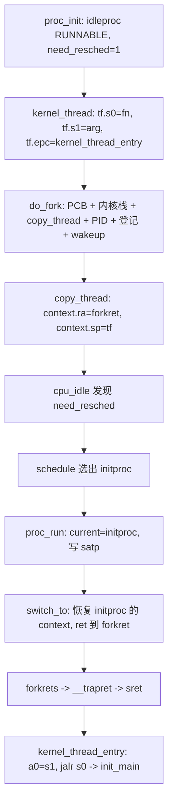
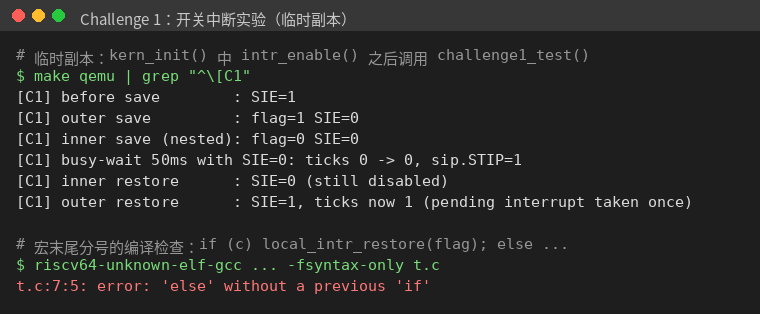
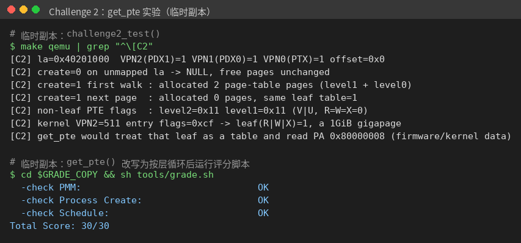
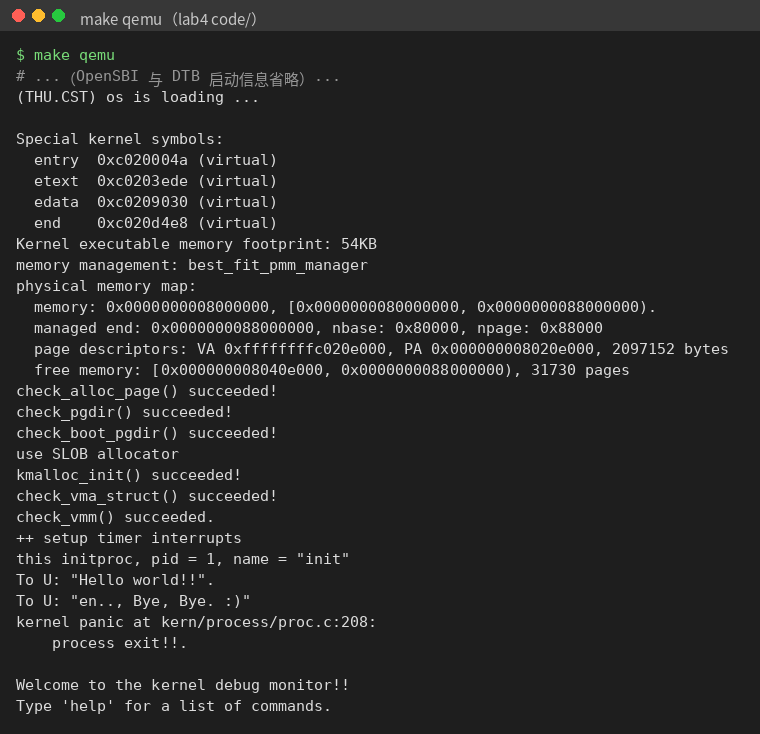
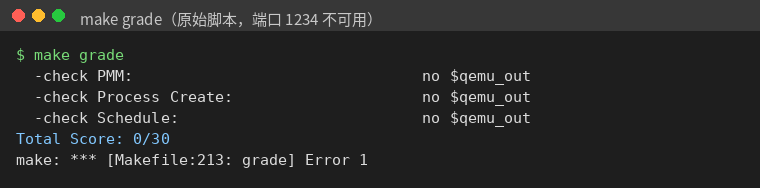
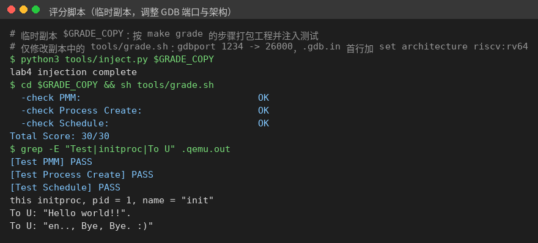

# Lab4 实验报告：进程管理

## 实验基本信息

| 项目 | 内容 |
|------|------|
| **实验名称** | Lab4：进程管理 |
| **小组成员** | 2412832-王雅枫、2413276-胡楚骅、2412737-罗元伟 |
| **完成日期** | 2026-11-16 |
| **提交分支** | `lab4` |
| **代码位置** | `code/` |

### 小组分工

练习如何分工？

| 成员 | 负责的练习/模块 |
|------|----------------|
| 2412832-王雅枫 | 迁移 Lab2/Lab3 实现到 Lab4 框架；功能模块二：进程创建及初始化（`alloc_proc`、`copy_mm`、`copy_thread`、`do_fork`、`kernel_thread`、`proc_init`） |
| 2413276-胡楚骅 | 功能模块一：虚拟内存页操作（`page_insert`、`page_remove`） |
| 2412737-罗元伟 | 功能模块三：进程调度（`switch_to`、`proc_run`、`schedule`、`cpu_idle`）；扩展练习 Challenge 1、Challenge 2；整体测试 |

三个功能模块按依赖顺序完成：模块一和迁移工作先提交，模块二在其上创建线程，模块三最后接入调度并做整体验证。代码中的 `LAB4 functionN` 注释已替换为对应负责人的学号；迁移进来的 Lab2/Lab3 代码保留原负责人的学号注释。

实验报告如何分工？

各成员在 `report/prompt.md` 中记录自己负责部分的提示词和每轮执行结果。罗元伟依据代码、提交记录和 `prompt.md` 整合本报告，并编写模块三、Challenge 和测试部分；模块一、模块二的说明由各负责人审阅确认。

---

## 一、实验目的

本实验的主要目的是：

1. 在已有物理内存管理和 Sv39 页表的基础上，完成建立与撤销单页映射的接口，理解页表项、物理页引用计数和 TLB 三者的同步关系。
2. 理解进程控制块 `proc_struct` 的组成，掌握内核线程的创建过程：分配 PCB 与内核栈、构造首次运行现场、分配 PID 并登记。
3. 理解上下文切换与调度：`idleproc` 如何通过 `schedule()`、`proc_run()` 和 `switch_to()` 把 CPU 交给 `initproc`，以及新线程第一次运行时经过的恢复链路。
4. 理解关中断临界区和多级页表遍历的设计细节，并练习用结构化提示词让 AI 完成和验证内核代码。

---

## 二、实验环境

你们使用的 AI 工具

| 成员 | AI 编程工具 | 底层模型 | 备注 |
|------|------------|---------|------|
| 2412832-王雅枫 | Codex | 6.1sol high | Lab4 工具沿用 Lab3 报告中的记录，待本人确认 |
| 2413276-胡楚骅 | Codex | 6.1sol high | Lab4 工具沿用 Lab3 报告中的记录，待本人确认 |
| 2412737-罗元伟 | Claude Code（终端 Agent） | Claude Opus 5.5 | 模块三实现、Challenge 实验、整体测试与报告整合 |

**说明：**
- **AI 编程工具**：指具体使用的终端工具、编辑器插件、桌面应用或浏览器界面
- **底层模型**：指该工具使用的大语言模型及版本

整体测试在罗元伟的 WSL2 环境中完成：

| 项目 | 配置 |
|---|---|
| 系统 | Ubuntu 24.04.4 LTS（WSL2，`networkingMode=mirrored`） |
| 交叉编译器 | `riscv64-unknown-elf-gcc 13.2.0` |
| 模拟器与固件 | QEMU 4.1.1（`virt`），OpenSBI v0.4 |
| 调试器 | `riscv64-unknown-elf-gdb`（指向 `gdb-multiarch` 15.1） |
| 物理内存管理器 | `best_fit_pmm_manager` |

---

## 三、实验整体逻辑分析

### 3.1 本章节的逻辑主线

Lab4 围绕“让内核从单一执行流变成可以调度多个内核线程”展开。实验手册把执行链概括为：

```text
kern_init -> pmm_init -> pic_init/idt_init -> vmm_init -> proc_init -> cpu_idle -> schedule -> proc_run -> switch_to
```

前半段准备地址空间：物理页分配、页表映射接口、虚拟内存区域管理。后半段准备执行实体：先把当前启动现场包装成第 0 个线程 `idleproc`，再用“复制现场”的方式创建第 1 个线程 `initproc`，最后由 `idleproc` 主动调用调度器，把 CPU 切换给 `initproc`。

本实验的“进程”都是共享内核地址空间的内核线程：所有线程的 `pgdir` 都是 `boot_pgdir_pa`，`mm` 为空。调度是非抢占式的，调度点只有 `cpu_idle()`（以及评分测试主动调用 `schedule()` 的位置），时钟中断只计数，不触发切换。

### 3.2 功能的逐步实现

1. **迁移 Lab2/Lab3 的实现**：`page_init()`、Best-Fit 分配器、Trap 入口/恢复和中断处理是本实验运行的前提，必须先接入，否则内核无法分配页面，也无法从 trap 返回。
2. **功能模块一：虚拟内存页操作**。`page_insert()` 和 `page_remove()` 是所有映射维护的基础：`check_pgdir()`、`check_boot_pgdir()` 和后续用户地址空间都依赖它们正确维护引用计数和 TLB。
3. **功能模块二：进程创建及初始化**。有了内存支持，才能为线程分配 PCB（`kmalloc`）和内核栈（`alloc_pages`）。模块内部按“PCB → 地址空间 → 初始现场 → 创建与登记 → 包装入口 → 初始化管理结构”的顺序推进，因为后一个函数总是调用前一个。
4. **功能模块三：进程调度**。线程对象存在后，才需要把 CPU 交给它们。模块内部自底向上实现：先 `switch_to` 完成寄存器迁移，再 `proc_run` 切换 `current` 与页表，最后 `schedule` 和 `cpu_idle` 决定何时、切给谁。调度接入后系统形成闭环，才能运行完整的 `make qemu` 和 `make grade`。

模块之间的接口约定如下：



---

## 四、实验内容与实现

### 前置任务：迁移 Lab2/Lab3 实现

**负责人：** 2412832-王雅枫（提交 `a48bd93`）

Lab4 起始代码在 Lab2/Lab3 的位置留有空缺，需要先接入此前的实现：

| 文件 | 内容 | 原实现者 |
|---|---|---|
| `kern/mm/pmm.c`、`kern/mm/memlayout.h` | `page_init()`，以及 `KERNEL_BEGIN_PADDR`、`PHYSICAL_MEMORY_END` 两个地址宏 | 王雅枫（Lab2） |
| `kern/mm/default_pmm.c` | Best-Fit 分配器（`best_fit_pmm_manager`） | 胡楚骅（Lab2） |
| `kern/trap/trapentry.S` | `__alltraps` 调用 `trap()`、`RESTORE_ALL` | 胡楚骅（Lab3） |
| `kern/trap/trap.c` | 中断与异常处理 | 罗元伟（Lab3） |

迁移时有一处行为调整：Lab3 的时钟中断在计数到上限后关机，Lab4 需要线程持续运行，因此只保留“重设下一次时钟事件 + 计数 + 每 100 次输出”，去掉了定时关机。

---

### 功能模块一：虚拟内存页操作功能

**负责人：** 2413276-胡楚骅（提交 `431e66d`）

#### 模块功能描述

**需要实现/修改的函数：**

```c
int page_insert(pde_t *pgdir, struct Page *page, uintptr_t la, uint32_t perm);   // kern/mm/pmm.c
void page_remove(pde_t *pgdir, uintptr_t la);                                   // kern/mm/pmm.c
```

**功能说明：**

- `page_insert()` 把物理页 `page` 映射到线性地址 `la`，权限为 `perm`。它先用 `get_pte(pgdir, la, 1)` 找到（必要时建立）叶子页表项，失败返回 `-E_NO_MEM`。
- `page_remove()` 撤销 `la` 的映射；没有映射时直接返回，是幂等操作。
- 两者都要保证页表项内容、物理页引用计数和 TLB 三者一致，是 `check_pgdir()`、`check_boot_pgdir()`、评分测试 `[Test PMM]` 以及后续用户地址空间的基础。

实现要点：

```c
int page_insert(pde_t *pgdir, struct Page *page, uintptr_t la, uint32_t perm)
{
    pte_t *ptep = get_pte(pgdir, la, 1);
    if (ptep == NULL)
        return -E_NO_MEM;
    struct Page *old_page = NULL;
    if (*ptep & PTE_V)
        old_page = pte2page(*ptep);
    if (old_page != page)            // 同一页重复映射时不重复增加引用
        page_ref_inc(page);
    *ptep = pte_create(page2ppn(page), perm);
    tlb_invalidate(pgdir, la);       // sfence.vma la，只刷新这一个地址
    if (old_page != NULL && old_page != page && page_ref_dec(old_page) == 0)
        free_page(old_page);         // 被替换的旧页没有其他引用时释放
    return 0;
}
```

处理顺序的关键在于先增加新页引用，再写 PTE、刷新 TLB，最后才减少旧页引用。如果 `old_page == page`（例如只修改权限），引用计数保持不变；如果先减后增，同一页的引用计数可能先降为 0 而被误释放。`page_remove()` 则先以 `create = 0` 查找对应页表项，命中后清零 PTE、刷新 TLB，再减少物理页引用计数并在归零时释放。

#### 最终提示词

[待补充：由胡楚骅补充模块一实际使用的提示词，并同步记录到 `report/prompt.md`]

#### 实现迭代过程

本模块经过 1 次迭代完成实现，在后续联调和评分测试中，`[Test PMM]` 覆盖了首次映射、同一地址换页、重复映射同一页、修改权限不新增分配以及重复删除等场景，结果为 PASS；`check_pgdir()` 和 `check_boot_pgdir()` 也全部通过。

**最终结果：**

- ✅ 编译通过
- ✅ `[Test PMM] PASS`
- ✅ 功能符合预期

---

### 功能模块二：进程创建及初始化功能

**负责人：** 2412832-王雅枫（提交 `c3fc5f7`）

#### 模块功能描述

**需要实现/修改的函数：**

```c
static struct proc_struct *alloc_proc(void);
void proc_init(void);
int kernel_thread(int (*fn)(void *), void *arg, uint32_t clone_flags);
int do_fork(uint32_t clone_flags, uintptr_t stack, struct trapframe *tf);
static void copy_thread(struct proc_struct *proc, uintptr_t esp, struct trapframe *tf);
static int copy_mm(uint32_t clone_flags, struct proc_struct *proc);
// 均位于 kern/process/proc.c
```

**功能说明：**

| 函数 | 作用 | 关键细节 |
|---|---|---|
| `alloc_proc` | 分配并清空 PCB | `state = PROC_UNINIT`、`pid = -1`、`pgdir = boot_pgdir_pa`（物理地址）；两个链表节点用 `list_init` 初始化为自环 |
| `copy_mm` | 地址空间处理占位 | 内核线程没有用户 `mm`，用断言确认 `current->mm` 和 `proc->mm` 都为空后返回 0 |
| `copy_thread` | 在新线程内核栈顶放置 trapframe | `proc->tf = (struct trapframe *)(kstack + KSTACKSIZE) - 1`；复制现场后令 `a0 = 0`，`sp` 取 `esp` 或栈顶；`context.ra = forkret`、`context.sp = proc->tf` |
| `do_fork` | 组合资源并登记 | 先准备 PCB、内核栈、地址空间和现场，再在关中断下复查上限、分配 PID、加入哈希表与 `proc_list`、`nr_process++`、`wakeup_proc`；失败时按申请逆序释放 |
| `kernel_thread` | 把函数包装成线程 | `tf.s0 = fn`、`tf.s1 = arg`、`tf.epc = kernel_thread_entry`；`status` 置 SPP、SPIE，清 SIE；附加 `CLONE_VM` 后调用 `do_fork` |
| `proc_init` | 初始化进程管理 | 初始化链表和哈希桶；`idleproc` 使用 `bootstack`、`pid = 0`、`RUNNABLE`、`need_resched = 1`，不加入 `proc_list`；设 `current = idleproc` 后创建 `initproc`（`init_main("Hello world!!")`） |

几处容易出错的设计：

- `context.sp` 和 `tf->gpr.sp` 是两个不同的栈指针：前者是 `switch_to` 恢复后执行 `forkret` 时使用的栈（即 trapframe 所在位置），后者是 `sret` 之后线程运行时使用的栈。
- `do_fork` 在资源全部准备好之后才登记到全局链表和哈希表，调度器因此不会看到尚未初始化完成的线程。
- `set_proc_name()` 按固定长度 `PROC_NAME_LEN` 复制源数据，直接传字符串常量 `"idle"` 会越界读取，因此用完整长度的局部数组承载名称后再传入。

#### 最终提示词

模块二按函数拆成 6 轮提示词，完整内容见 [prompt.md](prompt.md)。下面是组合整个创建流程的核心一轮 `do_fork()`：

````text
[PROMPT]
任务：在当前 Lab4 的 code/kern/process/proc.c 中，
接着已经实现的 alloc_proc()、copy_mm() 和 copy_thread()，
只实现 do_fork()，串联内核线程的创建流程。

功能目标：为新线程申请 PCB 和独立内核栈，处理地址空间与初始现场，
分配正式 PID，登记到进程链表和 PID 哈希表，最后设置为可运行。
任何可恢复失败都应返回负错误码，并释放本次已经申请的资源。

修改范围：
- 在 LAB4 function2 2412832 区域补充 do_fork()。
- 复用前三个函数及框架已有辅助函数，保留当前实现与注释。
- 不实现 kernel_thread() 和 proc_init()，不修改模块一和模块三。

操作要求：先阅读 get_pid()、hash_proc()、setup_kstack()、
put_kstack()、wakeup_proc() 与中断保护接口，确认资源所有权和登记顺序。
添加适量中文注释，说明正常流程、关键临界区和失败清理路径。

验收方式：使用当前 RISC-V 工具链构建临时工程副本并运行 QEMU，
检查成功创建、PID 唯一性、链表与哈希登记、父子关系、初始现场、
中断状态恢复、数量上限和内存分配失败后的清理。
测试辅助代码只放入临时副本，不改动正式工程的启动和调度流程。

[RELY]
依据当前工程中的真实定义：

1. 创建所需接口：
   static struct proc_struct *alloc_proc(void);
   static int setup_kstack(struct proc_struct *proc);
   static void put_kstack(struct proc_struct *proc);
   static int copy_mm(uint32_t clone_flags, struct proc_struct *proc);
   static void copy_thread(struct proc_struct *proc, uintptr_t esp,
                           struct trapframe *tf);
   void kfree(void *objp);

2. 登记和唤醒接口：
   get_pid() 分配未被已有进程占用的 PID。
   hash_proc() 将 PCB 加入 PID 哈希表。
   list_add() 可将 PCB 的 list_link 加入 proc_list。
   wakeup_proc() 将尚不可运行的线程设为 PROC_RUNNABLE。

3. current 表示父线程，nr_process 为当前进程数量，
   MAX_PROCESS 为数量上限；空闲线程计入数量，但不加入 proc_list。

4. 错误码：E_NO_MEM 表示内存不足，E_NO_FREE_PROC 表示数量达到上限。
   setup_kstack() 和 copy_mm() 成功返回 0，失败返回负错误码。

5. local_intr_save() 保存原中断状态并关中断，
   local_intr_restore() 恢复原状态，适用于本实验单核的登记临界区。
   当前 copy_mm() 仅支持没有用户 mm 的内核线程，不分配地址空间资源。

[GUARANTEE]
必须实现的函数：
int do_fork(uint32_t clone_flags, uintptr_t stack, struct trapframe *tf);

辅助函数要求：
复用已有接口，不新增正式工程的辅助函数或测试钩子。

[SPECIFICATION]
函数：do_fork()

Pre-Condition（前置条件）：
- current 指向有效的父内核线程，tf 指向有效的初始寄存器现场。
- 内存分配器、proc_list 和 hash_list 已初始化。
- current->mm == NULL，stack 的含义遵循 copy_thread() 的约定。

Post-Condition（后置条件）：
- 成功返回正 PID，find_proc() 可找到对应 PCB。
- 新线程的 parent 为 current，拥有独立内核栈及准备好的初始现场。
- PCB 已加入链表和哈希表，nr_process 增加 1，状态为 PROC_RUNNABLE。
- current 和调用者的 tf 保持不变，不直接执行线程切换。
- 失败返回负错误码，不留下本次创建的 PCB、内核栈或登记节点。
- 进入登记临界区前的中断状态在退出时得到恢复。

Case 1（正常创建）：
- 资源全部准备成功后，再保护 PID 分配、全局登记、计数更新和唤醒。
- 多次创建的线程 PID 不重复，独立内核栈互不重叠。

Case 2（数量达到上限）：
- 开始时已满，直接返回 -E_NO_FREE_PROC，不申请 PCB。
- 准备资源期间数量达到上限，登记前重新检查，释放本次资源后返回。

Case 3（资源准备失败）：
- PCB 分配失败，返回 -E_NO_MEM。
- 内核栈分配失败，释放 PCB，返回分配错误码。
- copy_mm() 返回错误时，释放内核栈和 PCB，保留其错误码。
  当前用户 mm 不受支持的情况仍由 copy_mm() 的断言处理。

Requirements（其他约束）：
- 先准备资源，再登记，最后唤醒，避免调度器看到半初始化线程。
- 按申请的逆序清理资源，不重复释放，不回收父线程的资源。
- 对全局结构的保护针对当前单核环境，不将关本地中断视为多核锁。
- 使用 kfree() 释放 PCB，使用 put_kstack() 释放独立内核栈。
````

#### 实现迭代过程

本模块按 6 个函数分 6 轮实现，每轮都在临时工程副本中单独验证后再进入下一轮。

---

##### 第一次迭代：`alloc_proc()`

**最终结果：** 单文件编译通过，检查返回路径和各字段初始状态。

##### 第二次迭代：`copy_mm()`

**最终结果：** 单文件编译通过；保留 `clone_flags` 参数和函数形态，供后续实验扩展。

##### 第三次迭代：`copy_thread()`

**最终结果：** 临时副本输出 `COPY_THREAD CHECK PASSED`，检查了 trapframe 的位置与 16 字节对齐、复制独立性、`a0`/`sp` 的两种情况，以及现场之外的栈空间没有被覆盖。

##### 第四次迭代：`do_fork()`

**最终结果：** 临时副本输出 `DO_FORK CHECK PASSED`。除正常创建外，还注入了 PCB 分配失败、内核栈分配失败、进程数达到上限等情况，确认失败后空闲页数恢复到基线，链表和哈希表中没有残留。

##### 第五次迭代：`kernel_thread()`

**最终结果：** 临时副本输出 `KERNEL_THREAD CREATE PASSED` 与 `KERNEL_THREAD ENTRY PASSED`。测试通过 `context.ra` 手动进入 `forkret`，实际走通了 `forkrets -> __trapret -> sret -> kernel_thread_entry`，并确认线程收到原参数、SIE 已打开。

##### 第六次迭代：`proc_init()`

**遇到的问题：**
- `set_proc_name()` 用 `memcpy(proc->name, name, PROC_NAME_LEN)` 固定复制 15 字节，传入 `"idle"` 这样的短字符串常量会读到常量之后的内存。

**问题解决策略：**
- 保持已有接口不变，在 `proc_init()` 中用 `PROC_NAME_LEN + 1` 长度的局部数组承载名称再传入。

**最终结果：** 临时副本运行评分注入的创建测试，输出 `[Test PMM] PASS`、`[Test Process Create] PASS` 和 `PROC_INIT CHECK PASSED`，并通过手动恢复入口打印出 `init_main()` 的全部输出。

**关键改进点总结：**
1. 每轮提示词都在 `[PROMPT]` 中限定“只实现一个函数、不碰其他模块”，避免 AI 一次生成全部代码而难以验证。
2. 在 `[RELY]` 中写清 `context`、`trapframe` 的字段和 `forkret -> forkrets -> __trapret` 链路，使 `copy_thread` 能与已有汇编配合。
3. 在 `[SPECIFICATION]` 中为 `do_fork` 写出失败情况和清理顺序，测试时逐一注入失败。

---

### 功能模块三：进程调度

**负责人：** 2412737-罗元伟（提交 `bc1d8a3`、`077c0e6`、`e74c5a6`、`dcba670`）

#### 模块功能描述

**需要实现/修改的函数：**

```c
void cpu_idle(void);                                       // kern/process/proc.c
void schedule(void);                                       // kern/schedule/sched.c
void proc_run(struct proc_struct *proc);                   // kern/process/proc.c
void switch_to(struct context *from, struct context *to);  // kern/process/switch.S
```

**功能说明：**

**`switch_to`**：`a0 = from`，`a1 = to`。依次把 `ra`、`sp`、`s0`~`s11` 存入 `from`，再从 `to` 载入，最后 `ret`。只保存这 14 个寄存器，是因为 `switch_to` 是一次普通函数调用：调用者保存寄存器（`t0`~`t6`、`a0`~`a7`）已经由调用方编译器处理，被调用者保存寄存器才需要由 `switch_to` 保证。偏移按 `struct context` 字段顺序写成 `i*REGBYTES`。

```asm
switch_to:
    STORE ra, 0*REGBYTES(a0)
    STORE sp, 1*REGBYTES(a0)
    STORE s0, 2*REGBYTES(a0)
    # ... s1 ~ s11 依次为 3 ~ 13
    LOAD ra, 0*REGBYTES(a1)
    LOAD sp, 1*REGBYTES(a1)
    LOAD s0, 2*REGBYTES(a1)
    # ... s1 ~ s11 依次为 3 ~ 13
    ret
```

`ret` 跳到的是新线程的 `ra`：运行过的线程回到它上次调用 `switch_to` 之后的位置；首次运行的线程 `ra = forkret`，`sp` 指向它的 trapframe，于是进入 `forkrets -> __trapret`，`sret` 到 `kernel_thread_entry`。

**`proc_run`**：

```c
void proc_run(struct proc_struct *proc)
{
    if (proc != current) {
        struct proc_struct *prev = current, *next = proc;
        bool intr_flag;
        local_intr_save(intr_flag);
        {
            current = next;
            write_csr(satp, ((uintptr_t)SATP_MODE_SV39 << 60) | (next->pgdir >> RISCV_PGSHIFT));
            flush_tlb();
            switch_to(&(prev->context), &(next->context));
        }
        local_intr_restore(intr_flag);
    }
}
```

- 关中断：`current`、`satp` 和实际执行现场必须作为一个整体切换，否则中断处理看到的 `current` 可能与真实栈不符。
- `current` 必须在 `switch_to` 之前更新，因为新线程第一次运行时 `forkret()` 读取的是 `current->tf`。
- `satp` 的 MODE 字段在第 63~60 位，Sv39 的值是 8；PPN 是根页表物理地址右移 12 位。`libs/riscv.h` 中的 `lsatp()` 按 Sv32 格式写（MODE 只有 1 位），不能使用；参照的是 `pmm.c` 中 `enable_paging()` 的写法。
- `intr_flag` 是旧线程栈上的局部变量，旧线程被切回时恢复的是它自己的中断状态。

**`schedule`**：

```c
void schedule(void)
{
    bool intr_flag;
    list_entry_t *le, *last;
    struct proc_struct *next = NULL;
    local_intr_save(intr_flag);
    {
        current->need_resched = 0;
        last = (current == idleproc) ? &proc_list : &(current->list_link);
        le = last;
        do {
            if ((le = list_next(le)) != &proc_list) {
                next = le2proc(le, list_link);
                if (next->state == PROC_RUNNABLE)
                    break;
            }
        } while (le != last);
        if (next == NULL || next->state != PROC_RUNNABLE)
            next = idleproc;
        next->runs++;
        if (next != current)
            proc_run(next);
    }
    local_intr_restore(intr_flag);
}
```

- `idleproc` 不在 `proc_list` 中，所以它调度时从链表头开始找；普通线程从自己的下一个节点开始，绕一圈（最后也会检查到自己），实现轮转。
- 链表头是哨兵节点，不对应任何 `proc_struct`，遍历时必须跳过。
- 找不到就绪线程时退回 `idleproc`。

**`cpu_idle`**：`while (1) { if (current->need_resched) schedule(); }`。`need_resched` 声明为 `volatile`，每次循环都重新读取。

#### 最终提示词

模块三先给出总任务提示词，再按函数拆成三轮，完整内容见 [prompt.md](prompt.md)。总任务提示词如下：

````text
[PROMPT]
任务：在当前 Lab4 工程的 code/ 中完成功能模块三“进程调度”，
让 initproc 能够从 idleproc 手中接管 CPU，并通过 make grade 的调度测试。

功能目标：idleproc 在 cpu_idle() 中发现需要重新调度时调用 schedule()；
schedule() 选出下一个 PROC_RUNNABLE 线程，交给 proc_run()；
proc_run() 在关中断条件下切换 current 和页表，调用 switch_to()；
switch_to() 保存旧线程、恢复新线程的被调用者保存寄存器。

修改范围：
- kern/process/switch.S：switch_to()。
- kern/process/proc.c：proc_run() 和 cpu_idle()，放在 LAB4 function3 区域。
- kern/schedule/sched.c：schedule()，放在 LAB4 function3 区域。
- 将三处“LAB4 function3 YOUR CODE”中的 YOUR CODE 替换为 2412737。
- 不修改模块一、模块二已完成的函数，不修改 tools/ 下的测试与评分脚本。

工作方向（自底向上，每完成一个函数单独编译并提交一次）：
1. switch_to：先确定 struct context 的字段偏移，再写保存/恢复汇编。
2. proc_run：依赖 switch_to，完成 current、satp 和上下文的切换。
3. schedule + cpu_idle：依赖 proc_run，完成调度选择和空闲循环；
   接入后运行 make qemu 和 make grade 做整体验证。

验收方式：make 编译无错误无警告；make qemu 输出 initproc 的
"this initproc, pid = 1, name = "init"" 等字符串；
make grade 中 check PMM、check Process Create、check Schedule 全部通过。

[RELY]
- proc.h：struct context 依次为 ra、sp、s0~s11，共 14 个寄存器宽度；
  struct proc_struct 中的 state、need_resched、runs、context、pgdir、list_link。
- proc.c：全局变量 proc_list、idleproc、initproc、current；
  idleproc 由 proc_init() 设为 RUNNABLE 且 need_resched = 1，
  但 idleproc 不在 proc_list 中；do_fork() 用 list_add(&proc_list, ...) 登记新线程。
- copy_thread()：新线程 context.ra = forkret，context.sp = proc->tf；
  首次运行链路为 switch_to -> forkret -> forkrets -> __trapret -> sret -> kernel_thread_entry。
- sync.h：local_intr_save(x) / local_intr_restore(x)，可嵌套使用。
- riscv.h：STORE/LOAD/REGBYTES 汇编宏，SATP_MODE_SV39 = 8，RISCV_PGSHIFT = 12；
  lsatp() 是 Sv32 遗留实现，不可用。
- pmm.c：enable_paging() 中 write_csr(satp, 0x8000000000000000 | (boot_pgdir_pa >> RISCV_PGSHIFT))
  是正确的 Sv39 写法；pmm.h 提供 flush_tlb()。
- tools/test_lab4.c：test_lab4_schedule() 在 init_main 入口额外创建两个线程，
  反复设置 need_resched 并调用 schedule()，要求两个线程都运行过。

[GUARANTEE]
void switch_to(struct context *from, struct context *to);   (kern/process/switch.S)
void proc_run(struct proc_struct *proc);                      (kern/process/proc.c)
void cpu_idle(void) __attribute__((noreturn));                (kern/process/proc.c)
void schedule(void);                                          (kern/schedule/sched.c)
不新增对外接口；如需辅助逻辑，保持在对应函数内部。

[SPECIFICATION]
总体要求：
- 调度和切换过程必须原子：修改 current、satp 和执行现场期间不能被中断打断。
- 调度点只有 cpu_idle() 和测试代码主动调用 schedule() 两处，不在时钟中断中抢占。
- 每个函数的详细行为规格见下面各小节。
````

#### 实现迭代过程

本模块按 `switch_to` → `proc_run` → `schedule` + `cpu_idle` 自底向上分 3 轮实现，每轮单独编译、验证和提交，第 4 次提交记录整体验证。

---

##### 第一次迭代：`switch_to()`

**最终结果：** 编译通过；反汇编确认保存和恢复偏移都是 0~104；在临时目录用 `_Static_assert` 检查 `sizeof(struct context) == 14 * REGBYTES` 及各字段偏移，输出 `CONTEXT_LAYOUT_OK`。

##### 第二次迭代：`proc_run()`

**最终结果：** 在临时副本中临时提供一个直接调用 `proc_run(initproc)` 的 `cpu_idle()`，并在 `init_main()` 开头断言 `current == initproc`、`satp == (8 << 60) | (boot_pgdir_pa >> 12)`。输出 `PROC_RUN CHECK PASSED` 和 `init_main()` 的三行字符串，说明首次运行链路已经打通。

##### 第三次迭代：`schedule()`、`cpu_idle()`

**最终结果：** 正式工程 `make qemu` 输出 initproc 的三行字符串；评分测试 `[Test Schedule]` 中，`initproc` 又创建了两个测试线程，反复调用 `schedule()`，两个测试线程都得到运行，测试通过。

##### 第四次迭代：整体验证中的评分环境问题

**遇到的问题：**
- 问题 1：正式工程直接运行 `make grade`，三项检查都显示 `no $qemu_out`。按 `grade.sh` 的参数手动启动 QEMU，报 `-gdb tcp::1234: Failed to find an available port: Address already in use`。Linux 内没有进程监听该端口；本机 WSL 使用 mirrored 网络，Windows 的 `netsh interface ipv4 show excludedportrange protocol=tcp` 显示 1199~1298 是系统保留端口段，1234 落在其中。
- 问题 2：换用可用端口后，GDB 报 `Truncated register 37 in remote 'g' packet`。`riscv64-unknown-elf-gdb` 实际是 `gdb-multiarch` 15.1，评分脚本不加载 ELF，它无法从 QEMU 4.1.1 的目标描述中确定架构。

**问题解决策略：**
- 两个问题都来自本机环境，与内核代码无关。仓库中的 `tools/grade.sh` 是课程评分脚本，保持不变；验证时复制工程并执行 `tools/inject.py`，只在副本的 `grade.sh` 中把 `gdbport` 改为 26000，并在生成的 `.gdb.in` 首行加入 `set architecture riscv:rv64`。评分结果为 30/30。

**最终结果：**

- ✅ 编译通过（仅有起始代码 `kmalloc.c:92` 的既有 `-Wint-conversion` 警告）
- ✅ `make qemu` 输出符合预期
- ✅ 评分三项全部通过（环境调整方式见上）

**关键改进点总结：**
1. 在 `[RELY]` 中写明 `lsatp()` 是 Sv32 遗留实现、`enable_paging()` 是正确写法，避免 AI 按旧版 ucore 代码调用 `lsatp()`。
2. 在 `[RELY]` 中写明 `idleproc` 不在 `proc_list` 中，以及 `do_fork` 用 `list_add` 插在头结点之后，使 `schedule` 的查找起点和轮转顺序与工程一致。
3. 在 `proc_run` 的规格中要求“先更新 `current` 再 `switch_to`”，并说明原因（`forkret` 读取 `current->tf`）。

---

### Challenge 1：说明 `local_intr_save(intr_flag); ... local_intr_restore(intr_flag);` 是如何实现开关中断的

**负责人：** 2412737-罗元伟

#### 宏展开与 CSR 操作

定义位于 `kern/sync/sync.h`：

```c
static inline bool __intr_save(void) {
    if (read_csr(sstatus) & SSTATUS_SIE) {   // 读 sstatus，看 S 态全局中断是否打开
        intr_disable();                      // clear_csr(sstatus, SSTATUS_SIE)，即 csrc
        return 1;                            // 记录进入时中断是开着的，由本次调用关闭
    }
    return 0;                                // 进入时已经关着，保持不变
}
static inline void __intr_restore(bool flag) {
    if (flag) intr_enable();                 // set_csr(sstatus, SSTATUS_SIE)，即 csrs
}
#define local_intr_save(x)    do { x = __intr_save(); } while (0)
#define local_intr_restore(x) __intr_restore(x);
```

`sstatus.SIE`（第 1 位）是 S 态的全局中断使能位。`local_intr_save` 读出它的值：为 1 时清零并让 `intr_flag = 1`，为 0 时保持不变并让 `intr_flag = 0`。`local_intr_restore` 只在 `intr_flag = 1` 时把 SIE 置回 1。因此 `intr_flag` 记录的是进入临界区之前中断是否开启，退出时恢复到原状态，而不是无条件打开。宏用 `do { } while (0)` 包裹，是为了让它在语法上成为一条独立语句。

#### 为什么保存旧状态而不是直接关、开

临界区在内核中经常嵌套：`schedule()` 关中断后调用 `proc_run()`，后者会再次关中断；`do_fork()` 的临界区内会调用 `kmalloc`、`cprintf` 等同样包含关中断保护的函数；在 trap 处理程序中，硬件进入 trap 时已经把 SIE 存入 SPIE 并清零 SIE。如果内层退出时直接无条件开中断，外层剩余代码就会失去保护。使用 `flag` 记录原状态后，内层得到 `flag = 0`，只有最外层的 restore 会真正重新打开中断。

屏蔽期间的中断并不是丢失，而是被推迟。时钟到期后 `sip.STIP` 会置位并保持挂起；当 SIE 重新置 1 后，CPU 会立即响应这个挂起的中断。

#### 在线程切换中的配对关系与作用范围

`proc_run()` 中的 `intr_flag` 是旧线程栈上的局部变量。旧线程在 `switch_to` 中被换下，之后被切回时，从 `switch_to` 返回并执行自己的 `local_intr_restore(intr_flag)`，恢复的是它自己进入临界区前的状态。新线程第一次运行不经过这条 restore，而是由 `kernel_thread()` 在 trapframe 的 `status` 中预设了 `SPIE = 1`、`SIE = 0`：恢复现场期间中断保持关闭，执行 `sret` 时 SPIE 写回 SIE，中断随之打开。

这对宏只屏蔽当前 hart 的 S 态中断，不影响异常（如缺页、非法指令），也不影响其他 CPU。在单核环境下，关中断就足以保证临界区不被打断；在多核环境下，其他 hart 仍可同时访问共享数据，需要配合自旋锁使用。`kmalloc.c` 中把 `spin_lock_irqsave` 直接定义为 `local_intr_save`，正是基于单核这一前提。

#### 实验验证与发现的隐患

在临时副本的 `kern_init()` 中，于 `intr_enable()` 之后调用测试函数：依次执行外层 save、内层 save、在 SIE = 0 时忙等约 50 ms（时钟周期为 10 ms）、内层 restore、外层 restore，并记录每一步的 `flag`、SIE、`ticks` 与 `sip.STIP`：



实验输出中，外层得到 `flag = 1`，内层得到 `flag = 0`；内层 restore 后 SIE 仍为 0。关中断的 50 ms 内 `ticks` 保持不变，`sip.STIP = 1`；外层 restore 后立即响应一次时钟中断，`ticks` 变为 1。由于 STIP 是电平状态位而非计数器，关中断期间多次到期的时钟事件只合并为一次响应。

此外，在检查 `sync.h` 时发现 `local_intr_restore(x)` 定义末尾自带分号，展开后会变成 `__intr_restore(x);;`。如果写在 `if (c) local_intr_restore(flag); else ...` 中，多出的空语句会导致 `else` 失去对应的 `if`（用工程编译参数检查会报 `error: 'else' without a previous 'if'`）。当前工程中的所有调用点都不在 if/else 分支中，因此不影响本实验；更稳妥的写法是同样使用 `do { __intr_restore(x); } while (0)`。`sync.h` 属于框架代码，未作修改，此处仅记录分析结果。

---

### Challenge 2：深入理解不同分页模式的工作原理

**负责人：** 2412737-罗元伟

#### `get_pte()` 中两段代码为什么如此相像

`get_pte(pgdir, la, create)` 的结构是：

```c
pde_t *pdep1 = &pgdir[PDX1(la)];                         // 第一段：VPN[2] 索引根页表
if (!(*pdep1 & PTE_V)) { 分配一页、清零、*pdep1 = pte_create(ppn, PTE_U | PTE_V); }
pde_t *pdep0 = &((pte_t *)KADDR(PDE_ADDR(*pdep1)))[PDX0(la)];   // 第二段：VPN[1]
if (!(*pdep0 & PTE_V)) { 分配一页、清零、*pdep0 = pte_create(ppn, PTE_U | PTE_V); }
return &((pte_t *)KADDR(PDE_ADDR(*pdep0)))[PTX(la)];    // 返回 VPN[0] 处的叶子 PTE 地址
```

三种分页模式的对比：

| 模式 | 虚拟地址位数 | 页表级数 | 每级索引位数 | 每页表项数 × 表项大小 | `get_pte` 中相似代码段数 |
|---|---|---|---|---|---|
| Sv32 | 32 | 2 | 10、10 | 1024 × 4 B | 1 |
| Sv39 | 39 | 3 | 9、9、9 | 512 × 8 B | 2 |
| Sv48 | 48 | 4 | 9、9、9、9 | 512 × 8 B | 3 |

三者的共同点是：每一级页表都正好占一个 4 KiB 页，每一级的 PTE 格式相同（PPN + `V`/`R`/`W`/`X`/`U`/`G`/`A`/`D`），而且判断规则也相同——有效且 `R = W = X = 0` 的 PTE 指向下一级页表，否则就是叶子。因此，硬件在每一级做的事情完全一样：用对应的 VPN 位段索引当前页表，取出 PTE，再跳到它指向的下一级。

`get_pte()` 在每一级非叶页表上做的也是同一件事：用该级 VPN 定位表项；表项无效且允许创建时，分配一页、清零（使新表中的所有表项都无效）、写入指向它的非叶 PTE；然后进入下一级。两段代码之所以几乎一样，是因为它们本质上是同一个逐级向下查找循环在 Sv39 下展开后的两次迭代，区别只在于索引位段（`PDX1` 取第 38~30 位，`PDX0` 取第 29~21 位）。最后一级 `PTX` 只取叶子表项地址，不再建表，所以形式不同。按照同样的规律，Sv32 下只有一段，Sv48 下会有三段。

为了验证这一点，我们在临时副本中把两段代码改写为循环：

```c
static const int shift[] = {PDX1SHIFT, PDX0SHIFT};   // Sv48 只需在前面加 39
pte_t *table = pgdir;
for (int level = 0; level < 2; level++) {
    pte_t *entry = &table[(la >> shift[level]) & 0x1FF];
    if (!(*entry & PTE_V)) { /* 与原实现相同的按需建表 */ }
    table = (pte_t *)KADDR(PDE_ADDR(*entry));
}
return &table[PTX(la)];
```

改写后 `check_pgdir()`、`check_boot_pgdir()` 通过，评分三项检查 OK、总分 30/30，说明两种写法等价。

临时副本中的其他实验输出如下：



- 地址 `0x40201000` 分解为 VPN[2] = 1、VPN[1] = 1、VPN[0] = 1；`create = 0` 时返回 `NULL`，空闲页数不变。
- `create = 1` 第一次访问分配了 2 个页表页（第二级和第三级各一个）；访问相邻页时不再分配，返回的 PTE 地址正好是前一个加 1，说明两者共用同一张叶子页表。
- 新建的非叶 PTE 标志为 `0x11`（`V | U`，`R = W = X = 0`）。

#### 查找与分配合并在一个函数里好不好，有没有必要拆开

我们的看法是：在当前教学内核中，合并的写法够用；但它把查找和分配两种语义放进了一个函数，带来了几个实际问题，值得拆开，或者至少改写为循环加上分离的分配策略。

合并写法的优点：

- 调用简单：`page_insert()` 用 `create = 1` 一次完成查找或建表，`get_page()`、`page_remove()` 用 `create = 0` 只查不建，共用同一次遍历。
- 代码量小，与 Sv39 的固定三级结构直接对应，便于阅读。

合并写法的问题：

1. **返回值含义不清**：返回 `NULL` 既可能是没有映射（`create = 0`），也可能是分配失败（`create = 1`），调用者无法区分。`page_insert()` 只能一律当作 `-E_NO_MEM`。
2. **失败时不回滚**：第二级表分配成功、第三级分配失败时，已经建立的第二级表会保留下来。它不会造成错误，但会占用一页内存，也与 `do_fork` 失败后恢复原状的约定不一致。
3. **查找路径不识别大页**：函数只检查 `PTE_V`，默认每一级有效 PTE 都指向下一级。实验发现，启动页表 `boot_page_table_sv39` 的第 511 项是 1 GiB 大页叶子（`0xcf`，含 `R`/`W`/`X`），覆盖整个内核。如果对内核虚拟地址调用 `get_pte()`，函数会把这个叶子当作页表，去读物理地址 `0x80000008`（OpenSBI 所在区域）中的表项；若再用 `create = 1`，还会把新表写进固件内存。查找逻辑本应识别叶子并停止，而与分配混在一起掩盖了这个问题。
4. **自检没有覆盖到这一点**：`check_boot_pgdir()` 本应逐页检查内核映射，但循环变量 `i` 是 `int`，`ROUNDDOWN(KERNBASE, PGSIZE)` 被截断为负数，再与 `size_t` 类型的 `npage * PGSIZE` 比较时转换为很大的无符号数，导致循环一次也不执行（在主机上用相同类型复现，迭代次数为 0），因此第 3 点没有被发现。
5. **非叶 PTE 的标志不符合规范**：新建的中间表项写入了 `PTE_U`。RISC-V 特权级规范规定非叶 PTE 的 `D`、`A`、`U` 位保留，软件应当清零。QEMU 不检查这一点，所以当前可以运行，但在更严格的实现上可能出问题。
6. **难以扩展**：分配策略（使用的分配器、是否清零、中间表项权限）固化在查找逻辑中，换成 Sv48 需要再复制一段代码。

改进建议是保留 `get_pte()` 作为对外接口，使现有调用者不需要修改，内部拆成两部分：

```c
// 仅查找：遇到无效项返回 NULL，遇到叶子（R/W/X 任一为 1）时停止并返回该叶子
pte_t *pte_lookup(pde_t *pgdir, uintptr_t la);
// 查找并按需建表：失败时返回明确的错误码，并释放本次新建的中间页表
int pte_walk_alloc(pde_t *pgdir, uintptr_t la, pte_t **ptep_store);
```

两者都用按层循环实现，级数由分页模式决定。Linux 也采用类似的分离方式：`pgd_offset`/`pud_offset`/`pmd_offset` 负责查找，`pud_alloc`/`pmd_alloc`/`pte_alloc` 负责按需分配。

上述 3~5 点均属于框架原有代码，本次实验未改动正式工程，仅在报告中记录。

---

## 五、测试与验证

**测试截图：**

正式工程 `code/` 中执行 `make clean && make` 和 `make qemu`。三行 initproc 输出全部出现，最后进入 `process exit!!` panic。这是因为框架中的 `do_exit()` 在 Lab4 尚未实现，`init_main` 返回后会调用它，属于预期行为。



正式工程中直接运行 `make grade` 时，由于本机 GDB 端口 1234 被 Windows 保留，QEMU 无法启动，三项都显示 `no $qemu_out`：



按 `make grade` 的步骤复制工程并注入测试，只在副本的评分脚本中调整 GDB 端口和架构设置（原因见“功能模块三”的第四次迭代），三项检查全部通过，总分 30/30：



| 检查项 | 覆盖内容 | 结果 |
|---|---|---|
| check PMM | `page_insert`/`page_remove` 的映射、换页、改权限、引用计数与重复删除 | OK |
| check Process Create | `idleproc` 与 `initproc` 的 PID、状态、内核栈、父子关系和初始 `context` | OK |
| check Schedule | 额外创建两个线程并反复调度，两者都运行；initproc 的三行输出 | OK |

---

## 六、实验总结与收获

### 对操作系统的理解

1. 本实验中重要的知识点，以及与 OS 原理中知识点的对应关系：

| 实验中的知识点 | 对应的 OS 原理 | 含义、关系与差异 |
|---|---|---|
| `proc_struct` | 进程控制块（PCB） | 原理中的 PCB 包含进程状态、寄存器、调度信息、内存信息、打开文件等。实验中的结构只保留了状态、PID、内核栈、上下文、trapframe、页表、链表节点，没有文件、信号等字段 |
| `PROC_UNINIT`/`RUNNABLE`/`SLEEPING`/`ZOMBIE` | 进程状态模型 | 原理中常用“就绪”和“运行”两个状态；实验中两者合并为 `RUNNABLE`，是否在运行由 `current` 区分 |
| `switch_to` 与 `struct context` | 上下文切换 | 原理说切换时要保存 CPU 现场。实验利用函数调用约定，只保存被调用者保存的 14 个寄存器，其余寄存器由编译器在调用点处理 |
| `trapframe` 与 `context` | 中断现场与进程现场 | trapframe 保存被中断打断时的全部寄存器和 CSR；context 只用于线程之间主动切换。新线程借用构造好的初始 trapframe 和 `sret` 完成第一次运行 |
| `schedule()` | 进程调度、FIFO/轮转 | 原理中的轮转调度依靠时间片和时钟中断实现抢占；实验中的调度点只有 `cpu_idle`，属于非抢占式，轮转只体现在查找起点上 |
| `idleproc` | 空闲进程 | 两者一致：没有其他就绪进程时占用 CPU。实验中它还承担完成内核初始化的角色，且不在 `proc_list` 中 |
| `do_fork`、`kernel_thread` | 进程创建（fork） | 原理中 fork 复制父进程的地址空间；实验中只创建共享内核地址空间的线程，`copy_mm` 是占位，相当于 `CLONE_VM` |
| `proc_run` 写 `satp` | 地址空间切换 | 原理中切换进程要切换页表；实验中所有线程共用 `boot_pgdir_pa`，切换后映射不变，但接口已经为用户进程做好准备 |
| `local_intr_save/restore` | 临界区、关中断实现互斥 | 原理中关中断是单处理器上最简单的互斥手段；实验在单核上直接使用它，并通过保存旧状态支持嵌套 |
| `page_insert`/`page_remove` 与 TLB | 页表、TLB 一致性 | 原理说修改页表后要使 TLB 中的旧翻译失效；实验用 `sfence.vma la` 精确刷新单个地址 |
| `get_pte` 多级遍历 | 多级页表 | 原理中多级页表按需分配中间页表以节省空间；实验中 `create` 参数直接体现了“按需建表”，Sv39 的三级结构与原理一致 |
| 引用计数 `page_ref` | 共享页与内存回收 | 原理中共享页需要引用计数才能安全回收；实验在 `page_insert`/`page_remove` 中维护引用计数，降为 0 时释放 |

2. OS 原理中很重要、但本实验没有对应上的知识点：

- 用户态进程与独立地址空间：本实验只有内核线程，没有用户态、`exec`、程序加载和 ELF 解析。
- 抢占式调度与时间片：时钟中断只计数，不触发 `need_resched`；也没有优先级、多级反馈队列、CFS 等调度算法。
- 进程的退出、等待与回收：`do_exit()` 直接 panic，没有 `wait`、僵尸进程回收和孤儿进程的处理。
- 写时复制（COW）和真正的 `fork` 地址空间复制。
- 进程间通信与同步原语：信号量、管程、条件变量、消息队列等。
- 多处理器调度和自旋锁：实验只在单核上运行，用关中断代替锁。
- 缺页异常与页面置换：本实验的映射都是预先建立的。

### AI 协作开发的经验

这次实验把大模块拆成按函数推进的多个小步，比如模块二拆成 6 轮、模块三拆成 3 轮，每完成一个函数就单独编译验证并提交。这样一旦出错能立刻定位到对应那一步，提交记录也和提示词一一对应，比一次性让 AI 生成整个模块稳妥得多。

在编写 `[RELY]` 时，所有寄存器位宽、宏定义和全局结构约束都必须直接对照当前源码。网上很多 ucore 代码基于 Sv32 或 x86，如果不在提示词里写明 `lsatp()` 是 Sv32 遗留实现、必须参照 `enable_paging()` 来写 `satp`，以及 `idleproc` 不在 `proc_list` 中、`do_fork` 用 `list_add` 插在头结点之后，AI 很容易按旧版代码生成错误的实现。

在前后函数尚未全部接通时，直接在临时工程副本里加测试入口（例如用直接调用 `proc_run(initproc)` 的临时 `cpu_idle` 验证切换链路），可以避免把调试代码混入正式工程。遇到 `make grade` 得 0 分时，先按评分脚本参数手动启动 QEMU 和 GDB 看清真实报错，也能避免误判为内核代码 bug。另外，做 Challenge 时把“嵌套关中断”“中断推迟”“两段代码等价于循环”都实际跑出实验输出，还能顺带发现 `sync.h` 宏末尾分号和 `check_boot_pgdir()` 整型溢出这类隐藏问题。
