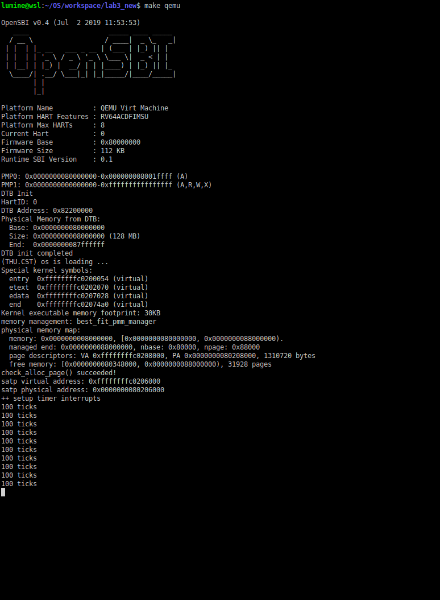
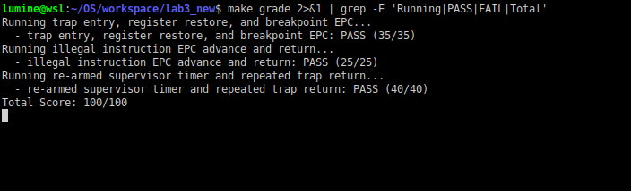

# Lab3 实验报告：中断与异常处理

## 实验基本信息

| 项目 | 内容 |
|---|---|
| 实验名称 | Lab3：中断与异常处理（断，都可以断） |
| 小组成员 | 2412832 王雅枫、2413276 胡楚骅、2412737 罗元伟 |
| 报告整理日期 | 2026-11-03 |
| 提交分支 | `lab3` |
| 当前代码位置 | `lab3_new/` |

### 小组分工

| 成员 | 实现与验证工作 | 报告工作 |
|---|---|---|
| 王雅枫（2412832） | 迁移 `page_init()`，核对新旧内存布局及接口 | 整合报告、整理实验主线和迁移分析 |
| 胡楚骅（2413276） | 迁移 Best-Fit；实现 Trap 入口调用和 `RESTORE_ALL` | 编写模块一说明，保留两轮提示词及当时的验证结果 |
| 罗元伟（2412737） | 实现中断与异常处理，补充关键代码注释，完成整合运行与评分 | 编写模块二说明、提供测试截图和报告初稿 |

各部分先由负责人完成，再通过 Git 的 `lab3` 分支整合。本报告中的最终运行结果采用罗元伟提交的测试记录和截图。

## 一、实验目的

本实验要解决的是：内核被中断或异常打断之后，怎样接管控制权、完成处理，再回到正确的位置执行。

我们重点关注四件事：

1. 区分硬件自动记录的状态和软件仍需保存的寄存器现场。
2. 使汇编入口、`struct trapframe` 与 C 函数的调用约定保持一致。
3. 正确处理断点、非法指令和持续发生的时钟中断。
4. 将 Lab2 的内存管理接入 Lab3，并保留新框架中的中断保护。

完成这些内容后，内核能够识别并处理实验要求的 Trap，保存被打断的现场，并按处理后的返回位置继续执行。

## 二、实验环境

### 2.1 开发与测试环境

开发使用 Windows 下的 WSL。最终整合测试由罗元伟在其 WSL2 Ubuntu 环境完成，版本按其提交记录填写如下：

| 项目 | 最终测试配置 |
|---|---|
| 目标平台 | RISC-V 64 位，QEMU `virt` |
| 交叉编译器 | `riscv64-unknown-elf-gcc 13.2.0` |
| 模拟器 | QEMU 4.1.1 |
| 固件 | OpenSBI v0.4 |
| 物理内存管理器 | `best_fit_pmm_manager` |
| 构建及验证入口 | `make`、`make qemu`、`make grade` |

组员使用的工具链有所差异。模块一早期构建时出现过汇编器不识别旧 CSR 名称 `sbadaddr` 的情况，最终整合环境能够正常编译相关汇编，因此报告分别记录开发时的问题和整合测试的环境。

### 2.2 AI 工具及使用范围

| 成员 | 使用工具 | 模型记录 | 使用范围 |
|---|---|---|---|
| 王雅枫 | Codex | 6.1sol high | 对比 Lab2/Lab3 接口、迁移物理页初始化并检查编译 |
| 胡楚骅 | Codex | 6.1sol high | 分两轮补全 Trap 入口和现场恢复，解释指令与验证结果 |
| 罗元伟 | Claude Code | Claude Opus 5.5 | 模块二实现、代码说明与整合测试 |

生成代码按实际接口、现场布局和返回行为核对。提示词及对应回复集中存放在 [prompt.md](prompt.md)。

## 三、整体设计与执行流程

### 3.1 启动依赖与中断初始化

Lab3 的基础包并没有直接包含我们在 Lab2 中补写的全部功能。`pmm.c` 和 `best_fit_pmm.c` 都留下了迁移位置。因此，开始实现 Trap 时，还需要先恢复可以工作的物理页管理。

这里容易混淆“设置入口”和“允许中断发生”。当前 `kern_init()` 在 `pmm_init()` 前后各调用了一次 `idt_init()`，它们都把 `stvec` 指向 `__alltraps`，并没有打开全局中断。物理内存初始化完成后，`clock_init()` 才设置第一次定时事件和时钟中断源使能，最后由 `intr_enable()` 打开 S 态全局中断开关。

按当前源码，主要顺序是：

```text
清零 BSS → dtb_init() → 控制台初始化 → 输出内核信息
        → idt_init() → pmm_init() → idt_init()
        → clock_init() → intr_enable() → 内核等待循环
```

这一顺序保证了在打开中断之前，Trap 入口、处理函数、恢复路径和物理内存管理都已经准备就绪。

### 3.2 一次 Trap 的完整路径

```text
中断到来，或者当前指令触发异常
  ↓
硬件记录返回位置、原因及相关状态，转入 stvec 指定的入口
  ↓
__alltraps：SAVE_ALL 将通用寄存器和 CSR 字段保存到栈上
  ↓
mv a0, sp；jal trap：把 Trap frame 交给 C 函数
  ↓
trap_dispatch()
  ├─ 中断 → interrupt_handler()
  └─ 异常 → exception_handler()
  ↓
__trapret：RESTORE_ALL 读取处理后的 Trap frame
  ↓
sret：按恢复后的状态和 sepc 返回
```

我们据此划分两个模块的边界：模块一负责让现场完整地进入和离开处理流程；模块二决定遇到具体事件时应做什么。两者之间传递的是同一个 `trapframe`，处理函数对它的合法修改必须在返回时生效。

## 四、实验内容与实现过程

### 4.1 前置任务：迁移 Lab2 的内存管理

#### 4.1.1 物理页初始化迁移

负责人：王雅枫（2412832）。涉及 `kern/mm/pmm.c` 和 `kern/mm/memlayout.h`。

迁移时先对比了两个实验的 `Page` 结构、设备树接口、地址转换宏和初始化调用关系。`get_memory_base()`、`get_memory_size()`、`pa2page()` 和描述符字段仍能沿用，但旧函数使用的两个地址宏没有出现在新框架中，于是依据 Lab3 已有布局补齐：

```c
#define KERNEL_BEGIN_PADDR  (KERNBASE - PHYSICAL_MEMORY_OFFSET)
#define PHYSICAL_MEMORY_END (KERNTOP - PHYSICAL_MEMORY_OFFSET)
```

这两个值由当前映射关系推导，避免再维护一组独立的固定地址。另一个需要保留的变化是：Lab3 在分配、释放和查询空闲页的接口外增加了中断状态保存与恢复。迁移采用补入 `page_init()` 的方式，保留新框架的这些接口。

`page_init()` 的工作可以分为三段：

1. 校验设备树信息，并将管理上界限制在框架可覆盖的范围内，再向下按页对齐。
2. 从当前内核 `end` 之后安排描述符数组，检查所需空间和地址运算，再计算向上按页对齐的空闲起点。
3. 将描述符置为已保留的初始状态，只把元数据之后的完整页面交给 `init_memmap()`。

地址和页号的含义也逐项核对：`pages` 指向描述符数组，数组下标是描述符索引，`nbase` 是 DRAM 起始物理页号，`npage` 是物理页号的排他上界。描述符数量据此按 `npage - nbase` 计算。

迁移后也继续保留溢出、内核覆盖范围、描述符容量和空闲页数量的检查。必须先确认元数据放得下，再开始写描述符；如果此时越界，后面的分配器自检已经无法补救。

#### 4.1.2 Best-Fit 分配器接入

负责人：胡楚骅（2413276）。涉及 `kern/mm/best_fit_pmm.c` 及管理器选择。

迁入的 Best-Fit 使用按地址排列的空闲链表。分配时寻找能够满足请求的最小块，剩余部分重新进入空闲链表；释放时按地址插入，并尝试与前后相邻块合并。最后在 `init_pmm_manager()` 中选择 `best_fit_pmm_manager`。

`page_init()` 只通过统一的 `init_memmap()` 接口注册空闲页面，不需要知道后面采用哪一种分配算法。这也是我们能够分开迁移、最后接入同一个管理器接口的原因。

#### 4.1.3 迁移任务的规格与验证

| 检查项 | 约定 |
|---|---|
| 前置状态 | `dtb_init()` 已执行，当前管理器已初始化，启动映射可用 |
| 正常结束 | `va_pa_offset`、`pages`、`npage` 正确；可用完整页完成注册 |
| 保留区域 | 固件、内核镜像、描述符数组及对齐产生的边界空间不进入空闲区 |
| 错误处理 | 无效范围、运算溢出、容量不足或没有空闲完整页时终止初始化 |
| 框架约束 | 保留新框架的中断保护和原子页标志接口 |

提示词设计以“迁移已有实现并检查新旧依赖”为任务边界，强调动态读取新内核的 `end`，以及保留已有检查。

迁移阶段，`pmm.c` 通过单文件编译检查，完成了与 Lab3 接口的编译衔接。最终整合运行输出 `memory management: best_fit_pmm_manager` 和 `check_alloc_page() succeeded!`，表明内核已选择 Best-Fit，并完成物理页分配与释放自检。

### 4.2 模块一：Trap 入口与上下文恢复

负责人：胡楚骅（2413276）。涉及 `kern/trap/trapentry.S`。

#### 4.2.1 Trap frame 布局

实现恢复宏之前，先对照 `SAVE_ALL` 与 `struct trapframe` 的字段。RV64 下，现场由 36 个 8 字节槽位组成，共 288 字节，当前 `sp` 指向该区域的起点。

| 槽位 | 保存内容 | 恢复时的作用 |
|---|---|---|
| 0～31 | 通用寄存器的对应字段；槽位 2 为原来的 `sp` | 恢复原执行流的整数寄存器现场 |
| 32 | `sstatus` | 为 Trap 返回提供状态 |
| 33 | `sepc` | 决定返回后的指令位置 |
| 34 | `sbadaddr`，即旧命名的 `stval` | 保存诊断信息 |
| 35 | `scause` | 判断事件原因 |

入口先用 `sscratch` 暂存旧 `sp`，再减小 `sp` 分配现场空间。随后读出并清零 `sscratch`，把旧栈指针写入槽位 2。恢复时读取这一槽位，即可取得原来的 `sp`。整个保存过程在当前内核栈上完成。

#### 4.2.2 汇编入口与 C 函数调用

`SAVE_ALL` 之后增加：

```asm
mv a0, sp
jal trap
```

此时 `sp` 正好指向 Trap frame。按 RISC-V 调用约定，`a0` 是第一个参数，`jal` 则建立 C 函数返回到汇编的地址。原执行流的 `a0` 和 `ra` 已经保存，所以这两条指令可以使用它们，而不会丢失被打断的现场。

这一部分的规格没有规定复杂的指令序列，而是约束调用前后的状态：传入的 `tf` 必须等于调用前的 `sp`；C 函数正常返回后，`sp` 仍指向同一个现场，执行流顺接 `__trapret`。

#### 4.2.3 上下文恢复顺序

`RESTORE_ALL` 先把槽位 32、33 读入 `s0`、`s1`，再分别写回 `sstatus` 和 `sepc`。接着恢复通用寄存器，包括刚才作为中转使用的 `s0`、`s1`，最后恢复槽位 2 中的旧 `sp`。

关键实现如下，省略了其他通用寄存器的重复加载指令：

```asm
# 通过临时寄存器恢复返回所需的 CSR
LOAD s0, 32*REGBYTES(sp)
LOAD s1, 33*REGBYTES(sp)
csrw sstatus, s0
csrw sepc, s1

# 此处省略 x1、x3～x7 的恢复
LOAD x8, 8*REGBYTES(sp)    # 恢复 s0 自身保存的值
LOAD x9, 9*REGBYTES(sp)    # 恢复 s1 自身保存的值
# 此处省略 x10～x31 的恢复

LOAD x2, 2*REGBYTES(sp)    # 最后恢复原 sp
```

这里有两个顺序约束：

- `s0`、`s1` 先用作 CSR 的中转，等中转完成后再恢复它们自己的最终值。
- 其余字段都依赖当前 `sp` 定位，因此旧 `sp` 必须最后读取。最后那条 `LOAD x2, 2*REGBYTES(sp)` 仍然用修改前的栈指针计算读取地址。

恢复规格采用 Trap frame 中处理后的最终值：模块二调整 `tf->epc` 后，恢复宏将它直接写回 `sepc`，返回地址的调整集中在异常处理函数中。

`sret` 根据 `SPP` 选择返回特权级，并将 `SPIE` 恢复给 `SIE`，返回位置来自 `sepc`。这些状态变化由指令完成，恢复宏不需要额外打开中断。[RISC-V S 态状态寄存器说明](https://docs.riscv.org/reference/isa/v20260120/priv/supervisor.html#_supervisor_status_sstatus_register)

#### 4.2.4 分步实现与构建问题

模块一分两轮完成：先补 `__alltraps` 的参数传递和调用，再实现 `RESTORE_ALL`。第一轮的 spec 从 `SAVE_ALL` 已完成这一状态出发，将“`trap()` 收到当前现场地址，返回后 `sp` 保持一致”作为调用结果；第二轮则要求读取处理后的现场，并最后恢复旧 `sp`。两轮分别对应入口和返回，便于按各自的状态变化核对实现。

提示词中的 `[RELY]` 给出真实的槽位布局、`trap()` 签名和调用约定，`[GUARANTEE]` 保留 `SAVE_ALL` 与结构体，`[SPECIFICATION]` 再写明上述前后状态。这样，生成代码采用什么指令序列，可以根据它是否满足这些约定来检查。原文与回复见 [prompt.md](prompt.md)。

构建检查分出了两个需要继续处理的问题：

| 检查入口 | 当时出现的问题 | 后续处理 |
|---|---|---|
| `make`、`make qemu` | `trap.c` 中两个处理函数尚未声明和实现 | 接入模块二的 `interrupt_handler()` 和 `exception_handler()` |
| 单独构建 `trapentry.o` | 汇编器报 `unknown CSR 'sbadaddr'` | 核对工具链对旧 CSR 名称的支持，在最终整合环境完成构建 |

接口分步补齐后，评分用例设置寄存器初值、触发断点，再比较返回后的值，检查入口和恢复代码是否配合正确。

### 4.3 模块二：中断与异常处理

负责人：罗元伟（2412737）。涉及 `kern/trap/trap.c`。

```c
void interrupt_handler(struct trapframe *tf);
void exception_handler(struct trapframe *tf);
static size_t trap_insn_len(uintptr_t epc);
```

#### 4.3.1 中断编号与函数规格

已有 `trap_dispatch()` 将 `cause` 转成有符号整数，通过最高位区分中断和异常。进入 `interrupt_handler()` 后，仍需去掉表示中断的最高位，再按 `IRQ_*` 编号处理。源码中的表达式为：

```c
intptr_t cause = (tf->cause << 1) >> 1;
```

`tf->cause` 的类型是无符号的 `uintptr_t`，因此这里先进行无符号移位、清除最高位，再把结果交给 `cause`。移位的行为由参与表达式的字段类型决定。

我们将两类处理的规格整理为：

| 处理入口 | 前置状态 | 返回前应满足的状态 |
|---|---|---|
| `interrupt_handler()` | `tf` 指向已保存的现场，中断类型已经由分派函数确认 | 按类型处理；时钟事件重新安排、计数正确；不因普通时钟中断而推进 `epc` |
| `exception_handler()` | `tf->cause` 为异常编号，目标指令位于本实验可读的内核地址范围 | 对断点和非法指令输出信息并跳过对应指令；其他异常输出现场 |
| `trap_insn_len()` | `epc` 处的指令半字可读取 | 对本实验出现的 16 位、32 位指令返回对应长度 |

整理模块二 spec 时，将输入分成时钟中断、其他中断、断点与非法指令、其他异常四类，分别写出应有的输出和状态变化。时钟分支需要更新下一次事件和计数，异常分支需要调整返回地址；这些后置条件也就成为核对各个分支的依据。对于正常返回的中断处理，保留 Trap frame 中的返回位置；对于要求跳过的异常，处理后 `epc` 应指向下一条指令。

对应的四段式提示词将 `clock_set_next_event()`、`ticks`、异常编号和 SBI 接口放入 `[RELY]`，将两个处理函数的签名及已有 Trap 通路列为接口约束，再在 `[SPECIFICATION]` 中逐类说明行为。这里特别写入“每次重设时钟事件”和“按实际长度推进 `epc`”，因为它们直接影响后续是否还能收到中断，以及异常后能否继续执行。完整设计与各轮记录见 [prompt.md](prompt.md)。

#### 4.3.2 时钟中断的重设与计数

检查 `clock_init()` 和 `clock_set_next_event()` 后，可以看到 `sbi_set_timer()` 接收的是一个到期时刻：当前 `time` 加上 `timebase`。持续中断需要在每次处理时重新提交下一次到期值。

因此，中断处理中的顺序是：

```c
clock_set_next_event();
if (++ticks % TICK_NUM == 0) {
    print_ticks();
    if (++num_prints == SHUTDOWN_AFTER) {
        sbi_shutdown();
    }
}
```

每次中断先设置下一次的未来到期时刻，形成持续的定时事件，再让 `ticks` 增加一次。这样，下一次触发时刻和当前中断的计数都在同一轮处理中完成。

本环境的 `time` 计数器频率为 10 MHz，`timebase` 为 100000，因此目标间隔约为 10 ms，每 100 次中断打印一行，约每秒输出一次。这里通过 `rdtime` 读取时间计数器，实际输出间隔还包含中断处理和模拟器运行带来的延迟。

实现采用 `SHUTDOWN_AFTER = 10`，累计输出十次，也就是处理 1000 次时钟中断后请求关机。评分用例在 `ticks` 达到 200 后输出通过标记，早于关机阈值。

`ticks` 声明为 `volatile size_t`，主流程轮询时会重新读取该变量，从而观察到中断处理函数更新后的计数。本实验在单核环境中由时钟中断处理函数逐次更新它。

#### 4.3.3 异常处理与返回地址调整

非法指令和断点异常中，处理函数调整的是 `tf->epc`，之后由模块一写回 `sepc`。两个函数不需要各自执行 `sret`。本实验选择在输出信息后跳过触发异常的指令，因此若不修改地址，返回后会再次触发同一异常。

返回地址的推进量根据指令长度确定，辅助函数先读取 `epc` 处的低 16 位：

```c
static size_t trap_insn_len(uintptr_t epc) {
    uint16_t low = *(const uint16_t *)epc;
    return ((low & 0x3) == 0x3) ? 4 : 2;
}
```

该函数用于本实验的 16 位和 32 位指令，读取位置为可读的内核代码地址。先读取 16 位，可与压缩指令的 2 字节对齐条件保持一致，再根据低位编码选择推进 2 或 4 字节。

其他异常调用 `print_trapframe()`，输出通用寄存器、状态、返回地址和原因等字段，供定位异常时使用，并保留原 `epc`。

#### 4.3.4 编码核对与处理结果检查

模块二的核对过程详见 [模块二实现说明_lyw.md](模块二实现说明_lyw.md) 中的反汇编和运行记录。

**指令长度与返回位置。** 评测内核中两条异常指令的编码如下：

```text
ffffffffc0201b50: 9002        ebreak
ffffffffc0201b00: 0000007b    .word 0x0000007b
```

第一条编码为 2 字节的 `c.ebreak`，第二条为 4 字节非法指令。按这些编码计算，处理后的 `epc` 分别应为 `0xffffffffc0201b52` 和 `0xffffffffc0201b04`。这一步把“根据指令长度返回”落实到了两个具体地址，也确定了辅助函数需要同时处理 2 字节和 4 字节两种情况。

读取长度时采用 16 位半字，与压缩指令的对齐要求一致；长度判断直接读取 `epc` 处的指令编码。`badvaddr` 用于保留异常诊断信息，非法指令异常时该字段可能为零，因此采用指令编码作为本实验长度判断的依据。

**原因分类与现场输出。** 随后检查构造的 Trap frame 能否进入对应分支。评分中使用了下面三组输入：

| 构造的原因 | 对应检查 |
|---|---|
| `IRQ_S_SOFT` 加中断标志位 | 输出 `Supervisor software interrupt` |
| 未知中断编号 `15` | 输出 `Unknown interrupt: cause 15`，随后打印现场 |
| 其他异常编号 `20` | 现场中的 `cause` 输出为 `0x00000014` |

成员记录中的实际输出包含：

```text
Exception type: Illegal instruction
Illegal instruction at 0xffffffffc0201b00
Supervisor software interrupt
Unknown interrupt: cause 15
```

这些输出与输入原因对应，说明分类和兜底分支均按预期执行。非法指令处理后的通过标记，以及断点返回后的寄存器比较结果，在第五节统一汇总。

#### 4.3.5 生成注释的核对与修正

提交前检查新增中文注释时，发现 `SHUTDOWN_AFTER` 的说明最初写成了“按指导书要求取 10”。对照指导书，要求是累计输出达到规定次数后关机，框架中也没有给出该宏的定义和取值。

随后将注释修改为“框架和指导书都没有给出具体数值，这里取 10”，保留原来的计数和关机逻辑，并重新编译通过。对应问题和修正记录保存在 `prompt.md` 的模块二部分。

## 五、测试与验证

### 5.1 测试环境与方法

最终整合测试由罗元伟完成，以下结果采用提交的运行记录和原始截图。

实际入口为：

```bash
make
make qemu
make grade
```

整合运行时，成员记录了系统 QEMU 8.2.2 搭配默认固件时没有出现内核启动输出的现象。核对 `tools/grade.sh` 后，确认评分程序直接从 `PATH` 查找 `qemu-system-riscv64`。于是将 QEMU 4.1.1 所在目录放到 `PATH` 最前，再运行正常启动和评分，得到下文结果。最终测试固定使用 QEMU 4.1.1 与 OpenSBI v0.4。

### 5.2 内核运行结果

运行截图中可以依次看到设备树提供的 128 MiB 内存、当前 Best-Fit 管理器、物理页分配自检通过、时钟初始化，以及连续十行 `100 ticks`。

截图中的空闲区为 `[0x80348000, 0x88000000)`，页面数为：

```text
(0x88000000 - 0x80348000) / 0x1000 = 31928
```

计算结果与输出中的 31928 页一致，表明空闲区起止地址与页面数量相互对应。初始化代码根据当前内核的 `end` 和描述符数组大小动态计算这些值，随内核布局调整空闲区域。



运行中连续输出十行 `100 ticks`，对应累计处理 1000 次时钟中断。达到 `SHUTDOWN_AFTER` 后，内核调用 `sbi_shutdown()` 退出，与成员记录的运行结果一致。

### 5.3 自动评分结果

评分会在临时副本中注入测试，并分别构建三个用例。注入过程不改原目录中的 `init.c`，因此正常启动内核和评分内核的行为有所不同。

| 用例 | 实际检查内容 | 结果 |
|---|---|---:|
| Trap 入口、寄存器恢复与断点返回 | 将多组整数寄存器设为已知值，触发断点，返回后逐项比较；检查断点输出 | 35/35 |
| 非法指令返回与兜底处理 | 执行 `.word 0x0000007b` 后继续运行，并检查软件中断、未知中断和其他异常的输出 | 25/25 |
| 持续 S 态时钟中断 | 等待 `ticks` 达到 200，检查统计输出和通过标记 | 40/40 |
| 合计 | 三个用例均通过 | **100/100** |

断点与非法指令用例在异常处理后继续执行，时钟用例在累计到 200 次中断后输出通过标记，分别对应寄存器恢复、异常返回和持续定时三个行为。



正常启动与自动评分两组结果共同展示了内存初始化、Trap 进入与返回、异常处理及持续时钟中断的整合运行情况。

## 六、总结与收获

### 6.1 实验认识

本次分工中，两个模块通过 Trap frame 衔接。模块一保证现场的布局和恢复顺序，模块二通过修改字段表达处理结果。整合时共同核对的重点是参数地址、字段含义和返回状态。明确这些约定后，两部分可以分别实现，再用同一组运行结果检查配合情况。

异常返回也体现了不同的处理策略：本实验的断点与非法指令选择跳过原指令；后续若实现可恢复的缺页异常，处理完成后则通常要重试原指令。保存同一份现场，可以服务于不同的恢复策略，返回地址应由具体处理逻辑决定。

### 6.2 与操作系统原理的联系和区别

| 原理中的概念 | 本实验中的对应 | 本实验尚未覆盖的部分 |
|---|---|---|
| 中断向量与事件分派 | `stvec` 指向统一入口，C 层根据原因分派 | 完整的外部设备和中断控制器处理 |
| 上下文保存与恢复 | Trap frame、汇编保存与恢复、`sret` | PCB、就绪队列和切换到另一个进程 |
| 时钟与分时调度 | 定时事件和 `ticks` 计数 | 时间片管理、调度算法和抢占式进程切换 |
| 临界区保护 | 分配器接口保存中断状态、关闭本核可屏蔽中断，再恢复旧状态 | 多核互斥和完整的锁设计 |
| 异常恢复 | 对本实验要求的异常调整返回位置 | 请求调页、页面置换及一般错误恢复 |
| 用户态请求内核服务 | 当前框架为后续工作提供入口基础 | 用户栈到内核栈切换、系统调用分派及返回值约定 |

#### 上下文保存与进程切换

上下文是一个执行流继续运行所需的状态，包括寄存器值、指令位置和栈等。实验中的 Trap frame 将整数寄存器和必要的 CSR 字段组织成一份现场，处理结束后据此恢复被打断的执行流。进程切换也依赖保存和恢复状态，但还需要调度器选择另一个进程，并恢复它保存的上下文。因此，本实验把现场管理落实到了寄存器和栈的具体布局，进程管理则在此基础上增加执行流的选择与切换。

#### 时钟中断与时间片调度

分时调度需要定期获得控制权，以统计进程运行时间并判断是否耗尽时间片。实验通过重设定时事件让内核周期性进入处理函数，`ticks` 则记录已经处理的节拍。当前每到 100 个节拍进行一次输出；在时间片调度中，可以在相同的时钟入口更新剩余时间片，达到条件后进入调度流程。两者共享周期事件这一基础，而调度还涉及进程状态、就绪队列和选择策略。

#### 中断屏蔽与临界区互斥

临界区是需要保持共享数据一致性的一段操作。修改空闲链表时，链表指针和空闲页计数需要配合更新。Lab3 在分配器接口外保存本核中断状态，关闭可屏蔽中断，完成操作后再恢复旧状态，使这段更新保持连续。保存旧状态还保证了：如果调用前中断已经关闭，返回时仍保持关闭。

这种保护针对本核的中断执行流。在多核系统中，共享链表还可能被其他核访问，需要用锁等机制协调核之间的操作。这也说明了中断屏蔽与互斥锁的作用范围：前者控制本核何时接收中断，后者协调多个执行主体对共享资源的访问。

### 6.3 提示词设计与代码核对

四段式提示词用于先确定任务和验收条件：在 `[PROMPT]` 中限定本轮修改位置，在 `[RELY]` 中列明现场布局和接口，在 `[GUARANTEE]` 中保留已有框架，在 `[SPECIFICATION]` 中说明处理前后的状态。模块一分两轮给出这些约束，便于逐次核对新增指令。

核对时采用具体对象：`mv a0, sp` 对应调用参数，保存槽位对应恢复偏移，反汇编编码对应 `epc` 的推进量，测试输出对应处理分支。这样，提示词中的要求能落实到源码和运行结果上。各轮输入及回复放在专门的提示词文档中，报告保留实现分析和问题处理过程。

## 参考资料

- [Lab3 实验目的](http://oslab.mobisys.top/lab2026/_book/lab3/lab3_1_goals.html)
- [Lab3 练习要求](http://oslab.mobisys.top/lab2026/_book/lab3/lab3_2_1_exercise.html)
- [Lab3 实验报告要求](http://oslab.mobisys.top/lab2026/_book/lab3/lab3_4_lab_requirement.html)
- 当前仓库的 `kern/trap/trapentry.S`、`kern/trap/trap.c`、`kern/trap/trap.h`、`kern/driver/clock.c`、`kern/mm/pmm.c` 和 `tools/test_lab3*`，均位于 `lab3_new/` 下。
