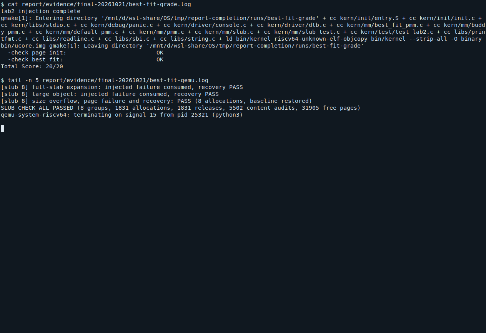
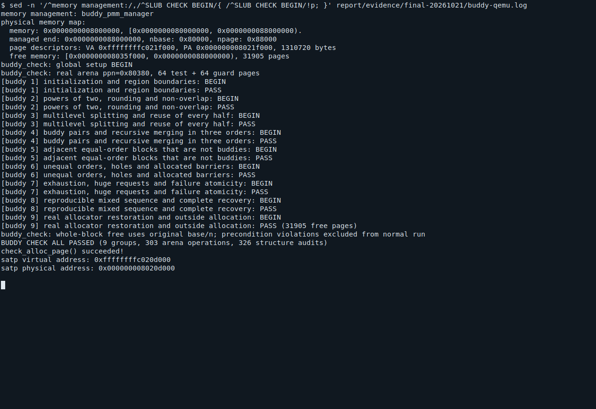
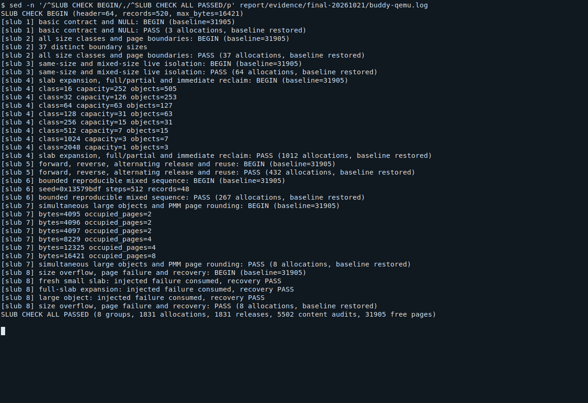
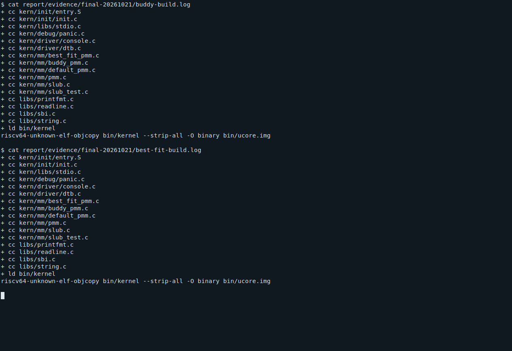

# 操作系统实验报告

## 实验基本信息

| 项目 | 内容 |
|------|------|
| **实验名称** | Lab2：物理内存管理 |
| **小组成员** | 2412832-王雅枫、2413276-胡楚骅、2412737-罗元伟 |
| **完成日期** | 2026-10-22 |

### 小组分工

| 成员 | 负责的练习/模块 |
|------|----------------|
| 2412832-王雅枫 | 模块一：`page_init()`，物理内存布局与初始化；对应 Challenge；分支任务：GDB 调试页表查询过程 |
| 2413276-胡楚骅 | 模块二前两项：First-Fit 分析、Best-Fit 实现；实验报告整合 |
| 2412737-罗元伟 | 模块二第三项：Buddy 及对应扩展任务 Challenge |

王雅枫负责模块一的设计、实现、测试、提示词与证据收集，以及对应 Challenge 和分支任务的报告撰写；胡楚骅负责 First-Fit 与 Best-Fit 的算法分析、代码说明及测试，并承担实验报告的统稿整合；罗元伟负责 Buddy 与扩展任务 SLUB 的代码实现、提示词设计、测试验证与报告撰写。

本实验源码位于 `lab2_new/`，报告、提示词记录、运行截图和测试证据统一存放在 `report/` 目录下。

## 一、实验目的

1. 掌握操作系统对物理内存的管理机制，理解如何根据 DTB 提供的硬件信息初始化页描述符、保留已占用内存，并将可用物理页交付给分配器。
2. 理解页表的建立与使用，明确虚拟地址、物理地址、物理页号与 `struct Page` 页描述符之间的转换关系，掌握内核启动初期的页表映射布局。
3. 掌握连续物理页分配算法，分析 First-Fit 的实现逻辑，动手实现并接入 Best-Fit 和 Buddy 分配器，理解空闲块的分配、拆分、回收与合并过程，对比不同策略下的碎片问题。
4. 通过选做的 SLUB 扩展任务，理解页级分配器与内核对象分配器的层次关系，掌握在物理页基础上管理任意大小内存对象的方法。
5. 使用 GDB 跟踪调试 QEMU 的地址翻译流程，实地观察软件 TLB 查询与多级页表遍历，深入理解 Sv39 模式下虚拟地址到物理地址的转换细节。
6. 结合功能需求与接口约束编写结构化提示词，探索利用 AI 辅助完成内核模块开发、测试设计与问题排查的协作流程，并通过严格的测试验证生成代码的可靠性。

## 二、实验环境

| 成员 | AI 编程工具 | 底层模型 | 备注 |
|------|------------|---------|------|
| 2412832-王雅枫 | Codex | GPT 6.1 Sol | |
| 2413276-胡楚骅 | ChatGPT、Codex（VS Code 插件） | GPT 6.1 Sol | |
| 2412737-罗元伟 | Codex（VS Code 插件）、Claude（VS Code 插件） | GPT 6.1 Sol、Opus 5.5 | |

---

## 三、实验整体逻辑分析

### 3.1 实验主线

在 Lab1 完成内核启动和基本输出的基础上，Lab2 重点解决物理内存的探测与动态管理问题。内核启动后首先需要探明可用物理内存的边界，利用 `struct Page` 页描述符数组记录每一页的状态，将固件、内核代码段及页描述符自身占用的内存标记为保留，最后把剩余的完整空闲物理页转交给物理内存分配器。

围绕物理页的分配与回收，实验依次探讨了多种管理策略：通过阅读 First-Fit 源码掌握空闲链表的基本维护，通过实现 Best-Fit 和 Buddy 对比不同选块与合并策略对外部碎片和内部碎片的影响，再通过选做的 SLUB 分配器在页分配器之上构建出细粒度的内核对象管理机制。此外，通过 GDB 跟踪启动页表与 QEMU 的地址翻译过程，将内核虚拟地址的访存路径与底层物理内存管理串联起来，形成完整的内存子系统视图。

### 3.2 实现步骤

1. **物理内存探测与初始化。** 解析 DTB 获取物理内存范围，计算页描述符数组的存放位置并完成初始化，扣留固件、内核镜像及描述符数组占用的物理页，将剩余的可用物理页交付给分配器管理。只有先确定可分配页的范围和初始状态，后续分配器才能安全使用这些资源。
2. **分析 First-Fit 并实现 Best-Fit。** 阅读默认的 First-Fit 代码，理清空闲块的双向链表组织、拆分与前后合并逻辑；随后在相同的 `pmm_manager` 接口下实现 Best-Fit 算法，对比两种线性链表策略在选块逻辑上的差异。先理解现有分配流程，再修改选块策略，可以集中比较算法差异，保留相同的接口和状态约定。
3. **实现 Buddy 伙伴分配器并设计自检测试。** 采用按阶（$2^k$ 页）分组的空闲链表组织物理页，利用物理页号异或运算实现快速伙伴定位、逐级拆分与递归合并，并针对未对齐边界、非二次幂请求及碎片的合并恢复编写自检用例。在连续页分配的基础上，进一步理解按阶管理及其拆分、合并规则。
4. **基于页分配器实现 SLUB 对象分配器。** 在底层按页分配的接口之上，设计固定尺寸类别（Size Classes）的 slab 缓存与大对象直接分配路径，实现按字节粒度的内核内存申请与释放。SLUB 依赖可用的页分配接口，因此在页分配器完成后实现。
5. **使用 GDB 调试页表查询与 TLB 机制。** 内核在进入 C 代码前已由 `entry.S` 启用 Sv39 大页映射。通过双 GDB 联调 QEMU 与 ucore，单步跟踪虚拟地址经过软件 TLB 查询、多级页表遍历最终转化为物理地址的全过程。该调试可与分配器实现分别开展，用于将分页原理与实际访存过程对应起来。

## 四、实验内容与实现

### 4.1 功能模块一：物理内存初始化

**负责人：** 2412832-王雅枫

**修改文件：** [kern/mm/pmm.c](../lab2_new/kern/mm/pmm.c)。核心函数：

```c
static void page_init(void);
```

#### 4.1.1 地址和页描述符的含义

| 对象 | 含义 | 当前框架的关系 |
|---|---|---|
| VA | 内核使用的虚拟地址 | 直接映射区内 `VA = PA + va_pa_offset` |
| PA | 物理字节地址 | `PADDR(VA)` 从内核直接映射地址减去偏移 |
| PPN | 绝对物理页号 | $\text{PA} \gg \text{PGSHIFT}$ |
| `nbase` | DRAM 起始页号 | $0\text{x}80000000 / 4096 = 0\text{x}80000$ |
| `npage` | 管理结束位置的绝对页号，不包含该页 | 默认 $128\text{ MiB}$ 时为 $0\text{x}88000$ |
| `pages` | 页描述符数组的内核虚拟地址 | 描述符数量是 $\text{npage} - \text{nbase}$ |
| `pages[i]` | 第 $i$ 个描述符 | 对应 PA $(\text{nbase} + i) \times \text{PGSIZE}$ |

需要注意的是，`npage` 是物理页号的上界而非描述符总数；`struct Page *` 指向的是管理元数据本身，不能直接当作所描述物理页的起始地址使用。

#### 4.1.2 行为规格

| 类别 | 约束 |
|---|---|
| 前置条件 | 启动页表和内核栈已就绪，DTB 已完成解析，当前分配器的 `init()` 已调用；采用单段连续 RAM 与固定内核映射布局 |
| 成功后置条件 | 虚拟物理偏移、页号上界、描述符数组地址设置正确；全部描述符先初始化为保留状态；仅将元数据末尾之后的完整空闲页交付给分配器 |
| 错误处理 | DTB 信息无效、地址范围计算溢出、RAM 无法容纳内核或描述符数组、扣除后无完整空闲页时，直接触发 `panic` |
| 接口约束 | 调用 `init_memmap(base, n)` 时保证 $n > 0$；传入的描述符范围有效，且交付前每一页均处于保留状态 |
| 不变量 | 先完成容量与边界检查再写入描述符数组；不释放内核和元数据占用的物理页；动态使用 `sizeof(struct Page)` 计算大小 |

#### 4.1.3 布局计算与实现顺序

设 DTB 报告的内存起点为 $B$、大小为 $S$，页大小 $P = \text{PGSIZE}$：

```text
raw_end          = B + S                  （先检查加法溢出）
managed_end      = ROUNDDOWN(min(raw_end, PHYSICAL_MEMORY_END), P)
descriptor_count = PPN(managed_end) - nbase
pages_va         = ROUNDUP(end, P)
pages_pa         = PADDR(pages_va)
descriptor_bytes = descriptor_count * sizeof(struct Page)
metadata_end     = pages_pa + descriptor_bytes
free_begin       = ROUNDUP(metadata_end, P)
free_count       = (managed_end - free_begin) / P
```

所有内存区间均采用**左闭右开**表示法，结束地址不包含在区间内。

具体实现分为以下六步：

1. **读取并校验 RAM 范围。** 先设置 `va_pa_offset` 再使用 `PADDR` 宏；若起点或大小为零，或者起点加大小发生无符号溢出，立即触发 `panic`。
2. **确定管理上界。** 将管理末尾限制在框架上限 `0x88000000` 以内，并向下按页对齐。同时检查该范围能否完整覆盖内核起始地址与链接符号 `end`。
3. **安置页描述符数组。** 将 `pages` 数组放在内核结束符号 `end` 之后的首个页对齐位置，使用 `sizeof(struct Page)` 计算总字节数。
4. **先检查容量，后写入内存。** 在对齐和乘法运算前检查溢出风险，确认扣除描述符占用后至少还剩一页完整空闲内存，随后再开始初始化描述符数组。
5. **全部标记为保留。** 遍历描述符数组，清零引用计数、标志位和 `property` 字段，初始化链表节点，并统一设置 `PG_reserved` 标志，防止已用内存被误分配。
6. **交付完整空闲页。** 将描述符数组的结束地址向上按页对齐得到 `free_begin`，调用 `init_memmap(pa2page(free_begin), free_count)` 将剩余物理页移交分配器，由分配器清除这些页的保留位并建立空闲链表。

物理内存的整体划分如下图所示（描述符数组覆盖整个管理范围，其自身也存放在这段 RAM 中）：

```text
0x80000000          0x80200000        pages_pa          free_begin        managed_end
    | 固件预留区域       | 内核、栈、页表等 | 页描述符及对齐尾部 | 可分配完整页       |
    +------------------+----------------+------------------+------------------+
    |<-------------------- 保留 -------------------------->|<---- 空闲 ------>|
```

注：前 $2\text{ MiB}$ 是实验框架约定的固定预留区间；当前 QEMU 环境下 OpenSBI 固件实际报告自身占用为 $112\text{ KiB}$。

#### 4.1.4 页对齐方向的选择与开销分析

在计算边界时，`managed_end` 采用向下页对齐，是因为末尾不足一页的零头无法作为完整物理页分配；而 `free_begin` 采用向上页对齐，是因为只要某个物理页内还存有半截页描述符，该页就不能开放给分配器写入。一处向下、一处向上，分别避免了越界分配和破坏管理元数据。

页描述符初始化仅在系统启动时执行一次，时间复杂度和空间复杂度均为 $O(\text{npage} - \text{nbase})$。在当前 RV64 构建下，`sizeof(struct Page)` 为 $40$ 字节，默认 $128\text{ MiB}$ 内存共需 $32768$ 个描述符，占用 $1310720$ 字节。

#### 4.1.5 提示词设计

以下为根据实际开发与复核过程整理出的结构化提示词，原始对话记录保存在 [prompt.md](prompt.md#raw-inputs) 中。

```text
[PROMPT]
任务：完成 Lab2 模块一 static void page_init(void)，为后续分配算法建立可靠基础。
功能目标：依据 DTB 计算可管理 RAM，安置并初始化 Page 数组，登记完整空闲页。
修改范围：kern/mm/pmm.c；辅助验证工具放 tools，报告与证据放仓库根目录 report。
操作要求：先核对地址转换与分配器接口；显式处理边界；保留官方测试与代码标记。
验收方式：正常 RAM、不同容量、非页对齐、容量不足和溢出检查；GDB 核对交付前后状态。

[RELY]
已有 DTB getter、PADDR/PPN/pa2page、链接符号 end、PGSIZE、struct Page 与 pmm_manager。
启动映射已建立，DTB 已解析，分配器 init 已执行；当前采用单段 RAM 与固定内核映射。

[GUARANTEE]
先验证布局容量再写数组；保留固件预留区、内核和元数据页；不向 init_memmap 传零页。
采用实际 sizeof(struct Page)；区分 VA/PA/PPN/描述符指针；保持分配器接口及官方测试。
仅在临时副本隔离未完成的队友代码；结果与日志必须来自真实运行。

[SPECIFICATION]
对象：static void page_init(void)
Pre-Condition：上述启动、DTB、分配器前置条件成立。
Post-Condition：offset、npage、pages 正确，全部描述符先保留，仅开放完整空闲页。
Case 1：有效且足够的 RAM，按框架上限和页边界初始化并打印布局。
Case 2：无效 DTB、溢出、容量不足或没有完整空闲页，明确 panic，禁止错误交付。
Requirements：不覆盖已用页，验证前后核对源文件哈希；保留 lab2 function1 标记，将 YOUR CODE 替换为负责人学号 2412832。
```

#### 4.1.6 实现与测试迭代过程

| 阶段 | 实际工作 | 发现与处理 |
|---|---|---|
| 初次实现 | 完成内存布局计算、描述符初始化和边界检查；搭建七组隔离验证用例 | 验证脚本直接读写 Windows 挂载目录下的活动日志时触发 `Errno 61`，改为在 Linux 本地临时目录运行并轮询，待进程结束后再拷回日志；七组用例全部通过 |
| 对齐复核 | 新增 `ram64-unaligned` 用例，将 DTB 报告的 RAM 大小减去 1 字节 | 八组用例全部通过；补充了关于 `npage` 与地址偏移的注释说明，函数逻辑无需改动 |
| 接口与证据复核 | 增加 `init_memmap` 交付前的逐页状态检查、元数据容量不足用例及源码哈希比对 | 九组用例全部通过；通过在副本中故意注释掉链表初始化来测试检查器，检查器成功捕获异常并输出 FAIL（见[自检记录](evidence/module1/checker-selftest.json)） |
| 联调与归档 | 使用 GDB 单步核对交付前后的内存状态，重跑全部九组测试并截取终端画面 | GDB 检查与自动测试全部通过，原工程源码未被测试脚本污染 |

<a id="module1-challenge"></a>

#### 4.1.7 模块一 Challenge：硬件可用物理内存范围的获取方法（思考题）

**负责人：** 2412832-王雅枫

**题目要求：** 当操作系统无法提前写死目标机器的物理内存范围时，如何在启动阶段动态获取可用物理内存区间？（参考[课程模块一要求](http://oslab.mobisys.top/lab2026/_book/lab2/lab2_2_1_exercise.html)）

**分析与解答：** 操作系统在启动时应当通过硬件平台的启动协议，接收由固件（Firmware）或引导程序（Bootloader）传递的物理内存布局描述。不同架构与固件环境下的主流获取方式对比如下：

| 方法 | 获取的信息内容 | 适用环境与注意事项 |
|---|---|---|
| 设备树（DTB） | `/memory` 节点的 `reg` 属性记录一段或多段 RAM 的起始地址与长度；需结合保留内存节点排除不可用区域 | RISC-V 与嵌入式 Linux 常用（本实验采用此方式）。解析时需遵守 `#address-cells` 和 `#size-cells` 规范，不能写死为单段 64 位整数 |
| UEFI 内存映射 | 引导阶段调用 Boot Services 的 `GetMemoryMap()` 获取带类型的内存描述符数组并传给内核 | 支持 UEFI 的现代平台。需严格遵循 `ExitBootServices()` 的调用时序，按描述符类型区分可用 RAM、ACPI 表与运行时保留区 |
| BIOS E820 | 实模式下通过 `INT 15h, AX=E820h` 中断逐条查询物理地址区间及其可用状态 | 传统 x86 PC BIOS 环境。仅限在进入保护模式/长模式前的引导阶段调用，不适用于当前 RISC-V 环境 |
| 平台专用寄存器 | 在掌握芯片手册的前提下，直接读取内存控制器（DRAM Controller）配置与 SoC 地址映射表 | 强依赖具体 SoC 硬件。即便读出总容量，仍需配合固件预留信息和外设空洞分布才能算出安全的可分配区间 |

相关规范定义可参考 [Devicetree 节点规范](https://devicetree-specification.readthedocs.io/en/latest/chapter3-devicenodes.html#memory-node)、[UEFI 内存分配服务](https://uefi.org/specs/UEFI/2.10/07_Services_Boot_Services.html#memory-allocation-services) 以及 [ACPI E820 接口说明](https://uefi.org/specs/ACPI/6.6/15_System_Address_Map_Interfaces.html#int-15h-e820h-query-system-address-map)。

**本实验的代码路径：** 在 ucore 启动时，`entry.S` 将 OpenSBI 通过 `a1` 寄存器传入的 DTB 物理地址保存下来；随后 `dtb_init()` 解析设备树，提取出 RAM 的起始地址和大小；`page_init()` 再通过 `get_memory_base()` 和 `get_memory_size()` 获取这两个值并计算管理边界。当修改 QEMU 的 `-m` 参数时，DTB 内容随之改变，内核无需重新编译即可适应新的内存大小（受限于框架宏 `PHYSICAL_MEMORY_END` 以及当前简化解析器仅读取首段内存的实现）。

**从“获取到 RAM 区间”到“交付给页分配器”的完整处理流程：**

```text
获取固件提供的原始内存区间列表
  → 校验零长度、整数溢出、区间重叠，并按内核支持的最大物理地址截断
  → 筛选出类型为可用 RAM 的区间
  → 挖去固件驻留区、内核代码与数据段、启动栈、初始页表、页描述符数组以及尚未解析完的 DTB 自身
  → 将剩余的每一段可用区间起点向上页对齐、终点向下页对齐
  → 逐段调用 init_memmap 交付给物理页分配器，严禁跨越中间的保留空洞将不同区间强行连成一整块
```

在标准设备树规范中，除了 `/memory` 节点外，还需要解析 `/reserved-memory` 节点与文件头部的 Memory Reservation Block（参考 [DTB 保留块规范](https://devicetree-specification.readthedocs.io/en/v0.2/flattened-format.html#memory-reservation-block)）。例如，若可用 RAM 为 `[0x80000000, 0x88000000)`，扣除内核与描述符后起点为 `free_begin`，而中间 `[0x84000000, 0x84200000)` 被标记为保留空洞，则初始化代码应当将 `[free_begin, 0x84000000)` 和 `[0x84200000, 0x88000000)` 作为两段独立的连续区域分别调用 `init_memmap`，同时让空洞对应的页描述符继续保持 `PG_reserved` 状态。

**补充讨论：能否通过 `satp` 页表或直接读写内存来探测容量？**
- **不能通过 `satp` 或页表反推。** 页表仅定义虚拟地址到物理地址的映射关系与访问权限，并不代表目标物理地址上真的插有内存条。例如本实验 `entry.S` 使用一个根页表大页项直接映射了 $1\text{ GiB}$ 地址空间，但默认物理内存只有 $128\text{ MiB}$。
- **不能在未知地址空间中盲目使用读写试探（Memory Probing）。** 对未知的物理地址执行写操作，极易误触外设的 MMIO 寄存器导致硬件状态错乱，或者覆盖正在运行的固件与内核数据，也可能触发总线访问异常（Load/Store Access Fault）或遇到地址回绕（Address Aliasing）。因此，应优先采用固件、引导程序或明确的板级配置提供的内存信息，读写探测仅适用于范围和恢复机制明确的平台。

### 4.2 功能模块二：物理内存分配

#### 4.2.1 任务一：First-Fit 分析

**负责人：** 2413276-胡楚骅

**（1）空闲页初始化**

First-Fit 分配器首先在 `default_init()` 中初始化空闲块双向循环链表 `free_list`，并将空闲页总数 `nr_free` 置零。

当 `page_init()` 调用 `default_init_memmap(base, n)` 交付一段连续物理页时，函数先断言 $n > 0$，随后遍历这 $n$ 个页描述符：确认每一页原先处于保留状态，清除其标志位与 `property` 字段，并将引用计数清零。接着，将起始页 `base` 的 `property` 设为 $n$ 并打上 `PG_property` 标志，表示这是一个包含 $n$ 页的空闲块首页，同时将 `nr_free` 增加 $n$。最后，按照物理地址递增的顺序，将 `base->page_link` 插入到 `free_list` 的对应位置。

**（2）分配连续物理页**

`default_alloc_pages(n)` 首先断言 $n > 0$；若申请页数 `n > nr_free`，直接返回 `NULL`。随后从 `free_list` 表头开始顺序遍历各空闲块首页，寻找第一个满足 `page->property >= n` 的块。

找到目标块后，先将其从链表中取下。若该块页数大于 $n$，则发生拆分：将跳过前 $n$ 页后的新起点 `page + n` 设为剩余空闲块的首页，写入剩余页数 `page->property - n` 并设置 `PG_property` 标志，再插回原链表位置。最后，将 `nr_free` 减去 $n$，清除所分配块首页 `page` 的 `PG_property` 标志并返回 `page`。若遍历完整个链表仍未找到足够大的块，则返回 `NULL`。

**（3）回收页面与合并相邻空闲块**

`default_free_pages(base, n)` 首先断言 $n > 0$，并逐页检查归还区间内的页面既不是保留页，也不是已处于空闲链表中的块首页。随后重置这 $n$ 页的标志位与引用计数，将首页 `base` 的 `property` 设为 $n$、置上 `PG_property` 标志，并将 `nr_free` 增加 $n$。接着按地址递增顺序将 `base` 插入 `free_list`。

插入完成后，立即检查与前后相邻空闲块的合并条件：
- **向前合并：** 检查链表中的前驱节点 `p`。若 `p + p->property == base`，说明前一个空闲块与当前块在物理上紧挨着。此时将 `base->property` 累加到 `p->property` 上，清除 `base` 的 `PG_property` 标志并从链表中删除 `base`，最后令 `base = p`。
- **向后合并：** 以更新后的 `base` 检查后继节点 `p`。若 `base + base->property == p`，说明当前块与后一个空闲块物理连续。同样将 `p->property` 累加到 `base->property`，清除 `p` 的首页标志并将其从链表中摘除。

**（4）First-Fit 算法的优缺点与改进方向**

First-Fit 每次从低地址开始寻找第一个满足要求的空闲块，实现简单，且倾向于将高地址的大块内存保留下来。但缺点在于低地址区域容易被反复切割，留下许多难以被后续请求利用的外部小碎片；同时每次分配都从头扫描这些小碎片，拉低了查找效率。

针对这些问题，可以从两个方向改进：
- **调整选块策略：** 可考虑 Worst-Fit，优先从最大空闲块分配，使剩余块继续容纳不同大小的请求；但它也可能拆散大块，影响后续大请求。Next-Fit 则从上次查找位置继续扫描，减少重复遍历，实际效果取决于申请序列。
- **优化数据结构：** 引入按块大小分桶的多条空闲链表（Segregated Free Lists）或平衡二叉树，避免在单条线性链表上进行 $O(k)$ 复杂度的顺序查找，更彻底的做法则是采用按二次幂分阶管理的 Buddy System。

#### 4.2.2 任务二：Best-Fit 实现

**负责人：** 2413276-胡楚骅

**（1）算法设计与提示词编写**

Best-Fit 与 First-Fit 共享相同的双向链表组织和释放合并逻辑，核心区别在于 `best_alloc_pages(n)` 的选块过程：First-Fit 遇到第一个满足 `property >= n` 的块即停止查找，而 Best-Fit 需要遍历链表，在所有满足 `property >= n` 的候选块中挑出 `property` 最小的一块，用 `page` 保存当前最优候选。由于空闲链表按地址递增排列，仅在新块的 `property` 小于当前候选块的 `property` 时更新指针即可天然保证在块大小相同时优先选中低地址块；此外，若遍历途中遇到 `property == n` 的精确匹配块，可直接跳出循环完成分配。

在编写提示词时，采用了 `[PROMPT]`、`[RELY]`、`[GUARANTEE]` 和 `[SPECIFICATION]` 的四段式结构：明确限定只修改 `best_fit_pmm.c` 的待填区域和 `pmm.c` 的管理器绑定，严禁改动原有的 `basic_check()`、`best_fit_check()` 及队友编写的 `page_init()`；在规格部分详细给出了最小适配选块规则、拆分后原链表位置的保持、释放时的前后合并条件以及分配失败时的状态不变性。

<details>
<summary>本任务使用的完整提示词</summary>

````text
[PROMPT]

任务：
在操作系统 Lab2 工程中，实现完整的 Best-Fit 连续物理页分配模块，并接入内核。

工程目录为：
`/home/sven1/course-project/os/OS-/lab2/lab2_new`

以下文件路径均相对于该目录：
- 在 `kern/mm/best_fit_pmm.c` 的 `//lab2 function2-2 YOUR CODE` 标记处补全实现。
- 定义 `best_fit_pmm_manager`，并在 `kern/mm/pmm.c` 的 `init_pmm_manager()` 中切换使用它。

Best-Fit 的选块规则是：在所有页数不少于申请量的空闲块中，选择页数最少的一块；大小相同时选择地址较低的块。成功时分配恰好 `n` 个连续物理页，剩余部分继续作为空闲资源管理。

操作要求：
- 必须修改项目中的实际文件，不能只在对话中展示代码。
- 开始前检查当前分支、工作区和相关源码，保留已有未提交修改。
- 修改范围限于 `best_fit_pmm.c` 的待实现区域，以及 `pmm.c` 中 `init_pmm_manager()` 的分配器选择。
- 不得修改已有的 `basic_check()`、`best_fit_check()`，不得修改公共头文件中的接口、数据结构和宏定义。
- 不修改队友已完成的 `page_init()`、First-Fit 实现、构建与测试脚本、报告和提示词记录。
- 保留任务注释，将本任务标记中的 `YOUR CODE` 替换为学号 `2413276`。
- 可以添加本模块内部需要的静态辅助函数和管理状态，不引入无关功能、依赖或跨文件接口。
- 暂不执行 Git 提交或推送。

输出与验收要求：
1. 交付完整实现，满足 `basic_check()`、`best_fit_check()` 使用的状态约定，并通过两个测试，不得修改测试以获得通过。
2. 必须将 `pmm_manager` 设置为 `&best_fit_pmm_manager`，保证实际运行和检查的是 Best-Fit。
3. 完成编译和运行验证，终端输出应能明确显示当前策略为 `best_fit_pmm_manager`，并观察分配器自检结果。
4. 使用现有 `make grade` 入口进行验收，核对 Page Init 和 Best-Fit 的实际结果；不另建测试框架。
5. 最后说明修改文件、主要内容、验证命令和实际结果。失败或无法执行的检查须说明原因，不得把未验证或单纯超时写成通过。

环境：
- 编译与运行在 WSL Ubuntu 中进行。
- 已有 RISC-V 工具链目录：
  `/home/sven1/course-tools/riscv-elf-toolchains/bin`
- 本实验使用的 QEMU：
  `/home/sven1/course-tools/qemu-4.1.1-lab1/install/bin/qemu-system-riscv64`
- 运行前确认实际使用的工具路径及 QEMU 版本。需要调整时，只修改当前终端环境，不修改全局配置。
- 可使用现有 `make`、`make qemu`、`make grade`。内核正常运行后会进入循环，应根据实际输出判断结果，并只结束自己启动的测试进程。

[RELY]

以当前工程真实定义为准，使用以下已有接口、数据结构和工具，不重复定义或修改它们。

1. 分配器接口
- `kern/mm/pmm.h` 中的 `struct pmm_manager` 提供 `name`、`init`、`init_memmap`、`alloc_pages`、`free_pages`、`nr_free_pages`、`check` 成员。
- `kern/mm/best_fit_pmm.h` 已声明 `best_fit_pmm_manager`，其定义需要在本模块中补全。
- `kern/mm/pmm.c` 中的上层分配、释放和计数接口，通过当前 `pmm_manager` 调用具体分配器。

2. 页描述符与空闲区结构
- `kern/mm/memlayout.h` 提供 `struct Page`，包含 `ref`、`flags`、`property`、`page_link`。
- `Page*` 指向描述符，不是物理页的起始地址；描述符在 `pages` 数组中的顺序对应物理页顺序。
- 空闲块首页通过 `PG_property` 标识，其 `property` 记录块内连续页数；非首页不能仅凭该字段判断块大小。
- `free_area_t` 提供空闲链表头 `free_list` 和空闲页总数 `nr_free`。Best-Fit 的具体管理状态需要在本模块内定义。

3. 已有工具
- `libs/list.h` 提供链表初始化、插入、删除、判空和前后遍历操作。
- `kern/mm/memlayout.h` 提供保留位、空闲块首页标志的检查与修改宏，以及 `le2page`。
- `kern/mm/pmm.h` 提供 `page_ref`、`set_page_ref`、`page2pa`，以及测试使用的分配与释放接口。
- `pages`、`npage`、`nbase` 等由框架维护，不在 Best-Fit 中重复定义或改写。`npage` 是物理页号上界，不是空闲页数。

4. 初始化交接约定
- 分配器的 `init()` 先执行，随后已有 `page_init()` 通过 `init_memmap(base, n)` 交付可用的连续物理页。
- 交付时 `n > 0`，描述符范围有效，各页处于保留状态。本模块负责登记空闲资源，不重新实现 DTB 解析或内存布局计算。

5. 参考实现与测试
- `kern/mm/default_pmm.c` 提供完整 First-Fit，可参考其接口接入和状态维护方式，但应检查其逻辑，不能机械复制。
- `best_fit_pmm.c` 已提供 `basic_check()` 和 `best_fit_check()`。测试直接引用 `free_list`、`nr_free`，实现必须提供符合其预期的状态，且不得修改测试。
- `tools/` 中已有本实验的验收入口和测试文件。

[GUARANTEE]

在 `best_fit_pmm.c` 中实现以下模块内部函数：

```c
static void best_init(void);
static void best_init_memmap(struct Page *base, size_t n);
static struct Page *best_alloc_pages(size_t n);
static void best_free_pages(struct Page *base, size_t n);
static size_t best_nr_free_pages(void);
```

定义 `const struct pmm_manager best_fit_pmm_manager`：
- `.name` 为 `"best_fit_pmm_manager"`。
- 管理接口绑定到上述对应函数。
- `.check` 绑定已有的 `best_fit_check`，不重新编写检查函数。

提供测试所需的 `free_list`、`nr_free` 内部状态，可使用模块内的 `static free_area_t free_area` 及相应宏。

在 `pmm.c` 的 `init_pmm_manager()` 中，将当前分配器切换为 `&best_fit_pmm_manager`。

[SPECIFICATION]

函数：`best_init(void)`

Pre-Condition：
- 在登记可用物理页之前调用，本分配器尚未管理已交付的空闲块。
- 不要求空闲链表预先初始化。

Post-Condition：
- `free_list` 为合法的空双向循环链表，前后指针均指向链表头。
- `nr_free` 为 0。

函数：`best_init_memmap(struct Page *base, size_t n)`

Pre-Condition：
- `best_init()` 已完成，当前空闲链表及计数有效。
- `n > 0`；`base` 指向有效描述符数组中连续 `n` 个描述符，对应已确认可用的连续物理页。
- 这些页均处于保留状态，不与已登记的空闲区域重叠。

Post-Condition：
- 交付页的描述符标志、`property` 和引用计数完成初始化，不再处于保留状态。
- 以 `base` 为该空闲块首页，设置首页标志，`base->property = n`；其余页不标记为块首页。
- 首页节点加入空闲链表，保持地址递增顺序。
- `nr_free` 比调用前增加 `n`，已有空闲资源不丢失、不重复登记。

Requirements：
- `n == 0` 或交付页不处于保留状态时，按现有框架约定断言失败。
- 不清零物理页内容，不修改交付范围之外的描述符状态；必要的链表连接更新除外。

函数：`best_alloc_pages(size_t n)`

Pre-Condition：
- 分配器已初始化，`n > 0`。
- 空闲链表按地址递增排列，各块不重叠，首页标志和块长度有效。
- `nr_free` 等于全部空闲块的页数之和。

Post-Condition：

Case 1：存在满足申请量的空闲块
- 在所有 `property >= n` 的块中，选择 `property` 最小的一块；大小相同时选择地址较低的块。
- 从选中块起始位置分配恰好 `n` 个连续物理页，返回首页的 `Page*`。
- 已分配区域不再属于空闲链表，原首页的空闲块首页标志被清除。
- 若原块恰好为 `n` 页，不产生剩余块；否则剩余部分以 `page + n` 为首页，正确设置块长度和首页标志，并登记回空闲链表。
- `nr_free` 比调用前减少 `n`，其余空闲资源保持有效。

Case 2：无法满足申请
- `n > nr_free`，或总量足够但不存在至少 `n` 页的连续块时，返回 `NULL`。
- 不改变空闲链表、计数和页描述符状态。

Case 3：`n == 0`
- 断言失败，不作为正常分配请求处理。

Requirements：
- 返回描述符指针，不返回物理地址。
- 不清零物理页内容，不建立页表映射，不增加引用计数。

函数：`best_free_pages(struct Page *base, size_t n)`

Pre-Condition：
- 分配器已初始化，空闲链表及计数有效。
- `n > 0`；`base` 指向有效描述符数组中连续 `n` 页的起始描述符。
- 调用者保证该区域已分配、可以归还，且不与已有空闲块重叠。

Post-Condition：
- 归还页的相关标志和引用计数完成初始化，以空闲块形式重新登记。
- 空闲链表保持地址递增顺序。
- 与归还区域在物理位置上连续的前后空闲块均完成合并，不跨过占用页合并。
- 合并后的首页正确记录总页数并设置首页标志，被并入块的多余首页标志和链表节点被移除。
- `nr_free` 比调用前增加 `n`，合并不重复增加计数。

Requirements：
- 按现有框架约定，检查 `n > 0`，并逐页断言其不是保留页或已登记的空闲块首页。
- 上述断言不替代调用者对归还区域合法性的保证。
- 不清零物理页内容，不修改页表映射。

函数：`best_nr_free_pages(void)`

Pre-Condition：
- 分配器已初始化，`nr_free` 正确维护。

Post-Condition：
- 返回当前可分配的空闲物理页总数，不是空闲块数量。
- 不改变空闲链表、页描述符或计数。
````

</details>

完整对话记录见 [prompt.md 中成员二第 1 轮](prompt.md#member2-best-fit-round1)。

**（2）实现结果与验证**

通过 VS Code 中的 Codex 插件首轮完成 `best_fit_pmm.c` 的接口实现，并在 `pmm.c` 中切换为 `best_fit_pmm_manager`，通过原有自检，未追加修复。编译、运行与评分结果见[第 5.2 节](#best-fit-validation)。

**（3）Best-Fit 算法的优缺点与改进空间**

Best-Fit 每次挑选最接近请求大小的空闲块，避免了轻易拆散大块连续内存。但它在未遇到精确匹配块时必须扫描整条空闲链表，时间复杂度为 $O(k)$（$k$ 为空闲块数量）；而且由于每次都挑最接近的块切割，剩余部分往往是非常零碎的微小块（如 1 页），长期运行后链表中容易堆积大量难以利用的微小外部碎片。

若要优化查找开销，可以使用以 `(property, address)` 为键值的红黑树或跳表替代线性扫描：红黑树查找的最坏复杂度为 $O(\log k)$，跳表查找的期望复杂度为 $O(\log k)$。也可以按块大小分桶，为单页、双页等高频请求建立快速索引，但仍需选择最小合适块，拆分、释放和合并时也要同步维护索引。

<a id="buddy-implementation"></a>

#### 4.2.3 任务三：Buddy System 实现

**负责人：** 2412737-罗元伟

本小节实现 Buddy System（伙伴系统）连续物理页分配器。算法通过按阶（Order）组织的空闲链表管理内存，每个块的大小固定为 $2^k$ 页，分配时由高阶向低阶逐级对半拆分，释放时通过异或运算快速定位伙伴块并递归向上合并。

**（1）接口与内部状态**

新增 [`buddy_pmm.c`](../lab2_new/kern/mm/buddy_pmm.c) 和 [`buddy_pmm.h`](../lab2_new/kern/mm/buddy_pmm.h)，并在 `pmm.c:init_pmm_manager()` 中接入 `buddy_pmm_manager`。核心函数职责如下：

| 函数 | 职责 |
|---|---|
| `buddy_init()` | 初始化各阶空闲链表、空闲页总计数和最大阶数 |
| `buddy_init_memmap(base, n)` | 接收 `page_init()` 交付的可用页，按物理页号对齐关系拆分为若干 $2^k$ 大小的块并登记 |
| `buddy_alloc_pages(n)` | 将申请页数向上取整到 $2^k$，查找最小可用阶并逐级拆分，记录分配元数据 |
| `buddy_free_pages(base, n)` | 校验分配记录，归还整个 $2^k$ 页块并递归向上合并空闲伙伴 |
| `buddy_nr_free_pages()` | 返回当前实际未分配的空闲物理页总数 |
| `buddy_check()` | 在受控隔离区域内执行九组自检，结束后恢复真实分配器状态 |

阶数为 $k$ 的块包含 $2^k$ 个连续物理页。对于空闲块的首页，置上 `PG_property` 标志，用 `property` 字段记录阶数 $k$，并通过 `page_link` 挂入第 $k$ 阶空闲链表；对于已分配块的首页，利用 `flags` 的 bit 2 标记已分配状态，在 `flags` 高位记录原始请求页数 $n$，`property` 仍保存实际分配阶数 $k$。块内其余非首页的 `flags` 和 `property` 均保持为零。

在计算对齐与伙伴关系时，统一使用绝对物理页号 $\text{PPN} = \text{page2ppn(page)}$，避免错误地对虚拟地址、描述符指针或数组下标做异或运算。

**（2）初始化、拆分与合并逻辑**

在 `buddy_init_memmap(base, n)` 中，由于传入的起始物理页号不一定按大块对齐，且总页数 $n$ 也不一定是 $2$ 的幂，函数从起始 PPN 开始循环：每一步挑选满足“起始 PPN 能被 $2^k$ 整除，且 $2^k \le \text{剩余页数}$”的最大阶数 $k$，将该块登记并尝试与已有伙伴合并，直到 $n$ 页全部登记完毕。这种贪心切分方式保证了任意起点和长度的连续内存都能被精确纳入管理，既不遗漏尾部页面，也不会越过未交付的内存空洞。

分配 $n$ 页时，先向上取整找到满足 $2^k \ge n$ 的最小阶 $k$。若第 $k$ 阶链表非空则直接摘下首块；否则向更高阶查找第一个非空阶 $j (j > k)$，取下块后循环执行对半拆分：每次将高地址的右半块插入第 $j-1$ 阶空闲链表，保留低地址的左半块继续拆分，直至降到目标阶 $k$。随后将总空闲页数 `nr_free` 减去实际占用的 $2^k$ 页（例如申请 3 页实际占用并扣减 4 页，申请 5 页实际占用并扣减 8 页）。

释放时，调用者传入分配时的返回指针 `base` 和原始申请页数 $n$（如 `free_pages(p, 3)`）。函数校验 `base` 记录的原始请求页数与 $n$ 一致后，读出实际分配阶数 $k$，按 $2^k$ 页恢复空闲计数，并按以下公式计算伙伴块的首页物理页号：

```c
buddy_ppn = ppn ^ (1 << order);
```

当且仅当该伙伴页号落在有效管理范围内、对应页面非保留、处于空闲状态（`PageProperty` 为真）且阶数同样为 $\text{order}$ 时，才将伙伴从链表摘下，取两者中的较低地址作为新首页，令 $\text{order} \leftarrow \text{order} + 1$，继续向更高阶尝试合并。需要注意的是，物理地址相邻的两个同阶块若不属于同一个 $2^{\text{order}+1}$ 对齐的父块，它们的页号异或结果并不匹配，绝不能合并。

**（3）提示词设计与迭代过程**

开发过程分为两轮：第一轮提示词聚焦于实现 Buddy 的核心数据结构、拆分合并算法及基础自检；第二轮提示词则专门针对该实现设计独立的预期推导逻辑与九组边界测试。

<details>
<summary>第一份：Buddy 实现提示词原文</summary>

````text
[PROMPT]

请在当前 ucore Lab2 工程中，从零实现 Buddy System 连续物理页分配模块并接入内核。

仓库目录：D:\wsl-share\OS\workspace
工程目录：仓库内的 lab2/lab2_new
编译与运行在 WSL 中进行，请根据当前环境确认对应路径和工具链。

先检查当前分支、工作区和 AGENTS.md，再阅读相关源码。保留队友已有工作，不执行 Git 提交、推送或分支切换。

本轮实际编写分配模块与必要的基础自检；完整测试由下一轮任务完成。

[RELY]

以当前工程真实定义为准，重点阅读：

1. kern/mm/pmm.h：
   struct pmm_manager 及 alloc_pages、free_pages、nr_free_pages 接口。

2. kern/mm/memlayout.h：
   struct Page、free_area_t、页状态标志和相关宏。

3. kern/mm/default_pmm.c 和 kern/mm/best_fit_pmm.c：
   参考接口实现、页描述符维护和管理器注册方式。

4. kern/mm/pmm.c：
   阅读 init_pmm_manager、page_init 和分配、释放的上层调用关系。

5. libs/list.h、Makefile：
   使用工程现有链表工具，确认新增文件是否自动参与构建。

注意：
- Page* 指向页描述符，不是物理页地址。
- pages 数组中的相邻描述符对应相邻物理页。
- npage 是物理页号上界，描述符数量为 npage - nbase。
- 不直接套用 First-Fit、Best-Fit 测试的内部状态假设。
- 当前 make grade 检查 Page Init 和 Best-Fit，不能直接作为 Buddy 正确性的验收依据。

[GUARANTEE]

1. 新增 kern/mm/buddy_pmm.c 和 kern/mm/buddy_pmm.h。
2. 定义 const struct pmm_manager buddy_pmm_manager，实现：
   init、init_memmap、alloc_pages、free_pages、nr_free_pages、check。
3. 在 pmm.c 中包含新头文件，并在 init_pmm_manager() 中选择
   &buddy_pmm_manager。
4. 保留 page_init、First-Fit、Best-Fit 及其已有测试。
5. 公共头文件和 struct Page 的布局保持不变；内部需要的状态自行设计。
6. 新模块能编译、链接，并由内核实际调用。
7. 不修改报告、提示词记录和原有评分脚本。
8. 临时文件仅放在 D:\wsl-share\OS\tmp。

[SPECIFICATION]

一、内部组织与伙伴定位

- order 为 k 的块包含 2^k 个连续物理页。
- 按 order 管理空闲块，可使用多条空闲链表。
- 明确空闲块首页、块大小、已分配块信息和总空闲页数的表示方式。
- 推荐以实际物理页号 ppn 为统一坐标：
  order 为 k 的块首页满足 ppn 按 2^k 对齐；
  伙伴首页页号为 ppn XOR (1 << k)。
- 进行范围检查后才能将伙伴页号转换为 Page* 并访问。
- 不对虚拟地址或 Page* 本身做异或，也不混用物理页号和描述符下标。
- 最大阶数应覆盖当前可管理内存；不能因固定阶数过小而丢弃可用页。
- 使用安全的无符号运算，避免移位和向上取整溢出。

二、初始化

init() 初始化各阶链表、计数及必要状态。

init_memmap(base, n) 接收已有 page_init 交付的连续可用区域：
- n > 0，各页初始处于保留状态。
- 初始化描述符标志和引用计数。
- 起始地址和 n 都不保证按大块对齐，也不保证 n 是 2 的幂。
- 将整个区域拆成满足对齐要求的若干 2 的幂大小块。
- 所有可用页恰好登记一次，不遗漏尾部，不越过交付边界。
- 支持多次交付互不重叠的区域，不能跨越未交付空洞合并。
- 对已经登记且可以合法合并的伙伴进行合并，使空闲状态保持一致。
- nr_free_pages() 返回真实空闲页总数，而不是块数。

三、分配

alloc_pages(n)：
- n > 0。
- 将 n 向上取整为 m = 2^k，分配整个 m 页块。
- 从能满足请求的最小非空阶开始，必要时逐级二分。
- 每次保留一半继续拆分，另一半登记为对应阶的空闲块。
- 返回所分配块首页的 Page*。
- 实际扣减 m 页，并清除已分配区域的空闲块首页标志。
- 保存释放时需要的实际分配阶数及原申请页数等信息。
- 例如 alloc_pages(3) 实际占用 4 页，空闲页数减少 4。
- 总空闲页足够但不存在足够大的块时，也应返回 NULL。
- 请求过大或向上取整无法安全表示时返回 NULL。
- 失败时不改变链表、计数和已有分配状态。

四、释放与合并

free_pages(base, n)：
- 调用者传入原分配返回的 base 和原申请页数 n。
- 依据分配记录归还实际占用的整个 2^k 页块。
- 例如 alloc_pages(3) 返回 p，free_pages(p, 3) 应归还 4 页。
- 本实现采用整块释放约定，不支持部分释放；在注释和输出说明中写清楚。
- 只有伙伴空闲、阶数相同且范围合法时才能合并。
- 合并后以低地址为新首页，阶数加一，并继续寻找更高阶伙伴。
- 不能将“地址相邻”直接当作伙伴关系。
- 正确删除被合并节点，清理失效首页标志，维护块状态。
- 总空闲页数只增加本次实际归还页数，合并不重复计数。
- 按工程惯例断言明显违反接口前置条件的调用。

五、基础自检与验收

- 本轮提供实际执行的基础 check，至少检查单页分配、释放及计数恢复。
- 不得用空函数或无条件打印成功代替自检。
- 下一轮将扩展该 check 为完整测试。
- 在 WSL 中确认实际工具链，完成编译和 QEMU 运行。
- 核对启动输出包含 memory management: buddy_pmm_manager，
  并确认基础自检实际完成。
- 如现有模块一检查假定 alloc_pages(3) 恰好扣减 3 页，
  应说明其与本实现取整约定的差异，不修改队友测试来制造通过结果。
- 如运行 make grade，明确其检查对象和兼容性，不能将其结果冒充 Buddy 验收。
- 内核运行后可能进入循环，应根据输出判断，结束时仅处理自己启动的进程。

完成后说明：
1. 修改的文件和主要实现。
2. 阶数、对齐、伙伴定位、取整和释放约定。
3. 初始化、拆分、合并及计数维护的逻辑。
4. 实际执行的验证命令和结果。
5. 提供下一轮设计测试所需的内部状态说明。

未经执行的检查不得写成通过，不编造日志或截图。
````

</details>

<details>
<summary>第二份：Buddy 测试提示词原文</summary>

````text
[PROMPT]

请阅读上一轮生成的 ucore Buddy System 分配模块，为其设计并实现完整测试，使测试通过 buddy_pmm_manager.check 在真实内核中执行。

仓库目录：D:\wsl-share\OS\workspace
工程目录：仓库内的 lab2/lab2_new

先检查当前分支、工作区、AGENTS.md，以及上一轮的代码和实现说明。保留已有修改，不执行 Git 提交、推送或分支切换。

测试依据应来自 Buddy 的行为规格和独立推导的预期结果，不能把实现当前返回的结果直接当作正确答案。

[RELY]

阅读：
- kern/mm/buddy_pmm.c、buddy_pmm.h；
- kern/mm/pmm.h、memlayout.h、pmm.c；
- libs/list.h 和 Makefile；
- 第一轮提示词及实际实现采用的接口约定。

本任务约定：
- 申请 n 页实际占用 ceil_pow2(n) 页。
- free_pages(base, n) 使用原申请页数，归还实际占用的整个块。
- 分配块按其大小在物理页号上对齐。
- 合并要求同阶、空闲且互为伙伴。
- nr_free_pages() 统计真实未分配页数。

如果实际实现偏离上述规格，先指出差异，依据规格修复，不能通过降低测试要求使其通过。

[GUARANTEE]

1. 实现 buddy_check() 或等价测试入口，绑定到管理器的 check。
2. 测试实际执行分配与释放，使用 assert 等方式检查结果。
3. 每组测试输出可区分的名称，全部完成后再打印总通过标记。
4. 保留 First-Fit、Best-Fit 和原有评分脚本。
5. 优先在 buddy_pmm.c 内组织测试；确有必要时增加独立测试文件及最小构建接入。
6. 测试结束后恢复真实分配器状态，不泄漏页、不丢失空闲块、不影响内核后续使用。
7. 不修改报告或提示词文件；临时文件只放在 D:\wsl-share\OS\tmp。

[SPECIFICATION]

一、测试环境与预期值

先说明如何构造规模小、地址和布局可控的测试区域，使预期结果可以手工推导。

可从真实分配器借用一块足够大的对齐区域，再隔离内部管理状态进行测试，或采用其他能复用实际分配逻辑的方案。

要求：
- 不破坏区域外已有分配和空闲状态。
- 使用同一套生产分配、拆分和合并逻辑，不另写一个仅供测试的分配器。
- 伙伴计算依赖真实物理页号时，不直接拿任意静态 Page 数组冒充真实 pages 数组。
- 保存和恢复循环链表时正确处理哨兵引用，不能仅浅拷贝链表头。
- 预期块大小、页数和布局独立计算，不直接依赖被测辅助函数生成答案。
- 不要求某个具体返回地址，除非该场景只有唯一合法选择。

二、核心测试

至少覆盖以下场景：

1. 初始化与区域边界
- 单页区域。
- 起点不按大块对齐，长度不是 2 的幂的区域。
- 多个不连续区域，中间留有未交付空洞。
- 检查可用页无遗漏、无重复、无越界，空闲页计数正确。
- 检查连续区域分多次交付时，可合并的伙伴得到正确处理。

2. 基本分配与取整
- 分别申请 1、2、4、8 页等整阶大小。
- 申请 3、5 页，分别核对实际占用 4、8 页。
- 检查返回范围连续、物理页号对齐，多个未释放分配互不重叠。
- 用原申请页数释放后，实际占用页数全部恢复。

3. 逐级拆分
- 在只含一个大块的受控区域中申请较小块。
- 检查剩余各阶空闲块及总页数符合拆分预期。
- 继续分配，确认拆出的其他部分确实可用。

4. 伙伴合并与递归合并
- 构造唯一的一对同阶伙伴，分别释放，检查恢复成高一阶块。
- 按不同顺序释放多个小块，检查能够逐级合并回原大块。
- 通过重新申请大块验证合并结果，而不只检查计数。

5. 相邻但不是伙伴
- 构造两个物理相邻、同阶、但不互为伙伴的空闲块。
- 检查不会错误合并。
- 在无其他可用块的环境中，更高一阶申请应失败。

6. 不同阶与区域空洞
- 检查相邻但阶数不同的块不会直接错误合并。
- 检查不会跨越未交付空洞或已分配区域形成大块。

7. 分配失败与状态保持
- 耗尽测试区域后继续申请，返回 NULL。
- 总空闲页数足够，但没有合适阶的块时返回 NULL。
- 请求超过区域容量、最大可分配块，或导致取整溢出时安全失败。
- 对比失败前后的空闲块分布、计数和已有分配记录，确认状态不变。

8. 混合操作与完整恢复
- 执行固定、可复现的不同大小申请和乱序释放序列。
- 用独立的页占用记录检查重叠和计数。
- 全部释放后，检查恢复到初始空闲页数及应有的最大合并状态。
- 重复一次关键申请，确认恢复后的分配器仍可正常使用。

三、结构一致性检查

在关键操作后遍历内部空闲结构，至少检查：
- 节点所在链表与块阶数一致。
- 块长度为 2 的幂，首页按该长度对齐。
- 块范围均属于已交付区域。
- 空闲块互不重叠，空闲与已分配区域互不重叠。
- 首页标志和元数据一致，没有重复登记的节点。
- 各空闲块页数之和等于 nr_free_pages()。
- 在应完成合并的状态下，不遗留仍可合并的同阶伙伴。

测试记录数组和辅助状态应有明确容量，避免使用过大的内核栈数组。

n == 0、重复释放等违反前置条件的输入，如果实现采用 panic/assert，
应说明预期行为；只有在可隔离的单独运行中才执行，不能使正常测试提前终止。

四、运行与故障处理

- 在 WSL 中完成干净构建和 QEMU 运行，避免旧目标文件掩盖问题。
- 确认实际启用 buddy_pmm_manager。
- 确认每组测试实际执行，全部断言通过后才输出总通过标记。
- 不能仅凭编译成功、进程退出码或未立即崩溃判断测试通过。
- 超时且没有最终通过标记时，不得记为通过。
- 不修改原 make grade 的判分规则，不把 Best-Fit 分数当作 Buddy 测试结果。
- 如果测试发现实现错误，保留有效断言，作最小必要修复并重新运行相关测试。
- 只结束本轮启动的测试进程。

完成后输出：
1. 修改文件和测试入口。
2. “测试场景—预期结果—能够发现的错误”对照表。
3. 实际验证命令、关键输出和真实结果。
4. 一段可用于实验报告的说明，概括测试覆盖的核心行为、
   边界情况，以及它们为什么能够有效检验 Buddy 实现。

报告说明必须与实际运行结果一致，不编造通过记录、日志或截图。
````

</details>

**（4）测试设计与验证结果**

为了在真实物理页号上精确检验伙伴对齐与合并行为，测试代码先从真实分配器中借出一块 128 页对齐的连续区域（前 64 页作为受控测试场，后 64 页作为防越界合并的隔离区），将原分配器的各阶空闲链表与计数妥善备份后清空，随后在 64 页测试场内直接调用生产环境的 `buddy_init_memmap`、`buddy_alloc_pages` 和 `buddy_free_pages`。测试全部结束后，再将真实链表完整恢复并归还借用的 128 页。

测试内部维护了独立的页面归属位图与分配台账，并在每次关键操作后执行结构一致性审计（检查双向链表指针、块阶数与链表下标一致性、PPN 对齐、无重叠及不存在未合并的空闲伙伴）。九组测试覆盖场景如下：

| 组 | 测试内容 | 能发现的问题 |
|---|---|---|
| 1 | 单页、未对齐区间、多段交付及中间空洞 | 尾页遗漏、重复登记、跨越未交付空洞非法合并 |
| 2 | 1、2、4、8 页整阶分配，以及 3→4、5→8 页向上取整 | 取整计算错误、分配区间重叠、实际占用计数偏差 |
| 3 | 64 页大块逐级拆分至 1 页，并耗尽各阶剩余半块 | 拆分时右半块丢失、阶数更新或链表挂载错误 |
| 4 | 同阶伙伴成对释放，顺序、逆序及交错释放恢复大块 | 递归合并提前终止、合并结果依赖特定释放顺序 |
| 5 | 物理相邻、同阶但不属于同一对齐父块的两个空闲块 | 未校验异或伙伴关系，仅凭物理地址相邻就错误合并 |
| 6 | 相邻不同阶块、未交付空洞及已分配块阻隔 | 异阶直接合并、跨越空洞或存活块合并 |
| 7 | 容量耗尽、碎片化导致无大块、超大及溢出请求 | 分配失败时破坏原有空闲链表、计数或已分配状态 |
| 8 | 固定序列混合申请与乱序释放，最后重申最大块 | 复杂生命周期下的内存泄漏、计数恢复但大块未合并 |
| 9 | 恢复真实分配器状态，校验外部存活块并再次正常分配 | 测试过程污染全局分配器、借用页泄漏或链表哨兵修复错误 |

编译运行后，内核顺利完成 **9 组测试、303 次测试区操作和 326 次结构审计**，串口输出如下：

```text
BUDDY CHECK ALL PASSED (9 groups, 303 arena operations, 326 structure audits)
check_alloc_page() succeeded!
```

完整运行输出见 [Buddy 串口日志](evidence/final-20261021/buddy-qemu.log)，详细设计文档见 [Buddy 模块文档](buddy.md)。

### 4.3 模块二 Challenge：SLUB（选做）

**负责人：** 2412737-罗元伟

在页分配器之上，我们进一步设计并实现了简化的 SLUB 内核对象分配器，提供按字节粒度的内存申请与释放接口。底层直接调用 `alloc_pages()` 和 `free_pages()` 获取或归还物理页，上层则通过尺寸类别（Size Classes）和页内空闲链表管理小对象。

**（1）接口与内存布局**

新增 [`slub.c`](../lab2_new/kern/mm/slub.c) 和 [`slub.h`](../lab2_new/kern/mm/slub.h)，对外提供三个核心函数：

```c
void slub_init(void);
void *slub_alloc(size_t size);
void slub_free(void *ptr);
```

`slub_init()` 在 `pmm_init()` 完成后调用。`slub_alloc(size)` 返回至少 `size` 字节、满足 16 字节对齐的内核直接映射虚拟地址；当 `size == 0`、计算溢出或底层物理页不足时返回 `NULL`。`slub_free(NULL)` 直接返回，传入有效对象指针时将其归还至所属 slab 或底层页分配器。

对于 $\le 2048$ 字节的小对象，设立 8 个2的幂次尺寸类别，向上取整匹配最小可用类别。每个小对象 slab 占用 1 个物理页（$4096$ 字节），页首放置 56 字节的 `slub_header` 并填充对齐至 64 字节，剩余 $4032$ 字节划分为等长的对象槽位：

| 类别字节数 | 16 | 32 | 64 | 128 | 256 | 512 | 1024 | 2048 |
|---|---|---|---|---|---|---|---|---|
| 单页容量 | 252 | 126 | 63 | 31 | 15 | 7 | 3 | 1 |

```text
小对象页：[页头与对齐填充，64字节][等长槽位...][尾部余量]
大对象块：[首页头部，64字节][至少 size 字节用户区间][余量]
```

设槽位大小为 $s$（即 `object_size`），单页实际对象容量为 $\left\lfloor (4096 - 64) / s \right\rfloor$，即向下取整后的槽位数。空闲槽位利用自身前 8 字节存放单向链表 `next` 指针；槽位分配给调用者后，分配器不再读取其内部数据，调用者可以安全覆写整个请求区间。

**（2）缓存状态流转与大对象处理**

每个尺寸类别维护一个静态的 `slub_cache` 结构，包含 `partial`（部分占用）和 `full`（已满）两条双向链表。页首的 `slub_header` 记录所属 `cache` 指针、总容量、当前在用对象数 `inuse`、空闲槽位链表头 `freelist` 以及挂载到缓存链表的节点。
- **小对象分配与释放：** 优先从对应类别的 `partial` 链表首部 slab 弹出一个空闲槽位；若 `partial` 为空，则调用 `alloc_pages(1)` 申请新页并初始化为 slab。分配后若 `inuse == capacity`，将该 slab 从 `partial` 移入 `full`。释放时，若该 slab 原先处于 `full` 则移回 `partial`；若释放后 `inuse` 降为 0，则先将其从 `partial` 链表摘除，再立即调用 `free_pages(page, 1)` 将整页归还底层。
- **大对象直接分配：** 对于 $> 2048$ 字节的请求，计算所需页数 $p = \lceil (\text{size} + 64) / 4096 \rceil$，直接调用 `alloc_pages(p)`。在返回块的首页头部设置 `cache = NULL` 并记录原始请求页数 `requested_pages = p`，返回偏移 64 字节后的首地址。
- **指针逆向定位与 Buddy 兼容：** 无论是小对象槽位还是大对象起始地址，它们与各自的 `slub_header` 都位于同一个物理页（大对象的首页）内。因此 `slub_free(ptr)` 只需执行 `ROUNDDOWN(ptr, PGSIZE)` 即可直接拿到 `slub_header` 指针，完全不占用底层 `struct Page` 的 `property` 或 `flags` 字段。由于底层 Buddy 分配器会将非二次幂页数向上取整（如大对象请求 3 页实际分配 4 页），但要求释放时传入原始请求页数，因此大对象释放时读取 `header->requested_pages` 传给 `free_pages()`，实现了两层分配器的无缝衔接。

**（3）提示词设计与迭代过程**

同样分为实现与测试两轮进行：第一轮完成 SLUB 分配器代码与内核初始化接入；第二轮编写独立的 [`slub_test.c`](../lab2_new/kern/mm/slub_test.c) 测试套件。

<details>
<summary>第一份：SLUB 实现提示词原文</summary>

````text
请为当前 RISC-V ucore Lab2 内核从零实现一个简化的 SLUB 内存对象分配器，并接入内核，使其能够实际编译运行。实验没有提供 SLUB 代码框架，请自行分析、设计并创建必要文件，不能只输出伪代码或设计说明。

参考资料：
https://github.com/torvalds/linux/blob/master/mm/slub.c

一、先阅读现有工程

1. 遵守 D:\wsl-share\OS 下的 AGENTS.md，检查 Git 分支和未提交修改，保护已有工作。实现属于 lab2 分支，不创建 worktree，不自动提交或推送。
2. 定位实际内核源码根目录。当前 lab2 分支的源码位于 lab2/lab2_new/；如果目录已经调整，以实际工程为准，不为本任务重组整个仓库。
3. 阅读 Lab2 实验要求，以及 pmm.h、pmm.c、memlayout.h、mmu.h、当前启用的页分配器、内核初始化流程和 Makefile。
4. 核实 alloc_pages、free_pages、nr_free_pages 的实际语义，特别是 Buddy 对非二次幂请求的取整及释放约定；核实物理地址、内核虚拟地址和 Page 描述符之间的转换方式。不得假设 Linux 的辅助函数在本工程中存在。

二、总体设计

实现两层架构：

第一层：复用现有页分配器，通过 alloc_pages/free_pages 获取和归还物理页，不重新实现页分配算法，不把 SLUB 注册为替代现有页分配器的 pmm_manager。

第二层：在页分配器之上管理任意字节大小的对象。采用尺寸类别、同类对象缓存、slab 内空闲对象链表的简化 SLUB 思路。同一个 slab 内对象槽位大小相同；对象释放后可以复用，整块 slab 空闲后可以归还底层页分配器。

建议采用 16、32、64、128、256、512、1024、2048 字节的尺寸类别，每个小对象 slab 使用一个物理页；超过最大类别的请求走连续多页分配路径。“任意大小”指支持资源允许范围内的任意正整数字节请求，允许向上取整，不要求精确无碎片分配。

允许根据本工程调整类别和元数据布局，但必须说明理由，并保留上述主体思想。无需复现 Linux 的 per-CPU、NUMA、无锁操作或复杂调试设施；按当前实验的实际执行环境实现，不额外扩展 SMP 支持。

三、对外接口和行为

新增独立的 slub.c、slub.h，接口原则上为：

void slub_init(void);
void *slub_alloc(size_t size);
void slub_free(void *ptr);

如果工程已有同名接口，先检查冲突，再确定并说明最终命名。

明确以下约定：

1. slub_init 在底层物理页管理及必要地址映射可用后调用一次。
2. slub_alloc(0) 返回 NULL；资源不足、请求无法满足或尺寸计算溢出时返回 NULL。
3. 成功返回至少 size 字节的连续可读写内核虚拟地址，至少满足 16 字节对齐；用户可写完整请求区间，不能覆盖分配器仍需使用的元数据。
4. slub_free(NULL) 无操作；其他释放参数应当是尚未释放的有效分配起始地址。
5. 不要求支持重复释放或非法指针释放；不要为了本次实验额外实现完整的非法指针检查系统。
6. 不承诺新分配内存清零。
7. 小对象 slab 的最后一个存活对象释放后，立即归还该 slab 的页面；大对象释放后归还其占用的页面，便于验证回收。
8. 失败的分配不能泄漏页面、破坏空闲链表，或改变已有对象的数据。

四、实现时必须解决的问题

1. 为每个尺寸类别维护缓存状态，为 slab 记录所属类别、对象容量、在用数量和空闲对象链表。能够区分有空位和已满的 slab，正确处理其状态变化。
2. slab 内元数据、对齐填充和对象区不能重叠。根据实际布局计算容量，不能直接用 PGSIZE / 类别大小而忽略元数据。
3. 空闲对象可使用自身空间存放 next 指针，但对象分配给用户后，不能继续依赖会被用户覆盖的内容。
4. slub_free 只接收指针，必须能可靠找到所属 slab，或大对象分配的起始页及页数。大对象必须记录与底层释放接口相匹配的信息。
5. 元数据初始化和分配不能递归依赖尚未建立的 slub_alloc；可以使用静态缓存描述符、页内头部或其他简单可解释的方案。
6. 不破坏底层 Page 中已有字段及链表的含义，尤其不能未经分析复用 Buddy/Best-Fit 仍在使用的 property、flags 或 page_link。
7. 对 size 加元数据、对齐取整、计算页数等步骤检查整数溢出。底层接口若会断言拒绝无效页数，应在调用前处理。
8. 释放 slab 前先解除相关缓存引用，避免保留指向已归还页面的链表节点或指针。

五、接入、验证和交付

1. 将文件加入实际构建流程；如果 Makefile 已自动收集源码，不做多余修改。
2. 在合适的初始化位置调用 slub_init，保持现有页分配器检查正常运行。本阶段可以做最小冒烟验证，完整测试留给第二份任务。
3. 在实际可用的 WSL/交叉编译/QEMU 环境中编译并启动，运行现有必要检查；有可用的 make grade 时也执行。不能以“编译成功”代替“运行成功”，不能把原有 grade 通过当作 SLUB 已充分验证。
4. 发现由本次改动造成的问题时修复并重新验证。环境缺失或已有故障应如实说明，不伪造命令输出或成功结果。
5. 按 AGENTS.md 将本次实际使用的提示词及迭代追加到 report/prompt.md，保留原有记录，不编造未发生的提示词。
6. 最终说明修改文件、接口契约、数据结构、内存布局、分配和释放流程、初始化接入点、实际验证命令及结果，并列出供后续测试使用的尺寸类别、大小对象分界和回收规则。

请先简要说明基于现有代码确定的方案，然后直接完成实现和必要验证。时空复杂度不作要求，优先保证设计清楚、实现正确、能够运行。
````

</details>

<details>
<summary>第二份：SLUB 测试提示词原文</summary>

````text
请针对当前工程中已经实现的简化 SLUB 分配器，设计并实现内核测试函数，接入现有内核并实际编译运行。测试对象是上一阶段生成的实际代码，不是 Linux SLUB，也不能假设实验已经提供 SLUB 测试框架。

一、阅读代码并确定测试契约

1. 遵守 AGENTS.md，检查当前 lab2 分支和未提交修改，保留已有实现，不创建 worktree，不自动提交或推送。
2. 阅读 slub.c、slub.h、相关初始化代码、底层页分配器和 Makefile，确认实际接口、尺寸类别、对齐要求、slab 布局、大小对象分界、失败行为及页面回收规则。
3. 按第一阶段约定，slub_alloc(0) 返回 NULL，slub_free(NULL) 无操作；正常返回的对象至少满足 16 字节对齐，最后一个对象释放后整块 slab 页面立即归还。
4. 若实际实现与约定不符，应指出差异并判断是否属于实现错误，不能通过降低断言要求让错误实现通过。

二、测试组织

新增独立测试文件，例如 slub_test.c，提供 void slub_check(void)，在底层页分配器与 SLUB 初始化完成之后调用。

使用内核已有 assert、panic、cprintf 等设施。每组测试输出清晰的开始和通过信息，全部断言通过后才打印最终成功标记；失败信息应能定位测试阶段和关键参数。

测试辅助记录使用有界静态数组或其他独立存储，不用被测分配器分配测试自身的管理结构，不占用过大的内核栈。所有成功分配的测试对象最终都要释放。

三、必须覆盖的测试

1. 基本行为
   - 分配并释放小对象，检查非 NULL 和对齐。
   - 验证 slub_alloc(0) 和 slub_free(NULL)。
   - 不假设新对象内容为零。

2. 尺寸类别和边界
   - 覆盖全部实际尺寸类别。
   - 对每个类别边界 B，测试有效的 B-1、B、B+1。
   - 包含 1、3、17、100、513 等非整齐大小，去除重复或超出测试预算的案例。
   - 覆盖最大小对象类别附近，以及 PGSIZE-1、PGSIZE、PGSIZE+1、2*PGSIZE+37 等跨页大小。
   - 对每个成功分配的对象检查完整请求区间可以读写，包括首字节、末字节和跨页位置。

3. 多个存活对象的数据隔离
   - 同时保留一批相同大小和不同大小的对象。
   - 根据对象编号和字节偏移生成可重复的数据模式，写满各自请求的字节区间。
   - 检查存活对象的请求区间互不重叠。
   - 在后续分配、释放其他对象后，重新核对所有仍存活对象的完整内容。
   - 不读写请求范围之外的填充空间、元数据或已经释放的对象。

4. slab 扩展与状态转换
   - 对选定尺寸类别分配足够多对象，确保超过一个 slab 的实际容量，触发多个 slab。
   - 根据实际容量计算测试数量；如需内部信息，仅增加最小的只读测试辅助接口。
   - 覆盖“有空位到已满”“已满后释放一个对象”“再次分配”“全部释放并回收”的过程。
   - 释放部分对象后重新分配，确认能够继续正确使用空闲槽位，且未释放对象的数据保持不变。
   - 除非接口明确保证，不强制新对象必须返回某个特定旧地址。

5. 释放顺序与重复使用
   - 分别使用顺序、逆序和交错顺序释放。
   - 多轮执行分配、写入、校验和释放。
   - 使用固定种子的有界伪随机序列混合不同尺寸的分配与释放，维护独立的存活对象记录，使失败能够复现。

6. 大对象
   - 同时分配多个不同大小的多页对象，写满并核对完整请求区间。
   - 交错释放小对象和大对象，检查彼此数据不受影响。
   - 验证大对象释放所归还的页面数量符合底层页分配器的实际取整规则，不能假定请求几页就一定只占几页。

7. 页面回收
   - 在 SLUB 已初始化且没有测试对象存活时记录 nr_free_pages 基线。
   - 每组测试全部释放后，检查空闲页数恢复到对应基线。
   - 分别验证小对象 slab 和大对象的页面回收，并验证多轮运行后没有累计泄漏。
   - 有对象仍存活时，只能归还已经完全空闲的 slab，不能提前回收仍承载对象的页面。
   - 对回收行为的检查结合数据完整性，避免仅凭空闲页计数判断正确。

8. 失败和恢复
   - 使用接近 size_t 上限的请求检验尺寸加法、对齐和页数换算溢出，要求返回 NULL，且空闲页计数和已有对象内容不变。
   - 另外验证实际底层页分配失败后的处理。优先采用仅在测试构建启用的最小故障注入，让 SLUB 的某次取页请求返回 NULL；也可使用能完整恢复的受控资源不足方案。
   - 失败路径应分别覆盖新建小对象 slab 和大对象分配；确保测试确实触发取页，避免已有空闲槽位绕过失败点。
   - 检查失败没有泄漏页面或破坏状态；解除失败条件后，正常分配和释放仍应成功。
   - 不直接篡改底层页分配器内部空闲链表，不为了测试耗尽整个内核或陷入无限循环。

不要求测试重复释放、任意非法指针或释放后访问；这些不属于本次接口承诺。

四、验证与交付

1. 运行实际构建和 QEMU，确认 slub_check 确实执行并到达最终成功标记，同时原有页分配器检查仍通过。
2. 运行工程可用的必要检查及 make grade；分别报告原有评分结果和新增 SLUB 测试结果。
3. 若测试发现实现缺陷，保留能够暴露问题的断言，修复分配器后重新运行。明确区分修改测试本身与修复分配器，不得删除失败检查来制造通过。
4. 测试代码、运行参数和对象数量应有明确上界，适合当前实验内存和运行环境。
5. 追加记录本次实际使用的提示词和修复迭代到 report/prompt.md，保留已有内容。
6. 最终给出修改文件、测试入口、测试覆盖表、各类测试能发现的问题、实际命令及真实结果。未能运行的检查如实说明。

请直接完成测试实现、内核接入和运行验证，不只给出测试方案，也不要重写一套与现有实现无关的分配器。
````

</details>

在复核第 4 组 slab 状态转换测试时，我们将用例调整为：先连续分配填满两个完整的 slab，随后从第一个满 slab 中释放一个对象并立即再次申请一个同尺寸对象，验证该满 slab 确实被移回了 `partial` 链表且空闲槽位得以复用（此时空闲页总数不变，未触发第三页分配），最后再继续申请迫使分配器扩展出第三个 slab。这样避免了其他未满 slab 掩盖 `full -> partial` 状态转移遗漏的问题。

**（4）测试覆盖与运行结果**

通过编译参数 `SLUB_TEST=1` 启用完整测试套件 `slub_check()`（默认普通构建仅运行轻量级冒烟检查）。测试使用静态数组维护最多 520 个存活对象的记录，对每个分配出的对象按其编号、分配代数和字节偏移写入确定性的数据模式，并在后续每一次分配或释放操作后重新遍历校验全部存活对象的数据完整性与地址区间不重叠性质。八组测试内容如下：

| 组 | 测试内容 | 主要验证目标 |
|---|---|---|
| 1 | 小对象分配释放、零尺寸请求、`NULL` 释放及 16 字节对齐 | 基础接口契约与对齐保证 |
| 2 | 全部 8 个类别的 $B-1/B/B+1$ 边界、非规则尺寸及跨页大尺寸（共 37 种） | 类别向上取整、槽位容量计算及跨页读写安全性 |
| 3 | 同类与异类对象混合驻留，部分释放后再补齐 | 存活对象内存隔离，空闲槽位覆写不影响相邻存活对象 |
| 4 | 8 个类别分别填满两个 slab、释放单槽位重分配、扩展第三页并全回收 | `partial/full` 链表流转、槽位复用与空 slab 立即还页 |
| 5 | 三轮顺序、逆序、奇偶交错释放 | 反复建页与还页过程中无内存泄漏或链表悬挂指针 |
| 6 | 固定随机种子（`0x13579bdf`）的 512 步混合大小分配与释放序列 | 复杂交错生命周期下的状态一致性 |
| 7 | 多页大对象与小对象混合分配、交错释放 | 大对象页数计算，以及兼容 Buddy 的 3→4 页、5→8 页扣减与归还 |
| 8 | 接近 `SIZE_MAX` 的溢出请求，以及新建小 slab、满 slab 扩容、大对象取页三处故障注入 | 整数溢出防护，底层 `alloc_pages` 返回 `NULL` 时不破坏已有状态且后续可恢复 |

无论底层搭配 Buddy 还是 Best-Fit 页分配器，SLUB 测试均顺利完成 **8 组用例、1831 次分配、1831 次释放和 5502 轮存活数据校验**，测试结束后系统空闲页数精确恢复至初始基线 **31905 页**。

源码接入位置见 [`init.c`](../lab2_new/kern/init/init.c)，测试细节见 [SLUB 测试文档](slub-tests.md)，完整串口输出见 [Buddy 配置日志](evidence/final-20261021/buddy-qemu.log)和 [Best-Fit 配置日志](evidence/final-20261021/best-fit-qemu.log)。

### 4.4 分支任务：GDB 调试页表查询过程

**负责人：** 2412832-王雅枫

本任务按照实验指导书的三终端联调方案展开：终端一运行 `make debug` 启动带调试符号的 QEMU；终端二启动宿主机 x86_64 GDB 并 `attach` 到 QEMU 进程，观察模拟器内部的 MMU 地址转换与软件 TLB 逻辑；终端三运行 `make gdb` 启动 RISC-V 交叉 GDB 连接 QEMU 的 gdbstub，控制 ucore 内核执行。各步骤的关键观测数值已归档至[观察结果与截图哈希](evidence/mmu-interactive-20261021/results.json)。

#### 4.4.1 调试环境配置与三终端启动步骤

为观察 QEMU 内部函数局部变量与源码行号，首先编译了开启 `--enable-debug` 的 QEMU 4.1.1 调试版二进制文件（带 `debug_info` 且未 strip，准备过程记录见[准备记录](evidence/mmu-preparation-20261021/results.json)）：

```text
/home/wyuwra/.local/src/lab2-mmu/qemu-4.1.1/build-mmu-debug/riscv64-softmmu/qemu-system-riscv64
```

**终端一（启动 QEMU 并等待连接）：** 通过环境变量指定调试版 QEMU 路径，无需改动工程 `Makefile`：

```bash
cd /mnt/c/Users/ASUS/Desktop/操作系统/实验/lab2_new
export PATH="$HOME/.local/opt/riscv/bin:$PATH"
export QEMU="$HOME/.local/src/lab2-mmu/qemu-4.1.1/build-mmu-debug/riscv64-softmmu/qemu-system-riscv64 -L $HOME/.local/opt/qemu-4.1.1/share/qemu"
make debug
```

**终端二（宿主 GDB 附加 QEMU）：** 先用 `pgrep -af '[q]emu-system-riscv64'` 查出当前 QEMU 进程 PID（例如首轮为 7708，重启观察 Bare 模式时为 8562），再执行 `sudo gdb -q` 并 `attach <PID>`。随后设置 `set pagination off`、`handle SIGPIPE nostop noprint`，下好条件断点后输入 `continue` 让模拟器继续响应。

**终端三（内核 GDB 连接 ucore）：** 在源码目录配置好交叉工具链 PATH 后执行 `make gdb`，连接成功后输入 `continue` 启动内核。联调时需注意：当宿主 GDB 命中断点停住整个 QEMU 进程时，内核 GDB 会处于等待响应状态，需先在宿主 GDB 中 `continue` 放行，才能在内核 GDB 中继续操作。

#### 4.4.2 取指调用链与条件断点

本轮构建中 `kern_init` 的虚拟地址为 `0xffffffffc0200404`。在宿主 GDB 中针对该地址设置条件断点：

```gdb
break riscv_cpu_tlb_fill if address == 0xffffffffc0200404
```

断点命中时，`access_type` 为 `MMU_INST_FETCH`（指令取指）。`bt 6` 用于确认取指入口的调用栈，再通过单步执行观察地址翻译和 TLB 填充：

```text
get_page_addr_code → tlb_fill → riscv_cpu_tlb_fill
                                 ├─ get_physical_address：地址翻译与权限计算
                                 └─ 返回成功后调用 tlb_set_page
                                      → tlb_set_page_with_attrs
```

注：`get_page_addr_code` 是取指路径的入口；普通数据读写（Load/Store）未命中时则从各自的数据访存辅助函数进入 `tlb_fill`（见 4.4.6 节）。


#### 4.4.3 satp 寄存器、根页表与大页叶子项解析

单步进入 `get_physical_address` 函数后，打印 `env->satp` 的值为 `0x800000000008020a`：最高 4 位 $\text{MODE} = 8$ 表示启用 Sv39 三级页表机制；低 44 位 $\text{PPN} = 0\text{x}8020\text{a}$，左移 12 位得到根页表的物理基地址 $\text{base} = 0\text{x}8020\text{a}000$。此时 CPU 处于 S 模式（`mmu_idx == 1`），既不走 M 模式的直接物理访问分支，也不走 Bare 分支，而是初始化 Sv39 参数：`levels = 3`、`ptidxbits = 9`、`ptesize = 8`。


执行 `until cpu_helper.c:252` 来到页表项（PTE）读取位置，单步执行后观察第一轮循环（$i = 0$，即根页表级）的各变量值：

| 变量 | 实际值 | 含义解析 |
|---|---|---|
| `i` | `0` | 第 0 轮循环，查询顶级（根）页表 |
| `idx` | `0x1ff` | 虚拟地址 `0xffffffffc0200404` 的 $\text{VPN}[2]$（位 38:30）为 $511$ |
| `pte_addr` | `0x8020aff8` | 页表项物理地址 $= 0\text{x}8020\text{a}000 + 511 \times 8$ |
| `pte` | `0x200000cf` | 低 8 位标志为 `0xcf`，即 V、R、W、X、A、D 位均为 1，U 位为 0 |
| `ppn` | `0x80000` | $\text{pte} \gg 10$，对应物理基址 $0\text{x}80000000$ |

在 `cpu_helper.c` 中，第 256 行检查有效位 `V == 1`；第 259 行判断 `R/W/X` 是否全为 0（若全为 0 则是通往下一级页表的中间节点指针，否则为当前级别的叶子页表项）。由于 `entry.S` 中预设的该表项 `R/W/X` 均为 1，代码直接跳过中间节点分支进入第 262 行的叶子项权限与大页对齐检查。这直观展示了 Sv39 的 $1\text{ GiB}$ 大页（Gigapage）机制：虽然 Sv39 最多支持三级页表，但遇到根级叶子项时只需一次内存读取即可完成转换。


#### 4.4.4 1 GiB 大页的物理地址合成与权限检查

通过 S 模式权限与大页低位对齐检查后，由于该 PTE 的 A（Accessed）和 D（Dirty）位已在汇编中预先置 1，无需执行原子写回更新。随后代码来到第 333–334 行合成最终转换出的物理页基址：

```c
target_ulong vpn = addr >> PGSHIFT;
*physical = (ppn | (vpn & ((1L << ptshift) - 1))) << PGSHIFT;
```

此时 `ptshift = 18`（因为第 0 级叶子项跨越了底下两级共 $9 + 9 = 18$ 位页号），`vpn = 0xffffffffc0200`。上式将 PTE 提供的 `ppn` 高位（`0x80000`）与虚拟页号 `vpn` 的低 18 位（`0x00200`）按位或，再左移 12 位，计算出当前访问所在的 **$4\text{ KiB}$ 物理页基址** `*physical = 0x80200000`。加上页内偏移 `0x404` 后，对应的完整物理字节地址即为 `0x80200404`。


执行 `finish` 返回到 `riscv_cpu_tlb_fill` 的第 472 行，可见返回值 `ret = 0`（转换成功），导出权限 `prot = 7`（可读、可写、可执行），并顺利通过 PMP（物理内存保护）检查准备填入软件 TLB。

#### 4.4.5 软件 TLB 的填充、重查找与后续命中

单步进入 `tlb_set_page`，观察到传入参数为虚拟页基址 `vaddr_page = 0xffffffffc0200000`、物理页基址 `paddr_page = 0x80200000` 以及缓存粒度 `size = 0x1000`（$4096$ 字节）。可以看到，尽管硬件页表项是一个 $1\text{ GiB}$ 的大页，QEMU 的软件 TLB 依然按 $4\text{ KiB}$ 标准页粒度来建立缓存条目（并在内部计算出客体虚拟地址到宿主机模拟内存的偏移量 `addend`）。


填充完毕返回 `get_page_addr_code` 后，第 1033–1034 行重新计算 TLB 索引并获取条目指针 `entry`（因为 `tlb_fill` 过程中软件 TLB 数组可能发生动态扩容重分配，旧指针可能失效），并在第 1036 行通过断言确认新填入的条目已经处于命中状态。（注：截图中曾误将源码里的 `assert(...)` 当作 GDB 命令敲入，提示 `Undefined command`，随后输入 `next` 正常执行了 C 代码中的断言并来到第 1039 行。）


为了观察软件 TLB 命中时的快路径（Fast Path），我们在 `get_page_addr_code` 的第 1030 行设置条件断点，要求访问同一虚拟页且 TLB 标签已经匹配。继续运行后断点命中，此时访问地址为同一页内的下一条指令 `0xffffffffc0200404`，TLB 条目的 `addr_code` 标签为 `0xffffffffc0200000`。输入 `next` 后，执行流直接从第 1030 行的 `if (unlikely(...))` 判断跳到了第 1039 行利用 `addend` 计算宿主地址返回，完全绕过了第 1031–1032 行的 victim TLB 查找、`tlb_fill` 以及页表遍历。


#### 4.4.6 数据写入（Store）的地址翻译观察

禁用取指断点后，为观察内核数据访存的翻译过程，在宿主 GDB 中针对内核高地址空间的写操作设置条件断点：

```gdb
break riscv_cpu_tlb_fill if access_type == MMU_DATA_STORE && mmu_idx == 1 && address >= 0xffffffffc0000000ULL
```

断点命中时，捕获到一次 8 字节的数据写入（`MMU_DATA_STORE`，`size = 8`），目标虚拟地址为 `0xffffffffc0209ff8`。经过 `get_physical_address` 转换后返回 `ret = 0`，对应的 $4\text{ KiB}$ 物理页基址为 `0x80209000`，加上页内偏移 `0xff8` 得到实际物理地址 `0x80209ff8`。

对照内核反汇编代码可知，`kern_init` 入口处 `0xffffffffc0200414` 指令为 `addi sp, sp, -16`，紧接着 `0xffffffffc020041a` 为保存返回地址的压栈指令 `sd ra, 8(sp)`。由于初始内核栈顶 `bootstacktop` 位于 `0xffffffffc020a000`，计算 $\text{bootstacktop} - 16 + 8$ 恰好等于 `0xffffffffc0209ff8`，验证了这次数据写入正是 `kern_init` 函数序言中的首次压栈操作。


#### 4.4.7 Bare 模式对比与 QEMU 软件 TLB 的作用机制

最后对比未开启分页（Bare 模式）时的地址转换路径。最初尝试在内核 GDB 中使用 `monitor system_reset` 热复位系统，但发现复位后客体 PC 停留在 OpenSBI 异常入口 `0x80000474` 未能正常重走引导流程；于是改用 `monitor quit` 彻底关闭模拟器，重新启动三终端会话并在宿主 GDB 中设置断点：

```gdb
break cpu_helper.c:197 if mmu_idx == 1 && (env->satp >> 60) == 0
```

当 OpenSBI 刚刚切换到 S 模式跳转到内核入口 `0x80200000`、尚未执行 `entry.S` 中写 `satp` 开启分页的指令时，断点成功命中。此时 `mmu_idx = 1`（S 模式），`env->satp = 0x0`（$\text{MODE} = 0$，即 Bare 模式）。单步执行第 197 行 `*physical = addr` 后，物理地址直接被赋值为输入地址 `0x80200000` 并返回，没有发生任何页表内存读取。


值得注意的是，观察上图的调用栈可以发现，即便在 Bare 模式下，QEMU 依然经历了 `get_page_addr_code → tlb_fill → riscv_cpu_tlb_fill → get_physical_address` 这条软件 TLB 填充链路。真实硬件 CPU 的 TLB 缓存虚拟页到物理页的映射及访问权限等信息。QEMU 的软件 TLB 还需支持客体访存到宿主内存的转换，因此会缓存**客体虚拟地址到宿主机进程虚拟地址的偏移量（`addend`）**，并区分普通 RAM 与 MMIO 等访问路径。因此，哪怕客体处于不开启分页的 Bare 模式，首次访问某个 $4\text{ KiB}$ 页面时依然会触发 QEMU 的软件 `tlb_fill` 慢路径来建立宿主内存映射缓存。

## 五、测试与验证

物理内存初始化与各分配器分别验证，最终源码默认选择 Best-Fit。Buddy 在独立配置下运行自检，SLUB 通过统一页接口兼容两种底层分配器。MMU 调试过程及九张截图见第 4.4 节。

### 5.1 物理内存初始化测试

模块一验证时，Best-Fit 尚未完成，因此使用临时副本排除未完成的 Best-Fit 文件，选择 First-Fit 验证 `page_init()`。通过不同 RAM 容量、页对齐和异常输入检查初始化结果，九组检查均通过：

| 案例 | 输入/变化 | 判定结果 |
|---|---|---|
| `ram128` | 128 MiB | 原 First-Fit 自检、官方模块一测试、交付前与逐页检查通过 |
| `ram64` | 64 MiB | 随容量调整，以上检查通过 |
| `ram64-unaligned` | 64 MiB 的 DTB 报告大小减 1 字节 | RAM 末尾向下对齐，元数据尾页继续保留；以上检查通过 |
| `ram256-capped` | 256 MiB | 管理范围限制到 `0x88000000`；交付、逐页和 First-Fit 自检通过 |
| `invalid-zero` | DTB 报告大小为零 | 明确拒绝，未进入 `init_memmap` |
| `invalid-overflow` | 起点与大小相加溢出 | 明确拒绝，未进入 `init_memmap` |
| `insufficient-ram` | 报告范围无法容纳内核 | 明确拒绝，未进入 `init_memmap` |
| `insufficient-metadata` | 内核可放下，描述符数组放不下 | 明确拒绝，未进入 `init_memmap` |
| `no-free-pages` | 能容纳元数据，但无完整空闲页 | 明确拒绝，未进入 `init_memmap` |

负向案例通过表示内核正确拒绝错误输入。256 MiB 场景中，官方模块一检查假设 `npage` 等于未经截断的 DTB 结束页号，与框架固定上界不一致，因此跳过该项官方检查，改用逐页检查验证截断布局；其余三个正常容量案例执行官方检查。


图为验证脚本的直接输出。完整结果见[验证汇总](evidence/module1/results.json)，异常处理示例见[元数据空间不足日志](evidence/module1/insufficient-metadata-qemu.log)。


图为串口日志的终端回显，对应[运行日志](evidence/module1/ram128-qemu.log)和[编译日志](evidence/module1/ram128-build.log)。关键布局数值如下：

| 数值 | 含额外检查的九组验证构建 | 不注入 C 检查的 GDB 构建 |
|---|---|---|
| `nbase` / `npage` | `0x80000` / `0x88000` | 相同 |
| 描述符数量 / 字节数 | 32768 / 1310720 | 相同 |
| 描述符数组 PA | `0x80208000` | `0x80207000` |
| 首个空闲页 PA | `0x80348000` | `0x80347000` |
| 空闲页数 | 31928 | 31929 |

两份构建包含的检查代码不同，内核末尾 `end` 随之变化，描述符位置和空闲页数相差一页。非页对齐案例的管理末尾为 `0x83fff000`，描述符占 655320 字节，空闲起点为 `0x802a8000`，初始空闲页数为 15703，见[对应日志](evidence/module1/ram64-unaligned-qemu.log)。

使用 GDB 检查空闲页交付前后的状态：

1. 在 `page_init()` 入口确认调用来自 `pmm_init()` 和 `kern_init()`。
2. 在 `default_init_memmap()` 首条指令处读取 `a0`、`a1`，确认交付的描述符起点和页数。抽查页均为 `flags=1`、`ref=0`、`property=0`，链表节点自链接。
3. 在 `default_check()` 入口确认空闲区已登记，`nr_free=31929`，空闲块首页为 `flags=2`、`property=31929`，保留前缀仍为 `flags=1`。
4. 自检结束后，空闲页数恢复为 31929，串口输出 `check_alloc_page() succeeded!`。


图为 GDB 批处理日志的终端回显。详细过程见[GDB 命令](evidence/module1-gdb/commands.gdb)、[GDB 日志](evidence/module1-gdb/gdb.log)和[结果记录](evidence/module1-gdb/results.json)。三张模块一截图的来源见[图片清单](images/image-sources.json)。

<a id="best-fit-validation"></a>

### 5.2 Best-Fit 测试与验证

Best-Fit 任务完成后，在 WSL 中执行编译、启动与评分，结果如下：

| 命令 | 实际结果 |
|---|---|
| `make -j2` | 正常编译链接并生成内核镜像 |
| `make qemu` | 打印 `memory management: best_fit_pmm_manager` 及 `check_alloc_page() succeeded!` |
| `make grade` | Page Init 与 Best-Fit 均为 `OK`，得分 20/20 |
| `echo $?` | 输出 0，评分正常退出 |


接入 Buddy 与 SLUB 后，分别构建两种管理器配置。Best-Fit 配置开启 `SLUB_TEST=1`，课程评分仍为 20/20，同时通过 SLUB 八组测试。2026-10-21，我们在 GCC 15.1.0、QEMU 4.1.1 的本机环境中，对正式切换为 Best-Fit 的代码重新编译、启动并执行 `make grade`，得到相同评分结果，独立 SLUB 测试也通过。



图为已保存评分与运行日志在终端中的回显。对应[Best-Fit 评分日志](evidence/final-20261021/best-fit-grade.log)、[运行日志](evidence/final-20261021/best-fit-qemu.log)和[验证汇总](evidence/final-20261021/results.json)。Best-Fit 评分项检查当前管理器指针；算法行为由内置自检验证。

<a id="buddy-slub-validation"></a>

### 5.3 Buddy 与 SLUB 测试

**Buddy 测试。** 选择 `buddy_pmm_manager`，执行九组自检，覆盖初始化与区间边界、非二次幂请求、多级拆分、伙伴合并、相邻非伙伴块、空洞与占用屏障、失败后的状态保持、混合分配释放以及真实分配器恢复。测试完成 303 次测试区操作与 326 次结构审计，输出 `BUDDY CHECK ALL PASSED`。



**SLUB 测试。** 在两种底层页分配器配置下，SLUB 均完整执行八组测试，完成 1831 次对象分配、1831 次释放以及 5502 次存活对象内容核验，结束时空闲页数恢复至测试镜像的基线 31905 页。覆盖尺寸类别边界、跨页申请、对象隔离、slab 扩展与状态变化、不同释放顺序、随机序列、大对象页数取整，以及溢出和取页失败后的恢复。



集成验证使用 GCC 13.2.0、QEMU 4.1.1，在独立临时副本中构建，结果如下：

| 运行配置 | 编译及内核自检结果 | 课程评分 |
|---|---|---|
| Buddy + SLUB | Buddy九组自检、SLUB八组测试通过 | 10/20，Page Init通过，Best-Fit管理器选择不匹配 |
| Best-Fit + SLUB | Best-Fit自检、SLUB八组测试通过 | 20/20，退出码0 |

两种配置都通过 SLUB 测试。Buddy 配置的10分差异来自课程评分对 Best-Fit 管理器选择的要求，最终源码保持 Best-Fit。随后，我们在 GCC 15.1.0、QEMU 4.1.1 的本机环境中，使用临时副本单独选择 Buddy，也通过 Buddy 九组及 SLUB 八组测试。



详细覆盖见[Buddy设计与测试说明](buddy.md)和[SLUB测试记录](slub-tests.md)；原始结果见[集成验证汇总](evidence/final-20261021/results.json)、[Buddy运行日志](evidence/final-20261021/buddy-qemu.log)、[Buddy评分日志](evidence/final-20261021/buddy-grade.log)。四张新增图片通过终端回显保存的日志后截图，来源见[截图记录](evidence/final-20261021/screenshots.json)。

## 六、实验总结与收获

### 6.1 对操作系统的理解

**本实验中的重要知识点及其与 OS 原理的联系**

1. **物理页帧与管理信息。** 连续内存管理需要记录空闲块的起始位置和长度。实验以4 KiB为单位建立 `struct Page` 数组，用空闲块首页及链表组织空闲区。`Page *` 指向管理元数据，`npage` 是物理页号上界，描述符数量为 `npage - nbase`。数组自身同样占用RAM，因此初始化时要先扣除固件、内核和元数据空间，再登记空闲页。

2. **First-Fit、Best-Fit与碎片。** First-Fit取第一个满足要求的空闲块，Best-Fit取最小合适块。两种策略共享链表和释放合并接口，差异集中在选块过程。课本中的Best-Fit可以按块大小组织空闲区，实验则按地址组织并遍历选择，便于检查相邻块。按页精确切割仍可能留下外部碎片，最佳匹配也不能保证后续申请序列中的整体效果最优。

3. **Buddy的伙伴定位与合并。** Buddy按二次幂页数取整并分阶管理，利用 `ppn XOR (1 << order)` 定位伙伴。与普通相邻块合并相比，它要求两块同阶、空闲且属于同一个对齐父块，因此能统一拆分与合并规则，但会为非二次幂请求引入内部碎片。

4. **页表映射与物理分配。** 页表定义虚拟页与物理页的对应关系，MMU结合页内偏移完成地址翻译，TLB缓存近期映射。实验采用Sv39，启动页表使用1 GiB根级叶子映射，QEMU软件TLB则按4 KiB填充。分配器负责追踪实际RAM中的可用页，映射覆盖的范围与实际内存容量、分配粒度分别由不同机制确定。

5. **分层内存管理。** 底层Buddy或Best-Fit提供连续物理页，上层SLUB将页面划分为固定尺寸的对象槽位，通过 `alloc_pages()`、`free_pages()` 衔接。页头保存slab元数据，避免占用 `Page` 的分配器字段。相比每个小对象独占整页，尺寸分类提高了利用率，同时也会因类别取整留下内部碎片。这一层体现的是实验扩展中的对象分配机制。

**OS 原理中重要但本实验未涉及的知识点**

1. **按需加载与缺页处理。** 按需加载在程序实际访问某页时再准备对应数据，缺页处理需要分配页帧、加载内容、更新页表并重新执行指令。Lab2 主要完成物理页管理和启动映射，尚未实现这一套由缺页异常触发的加载流程。

2. **页面置换。** 内存不足时，FIFO、LRU、Clock 等算法用于选择需要换出的已占用页面，为新页面腾出页帧。Lab2 的 First-Fit、Best-Fit 和 Buddy 选择的是空闲块；页面置换则需要结合页面的使用情况和外存保存其内容，解决的是另一个层次的问题。

3. **工作集与缺页率控制。** 工作集反映进程近期访问的页面集合，缺页率可以帮助系统判断分配给进程的物理页是否充足，并据此调整驻留页数。Lab2 尚未建立进程运行时的页面访问统计，也没有按进程需求动态调整内存资源的机制。

### 6.2 AI 协作开发的经验

1. **在提示词中写清接口和单位。** 底层代码对地址类型和边界很敏感。明确区分虚拟地址、物理地址、物理页号与描述符数组下标，并约定Buddy申请页数取整、释放仍传原始请求页数，可以使页分配器与SLUB的大对象回收接口保持一致。

2. **提示词需要明确，但不必一味追求详细。** 在 Best-Fit 任务中，我们将任务、依赖、接口和行为规格逐项展开，形成了一份较长的提示词，首轮生成的实现通过了测试。但整理提示词花费了较多时间，其中部分结构定义和接口信息也可以由 AI 直接阅读源码获得。因此，提示词应重点说明最小适配规则、修改范围、需要保留的测试、分配器接入和验收要求，将具体实现交给 AI 结合工程分析。这次经历也让我们认识到，提示词设计需要同时考虑表达清楚和准备成本。

3. **将实现与测试设计分开。** Buddy与SLUB分别使用实现、测试两份提示词。测试阶段使用独立的页面占用记录和预期值推导方式，并在操作后检查链表与计数，减少测试只是重复实现逻辑的问题。

4. **通过受控故障注入检查失败恢复。** SLUB测试中加入单次取页失败，并检查故障标志确实被消费，覆盖新建slab、扩展和大对象取页失败后的状态保持与回收。这比单纯反复执行正常申请更容易检查异常路径。

5. **生成代码后仍需理解并验证状态变化。** Best-Fit中的选块、余块登记和前后合并需要自己读懂；模块一在交付前后检查描述符，能区分初始化与分配器各自的处理。运行时还应确认管理器名称，避免实现完成后仍在检查其他分配器。模块一的日志读取与旧PASS问题也说明，测试工具本身需要核对。
