# 操作系统实验报告

## 实验基本信息

| 项目 | 内容 |
|------|------|
| **实验名称** | Lab2：物理内存管理 |
| **小组成员** | 2412832-王雅枫、2413276-胡楚骅、2412737-罗元伟 |
| **完成日期** | 2026-10-22 |

### 小组分工

| 成员 | 负责的练习/模块 |
|------|----------------|
| 2412832-王雅枫 | 模块一：`page_init()`，物理内存布局与初始化；对应 Challenge；分支任务：GDB 调试页表查询过程 |
| 2413276-胡楚骅 | 模块二前两项：First-Fit 分析、Best-Fit 实现；实验报告整合 |
| 2412737-罗元伟 | 模块二第三项：Buddy 及对应 Challenge |

王雅枫负责模块一设计、实现、测试、提示词与证据，以及对应 Challenge 和分支任务的报告内容；胡楚骅负责 First-Fit、Best-Fit 对应算法分析、代码说明及测试，并负责实验报告整合；罗元伟负责 Buddy 及对应 Challenge 的实现、提示词、测试与报告说明。

---

## 一、实验目的

1. 理解物理内存的管理方法，掌握根据 DTB 提供的内存信息初始化页描述符、保留已用内存和登记可用物理页的过程。
2. 理解页表的建立和使用方法，明确虚拟地址、物理地址、物理页号与 `struct Page` 页描述符之间的关系，理解内核启动时建立的页表映射。
3. 理解页面分配算法，分析 First-Fit，实现并接入 Best-Fit 和 Buddy 分配器，掌握连续物理页的分配、拆分、回收与合并，比较不同分配策略及其碎片问题。
4. 通过选做的 SLUB 扩展任务，理解页级分配与内存对象分配的关系，以及在页分配器基础上管理不同大小对象的方法。
5. 使用 GDB 调试 QEMU 的地址翻译过程，观察 TLB 查询与页表遍历，理解 Sv39 下虚拟地址到物理地址的转换机制。
6. 学习根据功能需求与接口约定编写提示词，借助 AI 实现内存管理模块、设计测试并辅助调试，验证生成代码的正确性。

## 二、实验环境

| 成员 | AI 编程工具 | 底层模型 | 备注 |
|------|------------|---------|------|
| 2412832-王雅枫 | Codex | GPT 6.1 Sol | |
| 2413276-胡楚骅 | ChatGPT、Codex（VS Code 插件） | GPT 6.1 Sol | |
| 2412737-罗元伟 | Codex（VS Code 插件）、Claude（VS Code 插件） | GPT 6.1 Sol、Opus 5.5 | |

---

## 三、实验整体逻辑分析

### 3.1 本章节的逻辑主线

Lab1 完成了内核启动和基本输出，Lab2 则围绕物理内存管理展开，解决内核如何确定可用内存范围，以及如何组织、分配和回收这些内存的问题。实验通过页描述符记录物理页的状态，将固件、内核和页描述符占用的内存保留，再把其余可用物理页交给分配器管理。

在此基础上，通过分析 First-Fit、实现 Best-Fit 和 Buddy，理解不同策略如何选择空闲块、拆分和回收内存，以及如何处理碎片问题；选做的 SLUB 则进一步利用页分配器管理不同大小的内存对象。同时，结合启动页表和 QEMU 地址翻译调试，理解内核使用的虚拟地址如何映射到物理内存，明确物理内存分配与地址映射各自的作用及联系。

### 3.2 功能的逐步实现

1. **首先完成物理内存初始化。** 根据 DTB 提供的内存范围建立页描述符，保留固件、内核及描述符占用的内存，将可用物理页交给分配器。只有先明确哪些页可以使用，后续分配和回收才有可靠的基础。

2. **接着分析 First-Fit，再实现 Best-Fit。** 通过已有 First-Fit 代码理解空闲块的组织、分配、拆分、回收与合并，并在相同管理接口下实现 Best-Fit，比较两种策略选择空闲块的区别。

3. **随后实现 Buddy 分配器并设计测试。** 在掌握连续物理页分配后，进一步使用按大小分阶的方式组织空闲块，通过拆分和伙伴合并完成分配与回收，并验证其核心行为及边界情况。

4. **在页分配器基础上完成选做的 SLUB。** 前面的分配器以页为单位提供内存，SLUB 则利用这些页面管理不同大小的内存对象，因此需要先具备可用的页分配与回收接口。

5. **结合启动页表进行地址翻译调试。** 页表映射在进入内核 C 代码之前已经启用，是内核访问内存的基础。通过调试 QEMU 中的 TLB 查询与页表遍历，将地址翻译原理与实际访存过程对应起来。该调试任务可与分配器实现分别开展，不必等到所有分配算法完成后再进行。

## 四、实验内容与实现

### 4.1 功能模块一：物理内存初始化

**负责人：** 2412832-王雅枫

**修改文件：** [kern/mm/pmm.c](../lab2_new/kern/mm/pmm.c)。核心函数：

```c
static void page_init(void);
```

#### 4.1.1 地址和页描述符的含义

| 对象 | 含义 | 当前框架的关系 |
|---|---|---|
| VA | 内核使用的虚拟地址 | 直接映射区内 `VA = PA + va_pa_offset` |
| PA | 物理字节地址 | `PADDR(VA)` 从内核直接映射地址减去偏移 |
| PPN | 绝对物理页号 | `PA >> PGSHIFT` |
| `nbase` | DRAM 起始页号 | `0x80000000 / 4096 = 0x80000` |
| `npage` | 管理结束位置的绝对页号，不包含该页 | 默认 128 MiB 时为 `0x88000` |
| `pages` | 页描述符数组的内核虚拟地址 | 描述符数量是 `npage - nbase` |
| `pages[i]` | 第 i 个描述符 | 对应 PA `(nbase + i) * PGSIZE` |

`npage` 不能直接当作描述符数量。也不能把 `struct Page *` 当作其所描述物理页的起始地址：描述符是管理信息，本身与被管理页位于不同位置。

#### 4.1.2 行为规格

| 类别 | 约束 |
|---|---|
| 前置条件 | 启动分页和栈可用，DTB 已解析，当前分配器已初始化；沿用课程单段 RAM 与固定内核映射布局 |
| 成功后置条件 | 偏移、页号上界、描述符地址正确；所有描述符先初始化为保留；仅将元数据之后的完整空闲页交付分配器 |
| 错误处理 | DTB 信息无效、范围溢出、无法容纳内核或描述符、没有完整空闲页时明确 `panic` |
| 接口约束 | `init_memmap(base, n)` 的 `n > 0`；输入描述符范围合法，交付前每页均为保留状态 |
| 不变量 | 容量检查先于数组写入；不释放内核和元数据占用页；不硬编码描述符结构体大小 |

#### 4.1.3 布局计算与实现顺序

设 DTB 报告起点为 `B`、大小为 `S`，`P = PGSIZE`：

```text
raw_end          = B + S                  （先检查加法溢出）
managed_end      = ROUNDDOWN(min(raw_end, PHYSICAL_MEMORY_END), P)
descriptor_count = PPN(managed_end) - nbase
pages_va         = ROUNDUP(end, P)
pages_pa         = PADDR(pages_va)
descriptor_bytes = descriptor_count * sizeof(struct Page)
metadata_end     = pages_pa + descriptor_bytes
free_begin       = ROUNDUP(metadata_end, P)
free_count       = (managed_end - free_begin) / P
```

所有内存区间采用**左闭右开**表示法，结束地址不属于区间。

实现分为六步：

1. **读取并检查 RAM。** 设置 `va_pa_offset` 后才使用 `PADDR`；拒绝零起点、零大小和范围加法溢出。
2. **确定管理结束位置。** 限制在框架上界 `0x88000000` 内，并向下页对齐。检查 RAM 能覆盖固定内核起点和实际内核末尾。
3. **放置描述符。** 将 `pages` 放在链接符号 `end` 之后的首个页边界，使用实际 `sizeof(struct Page)` 计算容量。
4. **先检查，后写入。** 对齐和乘法可能溢出时提前拒绝；用剩余空间比较避免容量加法溢出。确定存在至少一页空闲内存后再写描述符。
5. **默认全部保留。** 清零引用计数、标志和 `property`，初始化链表节点，再设置保留位。这样尚未确认安全的页不会被提前开放。
6. **登记完整空闲区。** 元数据末尾向上对齐，调用 `init_memmap(pa2page(free_begin), free_count)`。具体分配器清除空闲页保留位，建立空闲块及计数。

内存布局如下；页描述符对应整个管理范围，描述符数组本身也占用其中的 RAM：

```text
0x80000000          0x80200000        pages_pa          free_begin        managed_end
    | 固件预留区域       | 内核、栈、页表等 | 页描述符及对齐尾部 | 可分配完整页       |
    +------------------+----------------+------------------+------------------+
    |<-------------------- 保留 -------------------------->|<---- 空闲 ------>|
```

前 2 MiB 是课程框架的固定预留范围；这不表示 OpenSBI 实际占满 2 MiB。当前运行固件报告自身大小为 112 KiB。

#### 4.1.4 为什么要一处向下对齐、一处向上对齐

RAM 结束位置向下对齐，是因为不足一页的尾部不能分配为完整页。描述符末尾向上对齐，是因为只要某一页仍含元数据，该页就不能交给分配器。两者分别避免分配越界和覆盖管理信息。

描述符初始化属于一次启动过程，时间复杂度为 `O(npage - nbase)`，元数据空间复杂度也为 `O(npage - nbase)`。当前 RV64 构建实际 `sizeof(struct Page) = 40` 字节，128 MiB 对应 32768 个描述符，占用 1310720 字节；实现使用 `sizeof`，没有写死 40。

#### 4.1.5 最终提示词整理版

以下为根据实际协作过程整理的复用版本，实际发送的提示词及反馈见 [prompt.md](prompt.md#raw-inputs)。

```text
[PROMPT]
任务：完成 Lab2 模块一 static void page_init(void)，为后续分配算法建立可靠基础。
功能目标：依据 DTB 计算可管理 RAM，安置并初始化 Page 数组，登记完整空闲页。
修改范围：kern/mm/pmm.c；辅助验证工具放 tools，报告与证据放 lab2/report。
操作要求：先核对地址转换与分配器接口；显式处理边界；保留官方测试与代码标记。
验收方式：正常 RAM、不同容量、非页对齐、容量不足和溢出检查；GDB 核对交付前后状态。

[RELY]
已有 DTB getter、PADDR/PPN/pa2page、链接符号 end、PGSIZE、struct Page 与 pmm_manager。
启动映射已建立，DTB 已解析，分配器 init 已执行；当前采用单段 RAM 与固定内核映射。

[GUARANTEE]
先验证布局容量再写数组；保留固件预留区、内核和元数据页；不向 init_memmap 传零页。
采用实际 sizeof(struct Page)；区分 VA/PA/PPN/描述符指针；保持分配器接口及官方测试。
仅在临时副本隔离未完成的队友代码；结果与日志必须来自真实运行。

[SPECIFICATION]
对象：static void page_init(void)
Pre-Condition：上述启动、DTB、分配器前置条件成立。
Post-Condition：offset、npage、pages 正确，全部描述符先保留，仅开放完整空闲页。
Case 1：有效且足够的 RAM，按框架上限和页边界初始化并打印布局。
Case 2：无效 DTB、溢出、容量不足或没有完整空闲页，明确 panic，禁止错误交付。
Requirements：不覆盖已用页，验证前后核对源文件哈希；未知学号保留占位。
```

#### 4.1.6 实际实现与复核过程

| 阶段 | 实际工作 | 发现与处理 |
|---|---|---|
| 初次实现 | 完成布局、描述符初始化、边界拒绝和输出；建立七组隔离验证 | 验证器读写 Windows 挂载目录中的活动日志出现 `Errno 61`，改为在 Linux 临时目录轮询，进程结束后保存日志；七组通过 |
| 对齐复核 | 增加 `ram64-unaligned`，报告 RAM 大小减 1 字节 | 八组通过；澄清 `npage` 与偏移的注释，未修改函数执行逻辑 |
| 接口与证据复核 | 增加交付前逐页检查、元数据容量不足案例、结果状态及源文件哈希 | 九组通过；故意在副本删除链表初始化，检查器捕获错误，失败结果覆盖预置的旧 PASS |
| 本次补齐交付 | 实际 GDB 核对、完整重跑九组、正式报告和证据图 | GDB 交付前后与原自检通过；验证过程未修改原工程源码 |

后两次复核补充了测试，`page_init()` 的执行逻辑保持不变。检查器自检通过故意删除副本中的链表初始化触发 FAIL，确认能够识别该错误，见[自检记录](evidence/module1/checker-selftest.json)。

<a id="module1-challenge"></a>

#### 4.1.7 模块一 Challenge：硬件可用物理内存范围的获取方法（思考题）

**负责人：** 2412832-王雅枫

**题意：** OS 没有预先写死当前机器的可用物理内存范围时，如何在启动时获得这些范围？本题要求分析方法，不要求在当前 RISC-V 内核中实现所有平台的探测接口。[课程模块一要求](http://oslab.mobisys.top/lab2026/_book/lab2/lab2_2_1_exercise.html)。

**回答：** 应优先使用平台启动协议提供的内存布局，由固件或引导程序把实际 RAM 的起点、长度和保留信息传给内核。具体接口取决于平台：

| 方法 | 取得什么信息 | 适用范围与限制 |
|---|---|---|
| 设备树 DTB | `/memory` 节点的 `reg` 描述 RAM 地址与长度，可以有多段；保留区还需结合保留信息排除 | 本实验采用此路径。应按地址/大小单元编码解析，不能将所有设备树固定视为一组 64 位起点和大小 |
| UEFI 内存映射 | 引导阶段调用 `GetMemoryMap()` 得到带类型的内存描述符，再将其传给内核 | 适用于 UEFI 启动；需要遵守退出启动服务的时序，区分可用内存、运行时保留和不可用区域 |
| 传统 PC BIOS E820 | 引导阶段通过 `INT 15h, E820h` 逐项获取物理地址区间及类型 | 适用于传统 IA-PC 实模式引导环境，本实验的 RISC-V 内核不能直接调用 |
| 平台专用硬件信息 | 在有芯片手册及访问权限时，结合内存控制器配置和 SoC 地址映射获取 RAM 分布 | 依赖具体硬件；容量信息还需结合地址洞、固件预留与当前占用，才能形成可分配范围 |

设备树对 RAM 与保留区的定义见 [Devicetree 节点规范](https://devicetree-specification.readthedocs.io/en/latest/chapter3-devicenodes.html#memory-node)；UEFI 方法见 [UEFI 内存分配服务](https://uefi.org/specs/UEFI/2.10/07_Services_Boot_Services.html#memory-allocation-services)；E820 的适用环境与区间枚举见 [ACPI 系统地址映射接口](https://uefi.org/specs/ACPI/6.6/15_System_Address_Map_Interfaces.html#int-15h-e820h-query-system-address-map)。

**本实验的实际路径：** `entry.S` 保存入口参数 `a1` 中的 DTB 物理地址；`dtb_init()` 验证并解析 DTB，保存 RAM 起点与大小；`page_init()` 通过 `get_memory_base()`、`get_memory_size()` 查询这些结果，再计算可管理范围。因此，内核无需把实际 RAM 大小写死；但当前框架仍有固定管理上限，且现有简化解析器只取得首组 RAM 范围，并未实现完整的多段内存与保留区解析。

切换 Best-Fit 或 Buddy 不改变内存发现流程：启动协议传入 DTB，`dtb_init()` 解析 RAM，`page_init()` 排除占用后交付物理页。getter 返回 DTB 中解析的起点和大小，`PHYSICAL_MEMORY_END` 用于限制管理上界。

**题目中的“不预先知道”有两种情况：**

1. **内核未写死容量，但固件/引导程序提供描述。** 内核按约定找到描述并解析即可，本实验属于这种情况；实际布局可随 QEMU 配置变化。
2. **连可信描述都没有。** 需要平台专用信息或引导程序支持；UEFI、E820 是各自启动环境下的替代途径，不能直接搬到当前 OpenSBI/RISC-V 环境中调用。完全没有平台信息时，无法用一段通用试写程序可靠推断任意机器的可分配物理地址范围。

**从“存在 RAM”到“可以分配”还需要处理什么？**

```text
获取带类型的内存区间列表
  → 检查零长度、溢出、重叠及平台管理上限
  → 选取允许使用的 RAM
  → 扣除固件预留、内核、栈、页表、描述符及仍需保留的启动数据
  → 每个剩余区间起点向上、末尾向下页对齐
  → 按合法区间登记空闲页，避免把内存空洞连成可分配块
```

上述是通用处理思路。设备树场景还应处理 `/reserved-memory` 与 DTB 保留表，并确保 DTB 本身在使用结束前不被覆盖，参见 [DTB 保留块规范](https://devicetree-specification.readthedocs.io/en/v0.2/flattened-format.html#memory-reservation-block)。本实验实现采用单段 RAM 与固定预留布局。

**有内存空洞时如何处理？** 以含保留空洞的假设布局为例：若 RAM 为 `[0x80000000, 0x88000000)`，扣除前部固件、内核和描述符后，空闲起点为 `free_begin`；另有保留洞 `[0x84000000, 0x84200000)`，且这些边界均已页对齐，那么可登记区间应为：

```text
[free_begin, 0x84000000) ∪ [0x84200000, 0x88000000)
```

应分别计算每个区间的页数、验证对应描述符，再交付给支持这些区间的分配器。不能把起点到最高末尾之间的全部地址作为一个空闲块，也不能仅凭总 RAM 容量确定可分配范围。若扩展当前实现，还需将简化 DTB 解析器与单区间初始化逻辑一起适配，保持空洞描述符为保留状态。

**能否从页表或 `satp` 反推 RAM 大小？** 不能。`satp` 提供分页模式和根页表物理页号；页表项描述地址转换。当前 `entry.S` 用一个根级叶子项描述 1 GiB 映射，但默认实际 RAM 是 128 MiB，PMM 仍应依据 DTB 及保留信息管理内存。映射覆盖某个地址，并不证明那里存在 RAM，更不证明它可以分配。

**能否直接从低地址往高地址读写来探测？** 在已知候选范围、具备异常恢复和平台保障的条件下，可以讨论保存原值、写入模式、读回比较和恢复的受控探测。但将这种方法推广到未知整个地址空间并不可靠：访问可能触及设备 MMIO、覆盖固件或内核、发生总线异常或地址别名；即使读写成功，也不能说明该内存未被其他组件占用。因此推荐采用固件/引导程序提供的描述，再做区间校验；完全缺少可信平台信息时，应停止或使用明确的板级配置，而不能凭访问成功就认定可用。

**结论：** 内存发现提供资源描述，物理内存初始化据此扣除保留和占用区域，最终得到可以交给分配器的完整页。

### 4.2 功能模块二：物理内存分配

#### 4.2.1 任务一：First-Fit 分析

**负责人：** 2413276-胡楚骅

**（1）空闲页初始化**

First-Fit 分配器首先通过 `default_init()` 初始化双向循环链表，并将空闲页总数置为零。

随后，`default_init_memmap()` 检查传入的页数 `n` 是否大于零，并初始化这段连续物理页对应的描述符，清除标志和 `property` 字段，将引用计数置零。之后，将这段空闲区的首页标记为空闲块首页，用其 `property` 记录块内页数，并增加空闲页总数。

最后，将该空闲块加入链表。如果链表为空，直接插入首页的链表节点；否则遍历已有空闲块，按照地址递增顺序找到位置并插入。

**（2）分配连续物理页**

`default_alloc_pages()` 首先检查申请页数 `n` 是否大于零；如果申请量超过空闲页总数，则返回 `NULL`。随后，从空闲链表头开始遍历，找到第一个页数不少于 `n` 的空闲块；如果没有满足条件的连续块，同样返回 `NULL`。

找到后，将该块的首页节点从链表中摘下，把前 `n` 页分配给调用者。如果仍有剩余页，则以剩余区域的第一页作为新空闲块首页，记录剩余页数、设置首页标志，并将其插回原链表位置。

最后，将空闲页总数减少 `n`，清除已分配区域首页的空闲块首页标志，并返回其 `Page` 描述符指针。

**（3）回收页面与合并相邻空闲块**

`default_free_pages()` 首先检查归还页数 `n` 是否大于零，并逐页检查其不是保留页或已登记的空闲块首页。随后清除相关状态标志，将引用计数置零，以传入区域的第一页作为空闲块首页，记录块内页数、设置首页标志，并增加空闲页总数。之后按照地址递增顺序，将该块的首页节点插入空闲链表。

插入后，先检查能否与前一个空闲块合并。如果前块的起始描述符加上块内页数，恰好等于本块的起始描述符，说明两个块在物理位置上连续。此时将本块长度累加到前块，清除本块的首页标志并摘下其节点，再将当前块指针更新为合并后的首页。

随后，以更新后的当前块检查后一个空闲块。如果当前块的起始描述符加上块内页数，恰好等于后块的起始描述符，则累加后块长度，并清除后块的首页标志、摘下其节点。合并只改变空闲块的组织方式，不再增加空闲页总数。

**（4）First-Fit 算法的改进空间**

First-Fit 在找到第一个满足申请量的空闲块后就进行分配，拆分后可能留下较小的碎片。可以考虑改为选择最大的空闲块，使分配后的剩余块仍能满足多种大小的申请，即 Worst-Fit 策略。但这种方式也可能提前拆散大块，影响后续较大连续空间的申请，因此效果取决于实际申请序列。

查找开销也有改进空间。当前实现每次从链表头开始遍历，可以记录上次查找的位置，采用 Next-Fit 减少重复扫描，但最坏情况下仍需遍历全部空闲块。也可以按块大小分组，跳过明显不足的块，不过需要在拆分、释放和合并时维护分组，并可能改变原有的首次适配选择顺序。

#### 4.2.2 任务二：Best-Fit 实现

**负责人：** 2413276-胡楚骅

**（1）实现与提示词设计**

本模块通过双向循环链表管理空闲物理页，链表按照地址递增排列，每个节点代表一个连续空闲块的首页。首页的 `property` 记录块内页数，`nr_free` 记录全部空闲页总数。初始化时先建立空链表，再接收 `page_init()` 交付的可用物理页，将其登记为空闲块。

与 First-Fit 找到第一个足够大的块就分配不同，`best_alloc_pages()` 需要比较满足申请量的候选块，选择其中页数最少的一块，大小相同时选择地址较低的块。遇到恰好满足申请量的块时，可以提前结束查找。选中后分配前 `n` 页，若有剩余，则重新设置剩余块的首页和长度，放回空闲链表；若没有合适的连续块，则返回 `NULL`，不改变原有管理状态。

释放时，将归还区域按地址顺序插入链表，并检查它与前后空闲块在物理位置上是否连续，能合并时扩大块长度并移除多余节点。保持链表按地址排列，既方便判断相邻关系，也保证同大小候选块按低地址优先选择。最后通过 `best_fit_pmm_manager` 注册各管理接口，并在 `pmm.c` 中切换分配器，使上层仍通过原有接口完成申请和释放。

提示词采用 `[PROMPT]`、`[RELY]`、`[GUARANTEE]` 和 `[SPECIFICATION]` 四段式结构，分别说明任务范围、已有依赖、交付接口和行为规格。规格重点规定了最小适配规则、拆分后剩余块的状态、释放后的相邻合并，以及分配失败时链表和计数保持不变，未逐行限定具体实现步骤。

修改范围限定为 Best-Fit 实现区和分配器选择位置，要求保留两个已有测试函数、公共接口和队友完成的 `page_init()`。验收要求包括正常编译运行、确认实际使用 Best-Fit，并通过已有自检和评分测试。

<details>
<summary>本任务使用的完整提示词</summary>

````text
[PROMPT]

任务：
在操作系统 Lab2 工程中，实现完整的 Best-Fit 连续物理页分配模块，并接入内核。

工程目录为：
`/home/sven1/course-project/os/OS-/lab2/lab2_new`

以下文件路径均相对于该目录：
- 在 `kern/mm/best_fit_pmm.c` 的 `//lab2 function2-2 YOUR CODE` 标记处补全实现。
- 定义 `best_fit_pmm_manager`，并在 `kern/mm/pmm.c` 的 `init_pmm_manager()` 中切换使用它。

Best-Fit 的选块规则是：在所有页数不少于申请量的空闲块中，选择页数最少的一块；大小相同时选择地址较低的块。成功时分配恰好 `n` 个连续物理页，剩余部分继续作为空闲资源管理。

操作要求：
- 必须修改项目中的实际文件，不能只在对话中展示代码。
- 开始前检查当前分支、工作区和相关源码，保留已有未提交修改。
- 修改范围限于 `best_fit_pmm.c` 的待实现区域，以及 `pmm.c` 中 `init_pmm_manager()` 的分配器选择。
- 不得修改已有的 `basic_check()`、`best_fit_check()`，不得修改公共头文件中的接口、数据结构和宏定义。
- 不修改队友已完成的 `page_init()`、First-Fit 实现、构建与测试脚本、报告和提示词记录。
- 保留任务注释，将本任务标记中的 `YOUR CODE` 替换为学号 `2413276`。
- 可以添加本模块内部需要的静态辅助函数和管理状态，不引入无关功能、依赖或跨文件接口。
- 暂不执行 Git 提交或推送。

输出与验收要求：
1. 交付完整实现，满足 `basic_check()`、`best_fit_check()` 使用的状态约定，并通过两个测试，不得修改测试以获得通过。
2. 必须将 `pmm_manager` 设置为 `&best_fit_pmm_manager`，保证实际运行和检查的是 Best-Fit。
3. 完成编译和运行验证，终端输出应能明确显示当前策略为 `best_fit_pmm_manager`，并观察分配器自检结果。
4. 使用现有 `make grade` 入口进行验收，核对 Page Init 和 Best-Fit 的实际结果；不另建测试框架。
5. 最后说明修改文件、主要内容、验证命令和实际结果。失败或无法执行的检查须说明原因，不得把未验证或单纯超时写成通过。

环境：
- 编译与运行在 WSL Ubuntu 中进行。
- 已有 RISC-V 工具链目录：
  `/home/sven1/course-tools/riscv-elf-toolchains/bin`
- 本实验使用的 QEMU：
  `/home/sven1/course-tools/qemu-4.1.1-lab1/install/bin/qemu-system-riscv64`
- 运行前确认实际使用的工具路径及 QEMU 版本。需要调整时，只修改当前终端环境，不修改全局配置。
- 可使用现有 `make`、`make qemu`、`make grade`。内核正常运行后会进入循环，应根据实际输出判断结果，并只结束自己启动的测试进程。

[RELY]

以当前工程真实定义为准，使用以下已有接口、数据结构和工具，不重复定义或修改它们。

1. 分配器接口
- `kern/mm/pmm.h` 中的 `struct pmm_manager` 提供 `name`、`init`、`init_memmap`、`alloc_pages`、`free_pages`、`nr_free_pages`、`check` 成员。
- `kern/mm/best_fit_pmm.h` 已声明 `best_fit_pmm_manager`，其定义需要在本模块中补全。
- `kern/mm/pmm.c` 中的上层分配、释放和计数接口，通过当前 `pmm_manager` 调用具体分配器。

2. 页描述符与空闲区结构
- `kern/mm/memlayout.h` 提供 `struct Page`，包含 `ref`、`flags`、`property`、`page_link`。
- `Page*` 指向描述符，不是物理页的起始地址；描述符在 `pages` 数组中的顺序对应物理页顺序。
- 空闲块首页通过 `PG_property` 标识，其 `property` 记录块内连续页数；非首页不能仅凭该字段判断块大小。
- `free_area_t` 提供空闲链表头 `free_list` 和空闲页总数 `nr_free`。Best-Fit 的具体管理状态需要在本模块内定义。

3. 已有工具
- `libs/list.h` 提供链表初始化、插入、删除、判空和前后遍历操作。
- `kern/mm/memlayout.h` 提供保留位、空闲块首页标志的检查与修改宏，以及 `le2page`。
- `kern/mm/pmm.h` 提供 `page_ref`、`set_page_ref`、`page2pa`，以及测试使用的分配与释放接口。
- `pages`、`npage`、`nbase` 等由框架维护，不在 Best-Fit 中重复定义或改写。`npage` 是物理页号上界，不是空闲页数。

4. 初始化交接约定
- 分配器的 `init()` 先执行，随后已有 `page_init()` 通过 `init_memmap(base, n)` 交付可用的连续物理页。
- 交付时 `n > 0`，描述符范围有效，各页处于保留状态。本模块负责登记空闲资源，不重新实现 DTB 解析或内存布局计算。

5. 参考实现与测试
- `kern/mm/default_pmm.c` 提供完整 First-Fit，可参考其接口接入和状态维护方式，但应检查其逻辑，不能机械复制。
- `best_fit_pmm.c` 已提供 `basic_check()` 和 `best_fit_check()`。测试直接引用 `free_list`、`nr_free`，实现必须提供符合其预期的状态，且不得修改测试。
- `tools/` 中已有本实验的验收入口和测试文件。

[GUARANTEE]

在 `best_fit_pmm.c` 中实现以下模块内部函数：

```c
static void best_init(void);
static void best_init_memmap(struct Page *base, size_t n);
static struct Page *best_alloc_pages(size_t n);
static void best_free_pages(struct Page *base, size_t n);
static size_t best_nr_free_pages(void);
```

定义 `const struct pmm_manager best_fit_pmm_manager`：
- `.name` 为 `"best_fit_pmm_manager"`。
- 管理接口绑定到上述对应函数。
- `.check` 绑定已有的 `best_fit_check`，不重新编写检查函数。

提供测试所需的 `free_list`、`nr_free` 内部状态，可使用模块内的 `static free_area_t free_area` 及相应宏。

在 `pmm.c` 的 `init_pmm_manager()` 中，将当前分配器切换为 `&best_fit_pmm_manager`。

[SPECIFICATION]

函数：`best_init(void)`

Pre-Condition：
- 在登记可用物理页之前调用，本分配器尚未管理已交付的空闲块。
- 不要求空闲链表预先初始化。

Post-Condition：
- `free_list` 为合法的空双向循环链表，前后指针均指向链表头。
- `nr_free` 为 0。

函数：`best_init_memmap(struct Page *base, size_t n)`

Pre-Condition：
- `best_init()` 已完成，当前空闲链表及计数有效。
- `n > 0`；`base` 指向有效描述符数组中连续 `n` 个描述符，对应已确认可用的连续物理页。
- 这些页均处于保留状态，不与已登记的空闲区域重叠。

Post-Condition：
- 交付页的描述符标志、`property` 和引用计数完成初始化，不再处于保留状态。
- 以 `base` 为该空闲块首页，设置首页标志，`base->property = n`；其余页不标记为块首页。
- 首页节点加入空闲链表，保持地址递增顺序。
- `nr_free` 比调用前增加 `n`，已有空闲资源不丢失、不重复登记。

Requirements：
- `n == 0` 或交付页不处于保留状态时，按现有框架约定断言失败。
- 不清零物理页内容，不修改交付范围之外的描述符状态；必要的链表连接更新除外。

函数：`best_alloc_pages(size_t n)`

Pre-Condition：
- 分配器已初始化，`n > 0`。
- 空闲链表按地址递增排列，各块不重叠，首页标志和块长度有效。
- `nr_free` 等于全部空闲块的页数之和。

Post-Condition：

Case 1：存在满足申请量的空闲块
- 在所有 `property >= n` 的块中，选择 `property` 最小的一块；大小相同时选择地址较低的块。
- 从选中块起始位置分配恰好 `n` 个连续物理页，返回首页的 `Page*`。
- 已分配区域不再属于空闲链表，原首页的空闲块首页标志被清除。
- 若原块恰好为 `n` 页，不产生剩余块；否则剩余部分以 `page + n` 为首页，正确设置块长度和首页标志，并登记回空闲链表。
- `nr_free` 比调用前减少 `n`，其余空闲资源保持有效。

Case 2：无法满足申请
- `n > nr_free`，或总量足够但不存在至少 `n` 页的连续块时，返回 `NULL`。
- 不改变空闲链表、计数和页描述符状态。

Case 3：`n == 0`
- 断言失败，不作为正常分配请求处理。

Requirements：
- 返回描述符指针，不返回物理地址。
- 不清零物理页内容，不建立页表映射，不增加引用计数。

函数：`best_free_pages(struct Page *base, size_t n)`

Pre-Condition：
- 分配器已初始化，空闲链表及计数有效。
- `n > 0`；`base` 指向有效描述符数组中连续 `n` 页的起始描述符。
- 调用者保证该区域已分配、可以归还，且不与已有空闲块重叠。

Post-Condition：
- 归还页的相关标志和引用计数完成初始化，以空闲块形式重新登记。
- 空闲链表保持地址递增顺序。
- 与归还区域在物理位置上连续的前后空闲块均完成合并，不跨过占用页合并。
- 合并后的首页正确记录总页数并设置首页标志，被并入块的多余首页标志和链表节点被移除。
- `nr_free` 比调用前增加 `n`，合并不重复增加计数。

Requirements：
- 按现有框架约定，检查 `n > 0`，并逐页断言其不是保留页或已登记的空闲块首页。
- 上述断言不替代调用者对归还区域合法性的保证。
- 不清零物理页内容，不修改页表映射。

函数：`best_nr_free_pages(void)`

Pre-Condition：
- 分配器已初始化，`nr_free` 正确维护。

Post-Condition：
- 返回当前可分配的空闲物理页总数，不是空闲块数量。
- 不改变空闲链表、页描述符或计数。
````

</details>

完整过程记录见 [prompt.md 中成员二第 1 轮](prompt.md#member2-best-fit-round1)。

**（2）实现结果与验证**

将首轮提示词交给 VS Code 中的 Codex 后，完成了 `best_fit_pmm.c` 的分配器实现，并在 `pmm.c` 中切换为 `best_fit_pmm_manager`。原有的 `basic_check()`、`best_fit_check()` 和队友完成的 `page_init()` 保持不变。本次首轮实现通过检查，未进行追加修复。具体测试结果与截图见[第 5.2 节](#best-fit-validation)。

**（3）Best-Fit 算法的改进空间**

当前实现按照地址顺序维护空闲链表，分配时需要遍历各个空闲块，才能确定满足申请量的最小块，最坏查找复杂度为 O(k)，其中 k 为空闲块数量。可以增加按块大小组织的索引，例如使用按块大小和地址排序的平衡树，加快最小合适块的查找。但在拆分、释放和合并后，需要同步更新索引，会增加管理结构和维护开销。

此外，Best-Fit 只保证本次选择的块最合适，仍可能在拆分后留下较小的碎片，不能保证后续申请中的整体效果最优。可以针对单页等常见申请大小维护专门的空闲块索引，在保持最小适配规则的前提下减少查找开销。

#### 4.2.3 任务三：Buddy System 实现

**负责人：** 2412737-罗元伟

Buddy 接入后，在 `1e9c4da` 版本的临时副本中完成编译与启动，九组自检通过，输出 `BUDDY CHECK ALL PASSED` 和 `check_alloc_page() succeeded!`。结果见[验证记录](evidence/sync-20261021-buddy/results.json)和[串口日志](evidence/sync-20261021-buddy/qemu.log)。

**实现设计：** 使用按阶划分的空闲链表，order 阶对应 `2^order` 页。登记可用区间时按物理页号对齐与剩余长度逐段拆分，保留尾部可用页；申请时将页数向上取整到二次幂，必要时逐级拆分较大块；释放时通过绝对物理页号 XOR 定位伙伴，仅合并同阶、空闲且范围合法的块。相邻块不一定是伙伴，不能只按地址连续合并。

**接口约定：** 返回连续物理页的首页描述符，`nr_free_pages()` 按实际取整后的页数计数。释放须传原始首页和原始请求页数，例如申请 3 页实际占 4 页，释放仍传 3。零页、部分释放、重复释放或错误请求数属于断言拒绝的前置条件违反。

**测试与文档：** [Buddy 设计与测试说明](buddy.md)介绍分阶、拆分、伙伴定位、描述符状态和九组测试覆盖。接入 SLUB 后的测试镜像保留 Buddy 自检，303 次测试区操作与 326 次结构审计通过，详细结果见文档中的证据索引。

### 4.3 模块二 Challenge：SLUB（选做）

**负责人：** 2412737-罗元伟

2026-10-21 已按第一份 SLUB 实现提示词新增 `slub.c`、`slub.h`，在 `pmm_init()` 后接入八个尺寸类别的对象缓存与连续页大对象分配。随后按第二份实际提示词新增独立 `slub_test.c/.h`，`SLUB_TEST=1` 构建在初始化后执行 `slub_check()`：八组测试全部通过，完成 1831 次成功分配和对应释放、5502 次完整内容复核，空闲页恢复到测试镜像基线 31905。覆盖全部类别边界、完整区间读写与隔离、slab 扩展和状态变化、释放顺序、固定随机序列、Buddy 大对象页数取整、溢出和三次取页失败恢复。

普通构建执行 SLUB 冒烟检查，测试构建通过受宏控制的辅助接口和取页包装检查失败恢复；两种构建均编译启动成功。默认 Buddy 配置下，课程评分为 10/20，其中 Page Init 通过，Best-Fit 项因管理器选择不匹配而失败；SLUB 八组测试通过。评分配置对照见第 5.3 节。

简明设计与测试方向见[SLUB 工作总结](slub-summary.md)，实现细节见[实现记录](slub.md)，测试覆盖和日志见[测试记录](slub-tests.md)，两份实际提示词见[提示词记录](prompt.md#slub-prompts)。模块一的内存范围获取思考题见第 4.1.7 节。

### 4.4 分支任务：GDB 调试页表查询过程

**负责人：** 2412832-王雅枫

2026-10-21 已按实验书的三终端流程完成现场交互观察：终端一 `make debug` 启动 QEMU；终端二使用宿主 GDB 附加 QEMU；终端三通过 `make gdb` 控制 ucore。完成 Sv39 页表单步、取指和数据写入地址转换、软件 TLB 填充与命中，以及重新启动后的 S 模式 Bare 对比。九张终端截图由王雅枫在调试过程中保存，具体数值及图片记录见[观察结果](evidence/mmu-interactive-20261021/results.json)。

#### 4.4.1 环境与复现入口

宿主系统为 WSL Ubuntu；宿主调试使用普通 `gdb`，内核使用 `make gdb` 调用的 SiFive RISC-V GDB 8.3。QEMU 4.1.1 调试版位于：

```text
/home/wyuwra/.local/src/lab2-mmu/qemu-4.1.1/build-mmu-debug/riscv64-softmmu/qemu-system-riscv64
```

配置开启 `--enable-debug`，`file` 确认包含 `with debug_info, not stripped`。最初构建 RV64，随后按实验书重新配置 RV32/RV64 并确认调试信息；初次构建日志见[准备记录](evidence/mmu-preparation-20261021/results.json)。调试通过独立的 QEMU 可执行文件进行，保留原安装版本。

终端一的启动方法如下；通过环境变量选择 QEMU，未修改 Makefile：

```bash
cd /mnt/c/Users/ASUS/Desktop/操作系统/实验/lab2_new
export PATH="$HOME/.local/opt/riscv/bin:$PATH"
export QEMU="$HOME/.local/src/lab2-mmu/qemu-4.1.1/build-mmu-debug/riscv64-softmmu/qemu-system-riscv64 -L $HOME/.local/opt/qemu-4.1.1/share/qemu"
make debug
```

终端二用 `pgrep -af '[q]emu-system-riscv64'` 查询本次 PID，再运行 `sudo gdb -q` 和 `attach 实际PID`。使用 `set pagination off`、`handle SIGPIPE nostop noprint`，设置条件断点后 `continue`。终端三在源码目录配置工具链 PATH 后 `make gdb`，连接成功再 `continue`。PID 随启动变化，每轮重新查询。

两个 GDB 的控制存在先后关系：宿主 GDB 停住 QEMU 时，内核 GDB 等待响应是正常的；要先让宿主 GDB `continue`，再在内核 GDB 发出控制命令。GDB 的分页提示中小写 `c` 表示继续显示且关闭分页，与 `(gdb)` 下执行内核的 `continue` 不同。

#### 4.4.2 取指调用链与条件断点

本轮 `kern_init` 地址为 `0xffffffffc0200404`。宿主条件断点如下：

```gdb
break riscv_cpu_tlb_fill if address == 0xffffffffc0200404
```

命中时类型为 `MMU_INST_FETCH`。调用栈确认取指/代码页查询的入口链路，随后单步观察地址翻译与 TLB 填充：

```text
get_page_addr_code → tlb_fill → riscv_cpu_tlb_fill
                                 ├─ get_physical_address：计算物理页基址与权限
                                 └─ 返回成功后调用 tlb_set_page
                                      → tlb_set_page_with_attrs
```

该链路对应取指与代码页查询。数据写入通过另一条件断点观察，见 4.4.6。

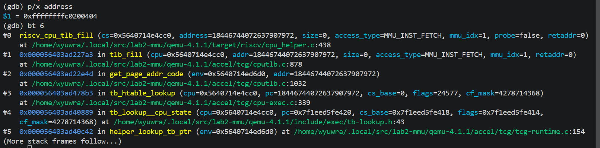

#### 4.4.3 satp、根页表与叶子项

在 `get_physical_address` 内检查 `env->satp=0x800000000008020a`：最高四位 MODE=8，为 Sv39；低 44 位 PPN 左移 12 位，得到根页表物理地址 `0x8020a000`。本轮 S 模式未进入第 171 行 M 模式绕过分支，也未进入第 196—199 行 Bare 分支，而是按 Sv39 设置 `levels=3`、`ptidxbits=9`、`ptesize=8`。

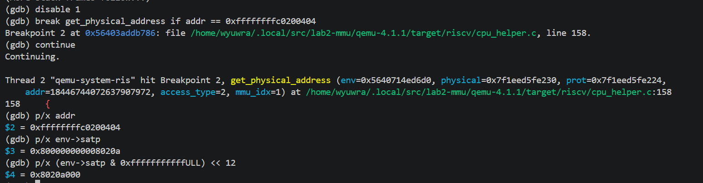

使用 `until cpu_helper.c:252` 到读取 PTE 之前，`next` 实际读取 8 字节，再 `next` 提取 PPN，得到：

| 变量 | 实际值 | 含义 |
|---|---|---|
| `i` | 0 | 当前为根页表这一轮 |
| `idx` | `0x1ff` | 虚拟地址位 38:30 选择第 511 项 |
| `pte_addr` | `0x8020aff8` | 根页表基址加 `511×8` |
| `pte` | `0x200000cf` | V/R/W/X/A/D 置位，U 未置位 |
| `ppn` | `0x80000` | `pte >> 10` |

关键分支包括：第 256 行检查 V；第 259 行检查 R/W/X 是否全零，全零时才沿下一级页表继续；第 262—287 行检查保留组合、U/S 权限、大页对齐和本次访问权限。本项的 V/R/W/X 都为 1，单步从 256 到 259、262，跳过了“下一级页表”的赋值分支。根级叶子项覆盖 1 GiB，因此 Sv39 支持三级，并不表示每次转换都必须读三张表。

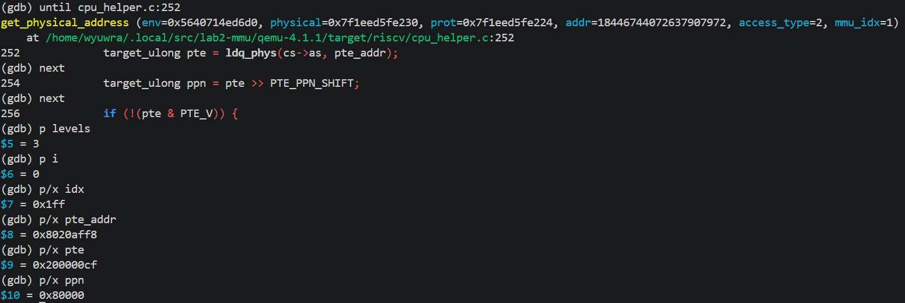

#### 4.4.4 大页地址计算与权限

通过权限检查后，`updated_pte` 逻辑按需设置 A/D；本项 A/D 已预置，当前取指不需要修改 PTE，也无需走原子更新及重试路径。第 333—334 行执行：

```c
target_ulong vpn = addr >> PGSHIFT;
*physical = (ppn | (vpn & ((1L << ptshift) - 1))) << PGSHIFT;
```

观察到 `ptshift=18`、`vpn=0xffffffffc0200`。对 1 GiB 大页，使用虚拟页号低 18 位补足页号，得到 **4 KiB 页基址** `0x80200000`。再组合原地址低 12 位 `0x404`，完整物理地址为 `0x80200404`。函数返回页基址后，还需组合页内偏移。

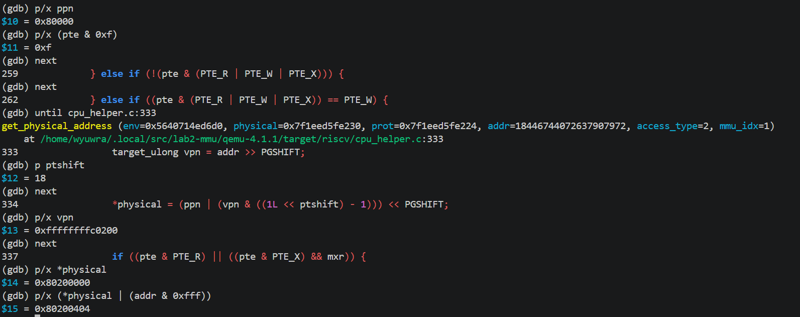

`finish` 返回 `riscv_cpu_tlb_fill` 后，运行到第 472 行，`ret=0` 表示成功，`prot=7` 表示软件 TLB 条目允许读、写、执行。第 463—471 行执行 PMP 权限检查，本次通过检查后进入填充路径。

#### 4.4.5 软件 TLB 的填充、重新查找与命中

`step` 进入 `tlb_set_page`，参数为虚拟页 `0xffffffffc0200000`、物理页 `0x80200000`、`size=0x1000`。虽然页表叶子映射为 1 GiB，这次 QEMU 软件 TLB 按 4 KiB 缓存。其条目含读/写/取指地址标签及用于映射到宿主地址的 `addend`；`addend` 用于计算宿主地址。

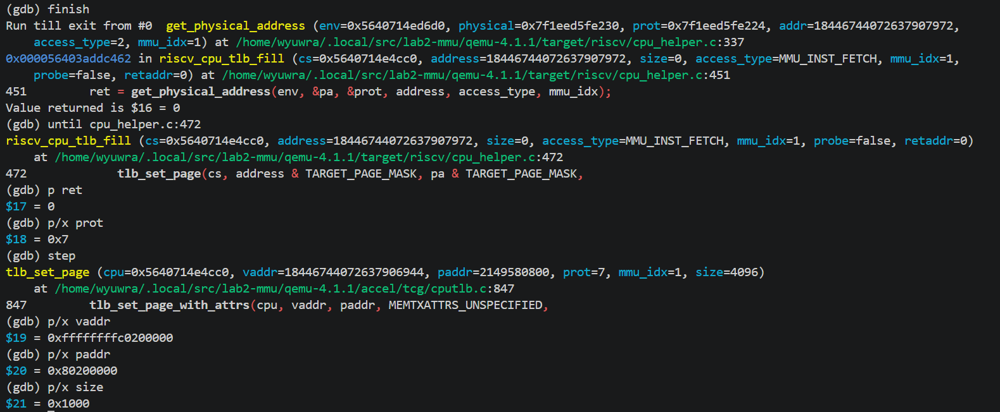

返回取指查询后，第 1033—1034 行重新获取索引和条目指针，因为 `tlb_fill` 可能导致表扩容，因此需要重新取得条目指针。之后第 1036 行检查填充后的命中。截图中把 `assert(...)` 源码误输入为 GDB 命令，出现 `Undefined command`；随后使用 `next` 经过源码中的断言，到达 1039 行。

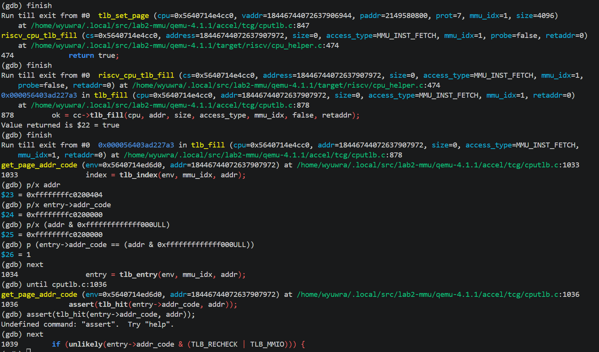

随后在第 1030 行设置“目标页且标签已匹配”的条件断点。再次调用时 `addr=0xffffffffc0200404`，标签为 `0xffffffffc0200000`；`next` 从 1030 直接到 1039，跳过主表未命中后的 victim TLB 查询、`tlb_fill` 和页表遍历。之前的未命中路径则实际经过 1032 行 `tlb_fill`；只主表未命中不代表一定遍历页表，因为 victim TLB 仍可能命中。

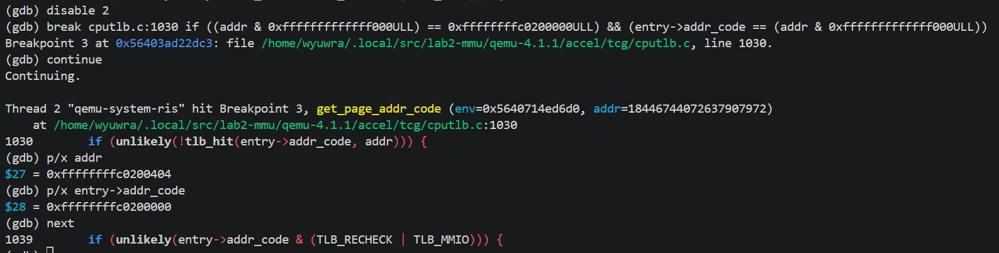

#### 4.4.6 实际数据写入

禁用先前断点后，设置：

```gdb
break riscv_cpu_tlb_fill if access_type == MMU_DATA_STORE && mmu_idx == 1 && address >= 0xffffffffc0000000ULL
```

捕获到 8 字节写入，虚拟地址 `0xffffffffc0209ff8`，`ret=0`；返回页基址 `0x80209000`，组合偏移 `0xff8` 得到物理地址 `0x80209ff8`。这是数据写入证据，与前面的取指访问分别记录。

静态交叉核对当前内核反汇编：`kern_init` 中 `0xffffffffc0200414` 为 `addi sp,sp,-16`，`0xffffffffc020041a` 为 `sd ra,8(sp)`；入口设置的 `bootstacktop=0xffffffffc020a000`。有效地址为 `bootstacktop-16+8=0xffffffffc0209ff8`，与本次实际写入匹配。该写入指令通过反汇编和入口栈布局定位。

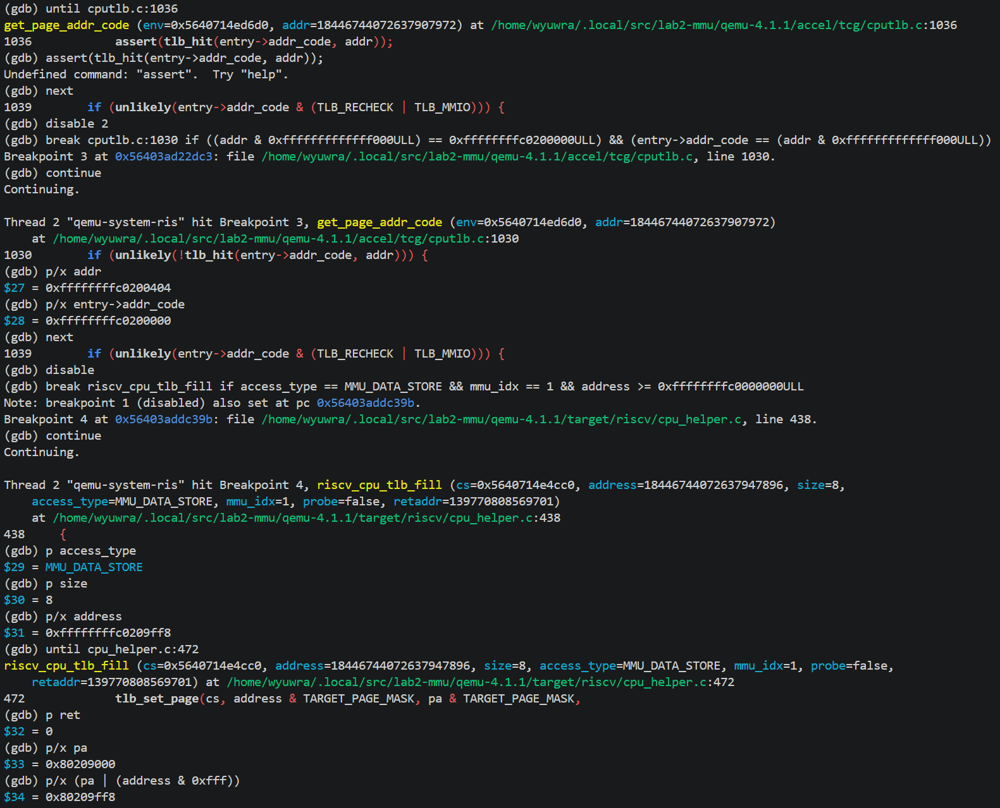

#### 4.4.7 Bare 模式与软件、硬件 TLB 的区别

尝试在内核 GDB 执行 `monitor system_reset` 后，没有命中目标 S 模式 Bare 分支，反复中断时客体 PC 为 `0x80000474`。核对固件反汇编，该处位于 OpenSBI 的异常入口；热复位未到达目标分支的原因尚未确定。最终通过 `monitor quit` 退出模拟器，重新 `make debug`、附加新 PID、`make gdb` 从全新启动观察。Bare 模式的观察通过重新启动完成。

新的宿主条件断点为：

```gdb
break cpu_helper.c:197 if mmu_idx == 1 && (env->satp >> 60) == 0
```

命中时 `satp=0`、`mmu_idx=1`，即当前 S 模式选择 Bare。执行第 197 行 `*physical=addr` 后，二者均为 `0x80200000`。此时无需页表遍历，但调用栈仍有 `get_page_addr_code → tlb_fill → riscv_cpu_tlb_fill → get_physical_address`，说明软件 TLB 慢路径也会处理 Bare 下的访问。

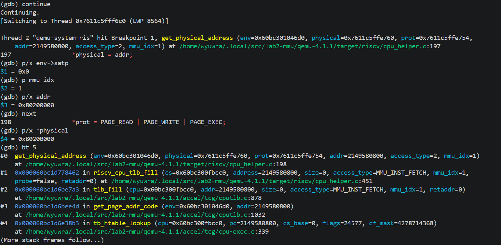

真实 RISC-V 的 Bare 模式在地址转换语义上直接使用地址，不要求基于 `satp` 页表做翻译。QEMU 的软件 TLB 还缓存访存权限、RAM/MMIO 分类和客体地址到宿主内存的映射，所以 Bare 下仍可能进入填充路径。这里的软件 TLB 服务于模拟器访存，其填充路径既处理分页，也处理 Bare 模式。

#### 4.4.8 调试经验与 AI 交互

本次通过 AI 协助完成：匹配符号的 QEMU 构建、三终端调度、条件断点选择、源码行号核对、页表项解码、页基址与偏移区分、软件 TLB 路径定位，以及 Bare 复现失败后的重新启动。实际请求、截图上下文和执行反馈见 [MMU 交互记录](prompt.md#stage-13)。

关键问题是区分 GDB 命令与 C 源码、区分分页提示和执行命令、区分两个 GDB 的目标。误在宿主 GDB 按 Ctrl+C 会停到 QEMU 主线程 `poll()`，此时没有 `env/addr` 等转换函数局部变量；应让宿主继续运行，在内核 GDB 控制客体，再等待目标条件断点。

本次观察覆盖正常映射、取指与数据写入、TLB 填充与命中，以及 Bare 模式对比。

**本机复现验证（2026-10-21）。** 在胡楚骅的 WSL 环境中，以默认 Best-Fit 的普通构建完成双 GDB 观察：宿主 GDB 启动带符号的 QEMU，RISC-V GDB 连接内核。取指地址为 `0xffffffffc02003f4`，`satp=0x8000000000080205`，根页表物理地址为 `0x80205000`；读取第 511 项得到 `PTE=0x200000cf`，完整物理地址为 `0x802003f4`。随后观察到 4 KiB 软件 TLB 填充，再次查询从命中判断直接到达第 1039 行。另一次启动确认 S 模式 Bare 下 `0x80200000` 直接对应同一物理地址，以及 8 字节数据写入由 `0xffffffffc0204ff8` 转换到 `0x80204ff8`。本机地址与前述截图对应不同构建，分别记录。

## 五、测试与验证

物理页初始化、Best-Fit、Buddy 和 SLUB 按各自任务分别验证。最终验收配置采用 Best-Fit，以满足课程对管理器选择的要求；Buddy 在其独立测试阶段选择运行，SLUB 通过统一页分配接口调用底层分配器。MMU 地址翻译的观察过程及截图见第 4.4 节。

### 5.1 物理内存初始化测试

模块一验证时，Best-Fit 尚未完成，因此使用临时副本排除未完成的 Best-Fit 文件，选择 First-Fit 验证 `page_init()`。通过不同 RAM 容量、页对齐和异常输入检查初始化结果，九组检查均通过：

| 案例 | 输入/变化 | 判定结果 |
|---|---|---|
| `ram128` | 128 MiB | 原 First-Fit 自检、官方模块一测试、交付前与逐页检查通过 |
| `ram64` | 64 MiB | 随容量调整，以上检查通过 |
| `ram64-unaligned` | 64 MiB 的 DTB 报告大小减 1 字节 | RAM 末尾向下对齐，元数据尾页继续保留；以上检查通过 |
| `ram256-capped` | 256 MiB | 管理范围限制到 `0x88000000`；交付、逐页和 First-Fit 自检通过 |
| `invalid-zero` | DTB 报告大小为零 | 明确拒绝，未进入 `init_memmap` |
| `invalid-overflow` | 起点与大小相加溢出 | 明确拒绝，未进入 `init_memmap` |
| `insufficient-ram` | 报告范围无法容纳内核 | 明确拒绝，未进入 `init_memmap` |
| `insufficient-metadata` | 内核可放下，描述符数组放不下 | 明确拒绝，未进入 `init_memmap` |
| `no-free-pages` | 能容纳元数据，但无完整空闲页 | 明确拒绝，未进入 `init_memmap` |

负向案例通过表示内核正确拒绝错误输入。256 MiB 场景中，官方模块一检查假设 `npage` 等于未经截断的 DTB 结束页号，与框架固定上界不一致，因此跳过该项官方检查，改用逐页检查验证截断布局；其余三个正常容量案例执行官方检查。


图为验证脚本的直接输出。完整结果见[验证汇总](evidence/module1/results.json)，异常处理示例见[元数据空间不足日志](evidence/module1/insufficient-metadata-qemu.log)。

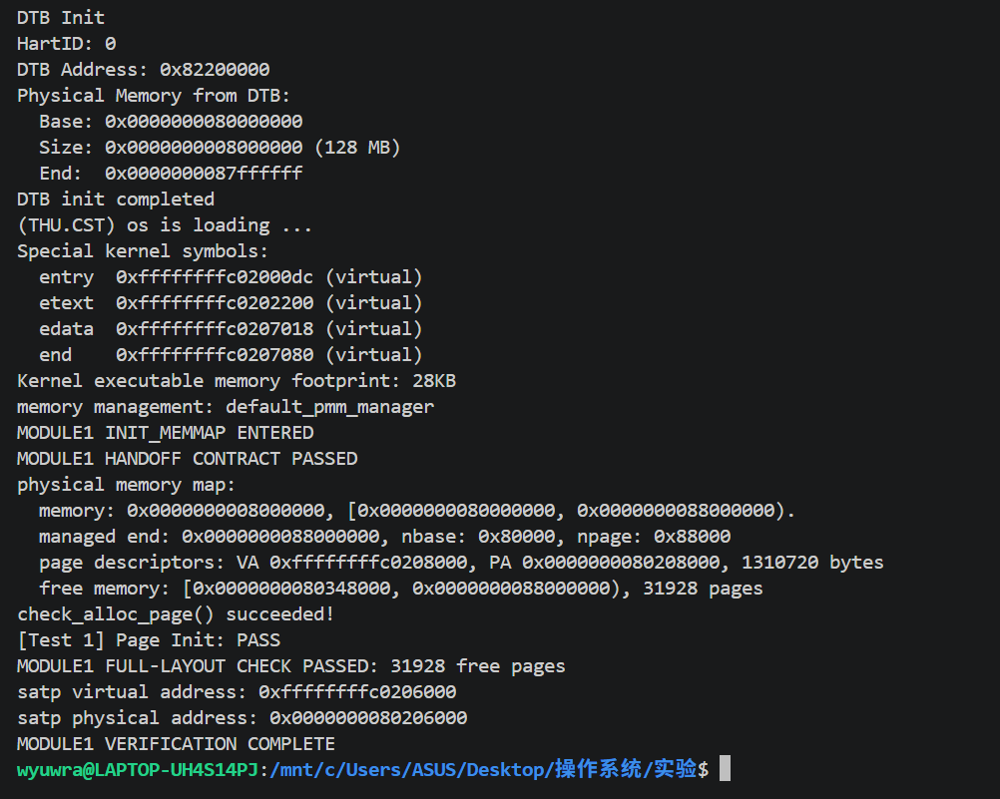

图为串口日志的终端回显，对应[运行日志](evidence/module1/ram128-qemu.log)和[编译日志](evidence/module1/ram128-build.log)。关键布局数值如下：

| 数值 | 含额外检查的九组验证构建 | 不注入 C 检查的 GDB 构建 |
|---|---|---|
| `nbase` / `npage` | `0x80000` / `0x88000` | 相同 |
| 描述符数量 / 字节数 | 32768 / 1310720 | 相同 |
| 描述符数组 PA | `0x80208000` | `0x80207000` |
| 首个空闲页 PA | `0x80348000` | `0x80347000` |
| 空闲页数 | 31928 | 31929 |

两份构建包含的检查代码不同，内核末尾 `end` 随之变化，描述符位置和空闲页数相差一页。非页对齐案例的管理末尾为 `0x83fff000`，描述符占 655320 字节，空闲起点为 `0x802a8000`，初始空闲页数为 15703，见[对应日志](evidence/module1/ram64-unaligned-qemu.log)。

使用 GDB 检查空闲页交付前后的状态：

1. 在 `page_init()` 入口确认调用来自 `pmm_init()` 和 `kern_init()`。
2. 在 `default_init_memmap()` 首条指令处读取 `a0`、`a1`，确认交付的描述符起点和页数。抽查页均为 `flags=1`、`ref=0`、`property=0`，链表节点自链接。
3. 在 `default_check()` 入口确认空闲区已登记，`nr_free=31929`，空闲块首页为 `flags=2`、`property=31929`，保留前缀仍为 `flags=1`。
4. 自检结束后，空闲页数恢复为 31929，串口输出 `check_alloc_page() succeeded!`。

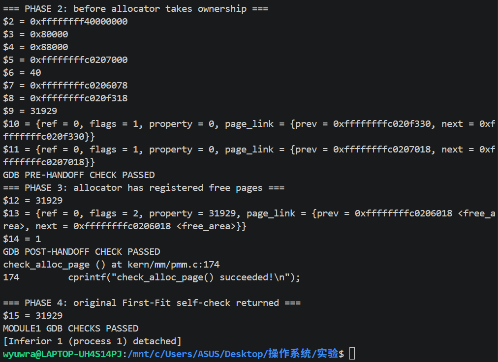

图为 GDB 批处理日志的终端回显。详细过程见[GDB 命令](evidence/module1-gdb/commands.gdb)、[GDB 日志](evidence/module1-gdb/gdb.log)和[结果记录](evidence/module1-gdb/results.json)。三张模块一截图的来源见[图片清单](images/image-sources.json)。

<a id="best-fit-validation"></a>

### 5.2 Best-Fit 测试与验证

Best-Fit 实现完成后，在 WSL 中选择 `best_fit_pmm_manager`，进行编译、启动和课程评分：

| 命令 | 实际结果 |
|---|---|
| `make -j2` | 编译、链接并生成内核镜像成功 |
| `make qemu` | 输出 `memory management: best_fit_pmm_manager`，确认使用 Best-Fit；随后输出 `check_alloc_page() succeeded!`，表明分配器自检完成 |
| `make grade` | Page Init、Best-Fit 均为 `OK`，总分为 `20/20` |
| `echo $?` | 紧接评分命令执行，输出 `0`，确认正常退出 |

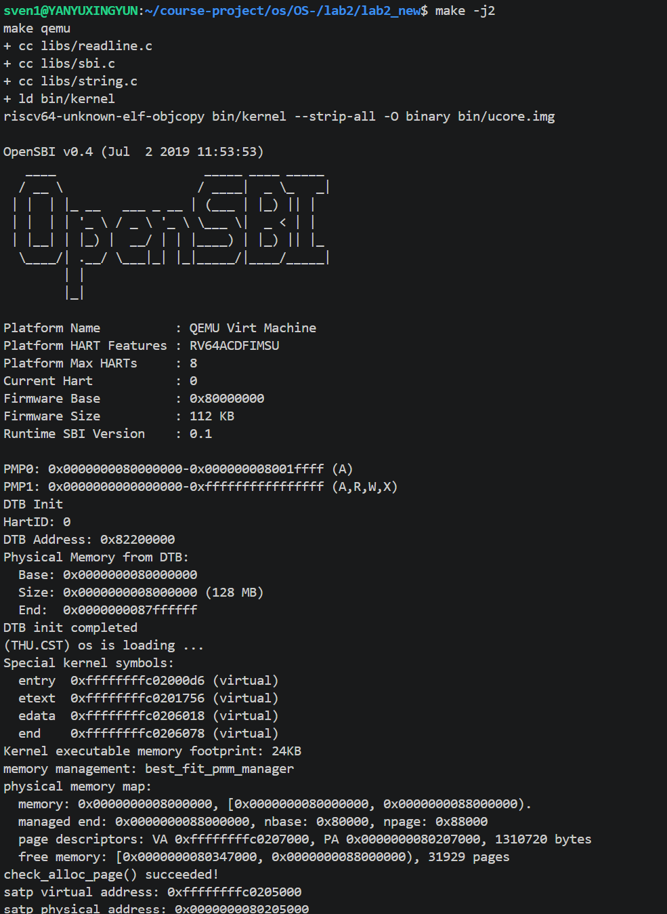

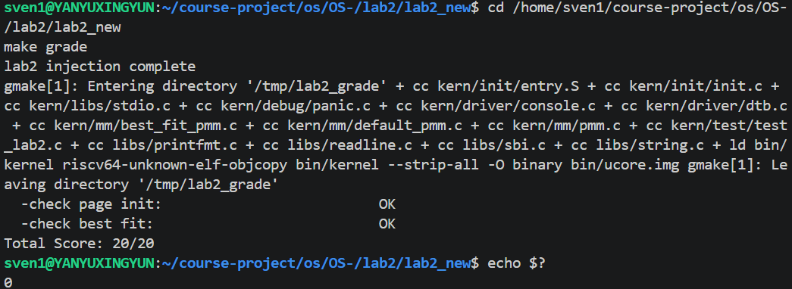

上述截图对应 Best-Fit 任务完成时的版本。接入 Buddy、SLUB 后，又在临时副本中选择 Best-Fit，启用 `SLUB_TEST=1`，执行官方注入器和评分脚本：课程评分仍为 20/20，退出码为 0，SLUB 八组测试同时通过。对应[评分日志](evidence/current-review-20261021/best-fit-slub-grade/grade.log)、[运行日志](evidence/current-review-20261021/best-fit-slub-grade/qemu.log)及[复核汇总](evidence/current-review-20261021/results.json)。

2026-10-21 在胡楚骅本机将默认管理器正式切换为 Best-Fit，使用 GCC 15.1.0、RISC-V GDB 16.3 和 QEMU 4.1.1 重新验证：`make -j2` 成功，正常启动通过 Best-Fit 自检和 SLUB 基本检查；`make grade` 的两项检查均为 OK，得分 20/20，退出码为 0。独立的 `SLUB_TEST=1` 构建通过八组测试，完成 1831 次分配与释放、5502 次内容核验，并恢复到 31905 个空闲页。

### 5.3 Buddy 与 SLUB 测试

**Buddy 测试。** 选择 `buddy_pmm_manager` 后，通过管理器的自检入口执行九组测试，覆盖区间登记与对齐、请求页数取整、多级拆分、伙伴合并、相邻非伙伴块、空洞与已占用区间、分配失败后的状态保持、混合分配释放以及真实分配器状态恢复。完整覆盖说明见[Buddy 测试设计](buddy.md)。

`1e9c4da` 版本编译启动后输出：

```text
memory management: buddy_pmm_manager
BUDDY CHECK ALL PASSED (9 groups, 303 arena operations, 326 structure audits)
check_alloc_page() succeeded!
```

自检后空闲页数恢复为 31913，结果见[编译日志](evidence/sync-20261021-buddy/build.log)、[运行日志](evidence/sync-20261021-buddy/qemu.log)和[验证记录](evidence/sync-20261021-buddy/results.json)。接入 SLUB 后的测试构建继续保留并通过 Buddy 九组自检。

**SLUB 测试。** 普通构建执行基本分配释放检查，`SLUB_TEST=1` 构建执行八组完整测试：

- 覆盖八个对象尺寸类别及边界、跨页请求、完整区间读写和存活对象间的数据隔离。
- 检查 slab 扩展、满与未满状态转换、不同释放顺序、槽位复用及固定随机分配序列。
- 检查大对象的 Buddy 页数取整、整数溢出、三种取页失败后的状态恢复及最终页面回收。

实际完成 1831 次成功分配和对应释放、5502 次完整内容复核，空闲页数恢复为测试构建基线 31905。普通构建与测试构建均启动通过，结果见[SLUB 测试记录](slub-tests.md)和[原始运行日志](evidence/slub-tests/test-qemu.log)。

接入 SLUB 后的配置对照结果如下，使用 GCC 8.3.0、QEMU 4.1.1，在独立临时副本中验证：

| 配置 | 运行与自检结果 | 课程评分 |
|---|---|---|
| Buddy，普通构建 | Buddy 九组自检、SLUB 基本检查通过 | 未执行 |
| Buddy，`SLUB_TEST=1` | Buddy 九组自检、SLUB 八组测试通过 | 10/20，Page Init 通过，Best-Fit 管理器选择不匹配 |
| Best-Fit，`SLUB_TEST=1` | Best-Fit 自检、SLUB 八组测试通过 | 20/20，退出码 0 |

课程评分中的 Best-Fit 项检查 `pmm_manager` 是否指向 `best_fit_pmm_manager`。测试 Buddy 时选择了另一管理器，因此该项为 FAIL；最终验收选择 Best-Fit，Buddy 的正确性由其独立自检结果说明。两种配置的评分见[Buddy 评分日志](evidence/current-review-20261021/buddy-slub-grade/grade.log)和[Best-Fit 评分日志](evidence/current-review-20261021/best-fit-slub-grade/grade.log)，测试汇总见[配置对照记录](evidence/current-review-20261021/results.json)。

上述配置对照完成后，胡楚骅本机又在临时副本中单独选择 Buddy，以 GCC 15.1.0、QEMU 4.1.1 完成 Buddy 九组及 SLUB 八组测试。正式源码保持默认 Best-Fit。

## 六、实验总结与收获

### 6.1 对操作系统的理解

**本实验中的重要知识点及其与 OS 原理的联系**

1. **空闲块的组织、拆分与合并。** 连续内存管理需要记录每个空闲块的位置和大小。分配时从合适的块中取出所需部分，回收时检查相邻空闲块并进行合并。实验中的 First-Fit 和 Best-Fit 使用双向循环链表，每个节点代表空闲块的首页，`property` 记录块内页数。这与原理中的空闲分区链表对应，但实验以物理页为分配单位，通过 `Page` 描述符记录状态，且需要先保留固件、内核及描述符数组占用的页。

2. **First-Fit、Best-Fit 的选择策略与碎片问题。** First-Fit 选择第一个满足需求的空闲块，Best-Fit 选择满足需求的最小空闲块。实验在相同接口下实现不同选择策略，使我们能够区分管理框架和分配算法。原理中可以将空闲块按大小排序以便寻找最佳匹配，实验的 Best-Fit 则保持链表按地址排列，通过遍历找到最小合适块，方便释放时判断相邻关系。两者选择规则相同，查找和维护方式不同；Best-Fit 仍可能留下小块外部碎片，其整体效果取决于后续申请序列。

3. **Buddy 的分阶管理与伙伴合并。** Buddy 将空闲块按二次幂大小分阶管理，申请时将过大的块逐级拆分，释放时将符合条件的伙伴块逐级合并。实验将该机制用于连续物理页分配，申请页数向上取整到二次幂，因此能够通过统一的拆分、合并规则管理不同大小的块，但也会产生内部碎片。与 First-Fit、Best-Fit 合并物理上相邻的空闲块相比，Buddy 还要求两块大小相同，并满足伙伴地址关系，不能将任意相邻块直接合并。

4. **分页地址翻译、多级页表与 TLB。** 分页机制通过页表将虚拟页号转换为物理页号，再结合页内偏移得到物理地址；多级页表用于组织较大的地址空间，TLB 缓存近期使用的地址映射。实验采用 RISC-V Sv39，由 `satp` 指定根页表物理页号，MMU 完成地址翻译。启动代码使用根级叶子项建立 1 GiB 映射，因此 Sv39 的三级结构并不意味着每次转换都要访问三级页表。同时，物理页分配器以 4 KiB 为单位管理页，页表负责描述映射，两者的管理粒度和职责不同。

5. **页级分配与 SLUB 对象分配的关系。** 页分配器以页为单位提供空间，而内核中的许多对象远小于一页，直接为每个对象分配整页会浪费空间。实验的 SLUB 扩展在页分配器上建立不同大小的对象缓存，将页面划分为多个对象槽位，并在释放后复用。这样，Buddy 负责底层连续页，SLUB 负责页内对象，形成分层管理。这里学习的是实验中的简化实现，重点在于分配粒度与接口分工。

**OS 原理中重要但本实验未涉及的知识点**

1. **按需加载与缺页处理。** 按需加载在程序实际访问某页时再准备对应数据，缺页处理需要分配页帧、加载内容、更新页表并重新执行指令。Lab2 主要完成物理页管理和启动映射，尚未实现这一套由缺页异常触发的加载流程。

2. **页面置换。** 内存不足时，FIFO、LRU、Clock 等算法用于选择需要换出的已占用页面，为新页面腾出页帧。Lab2 的 First-Fit、Best-Fit 和 Buddy 选择的是空闲块；页面置换则需要结合页面的使用情况和外存保存其内容，解决的是另一个层次的问题。

3. **工作集与缺页率控制。** 工作集反映进程近期访问的页面集合，缺页率可以帮助系统判断分配给进程的物理页是否充足，并据此调整驻留页数。Lab2 尚未建立进程运行时的页面访问统计，也没有按进程需求动态调整内存资源的机制。

### 6.2 AI 协作开发的经验

1. **先理解需求，再让 AI 实现。** 编写提示词前，需要先读懂模块的作用和接口约定。例如，`npage` 是物理页号上界，`pages` 是页描述符数组，两者的单位和含义不同。如果自己没有区分清楚，即使生成的代码能够编译，也很难判断内存范围是否计算正确。

2. **提示词需要明确，但不必一味追求详细。** 在 Best-Fit 任务中，我们将任务、依赖、接口和行为规格逐项展开，形成了一份较长的提示词，首轮生成的实现通过了测试。但整理提示词花费了较多时间，其中部分结构定义和接口信息也可以由 AI 直接阅读源码获得。因此，提示词应重点说明最小适配规则、修改范围、需要保留的测试、分配器接入和验收要求，将具体实现交给 AI 结合工程分析。这次经历也让我们认识到，提示词设计需要同时考虑表达清楚和准备成本。

3. **生成代码后，还需要理解关键处理。** 在阅读 Best-Fit 实现时，我们需要说明它为什么选择最小合适块、余块如何重新加入链表，以及释放时怎样判断能否与前后空闲块合并。AI 可以帮助完成实现，但判断实现是否符合要求、解释代码和完成答辩，仍需要自己理解这些状态变化。

4. **验证既要看结果，也要看过程中的状态。** 模块一在 `init_memmap()` 前后检查页描述符，可以区分初始化交付的状态与分配器处理后的状态。Best-Fit 验证则除了检查自检和评分结果，还需要确认输出的管理器名称为 `best_fit_pmm_manager`，避免代码已经实现，内核运行的却仍是其他分配器。

5. **测试工具本身也需要检查。** 模块一验证中实际遇到了活动日志读取和旧 PASS 结果的问题，之后通过调整日志读取位置、更新结果状态，并在副本中故意破坏实现来检查验证工具。这个过程说明，判断正确性需要确认测试实际执行了什么、结果是否来自本次运行，而不能只看一行成功输出。
